# Ordinary session allocation and ownership contract

The ordinary session uses fixed inbound and outbound storage and the existing
`Application`, `Message` and `SendToTarget` APIs. Session setup enables this
storage automatically. There is one engine, with no feature flag or alternate
send path. Ordinary applications receive owned callback messages. An explicit
`BorrowApplication(application)` wrapper permits callback-scoped delivery and
reusable response construction storage in that same engine.

The measured target is the warmed, bounded path from a TCP frame through
dictionary/group parsing, validation, ordinary application handling, encoding,
resend-journal commit, completed write and output-slot return. Source remains
compatible with Go 1.23. The callback-boundary correction restores owned
lifetimes for unchanged applications; those ownership copies allocate. The
explicit borrowed profile is the warmed zero-allocation contract.

The current [focused Go 1.23 check](benchmarks/zero-allocation/phase-7/callback-boundary/focused-third-go1.23.12.txt)
passed in 18.835 seconds. It includes all seven exact borrowed TCP allocation
intervals, public-constructor TCP coverage and generated-control ownership
regressions. Each exact interval completes 100 warmed cycles with zero added
objects and bytes. Final qualification also passes: all seven exact intervals
(10.379 s), Go 1.23 package tests (core 29.302 s; only the existing Mongo logger
teardown suite excluded), vet and the separate core race run (32.751 s).
Qualified-source verification reports all checks OK. The
[final evidence](benchmarks/zero-allocation/phase-7/callback-boundary/README.md)
records all 35 borrowed full-session rows and all ten direct-latency rows at
0 B/op and 0 allocs/op; the ten owned full-session rows still allocate.
Ordinary/group batch medians are 3.6%/5.0% higher than the matched compatible
parent, so this correction does not demonstrate a speed gain. Default owned
bytes increase by about 3 KiB per 32-request batch with allocation counts
unchanged.

Earlier measurements at `8033f27d`, `a2fb11b9` and their predecessors silently
borrowed callback storage. Their source identities and results remain in the
[phase-7 history](benchmarks/zero-allocation/phase-7/README.md), but do not qualify
the corrected default ownership contract. The old Linux VM ordinary p50 of
6.333–6.500 µs and cached-length batch gains of 1.5–2.5% are historical results,
not measurements of this callback correction.

PREPROD load testing is already complete in
[fix-server PR 1362](https://github.com/railbirdexchange/draftkings-exchange/pull/1362):
100 sessions and 664,255 orders. That run used the `8033f27d` dependency pin;
it does not establish deployed results for the new ownership correction. The
service still allocates, and a zero-allocation whole-library or fix-server
claim is not made.

Allocation and latency are separate qualifications. One microsecond is a
stretch target, not a release gate. The delivery objective is to reduce measured
latency as far as practical while preserving zero allocation in the supported
path, correctness and compatibility; it does not require an open-ended search
for the minimum achievable time.
The [resolved callback audit](benchmarks/zero-allocation/phase-7/callback-lifetime-audit.md)
records the adapters and regression fixtures that preserve default lifetimes.

## Configuration and cold storage

The reference workload uses FIX 4.4 over plain TCP, the repository's FIX44
dictionary, enabled validation and persistence, `NewNullLogFactory`, and an
explicit `NewBoundedStoreFactory(1024, 16384)`. The application reuses one response
message, changes scalar fields for every order and uses `BorrowApplication`
with the existing callbacks and `SendToTarget`. Static output groups are built
before measurement. Input groups,
including nested Parties/PartySubIDs, are parsed and validated on every request.

| Setting or storage | Default | Measured profile |
|---|---:|---:|
| `BoundedMaxFrameBytes`, complete wire frame | 16,384 | 16,384 |
| `BoundedMaxFields`, including repeated/header/trailer fields | 512 | 512 |
| `BoundedMaxGroupEntries`, total per message | 128 | 128 |
| `BoundedMaxGroupDepth` | 8 | 8 |
| `InChanCapacity` | 1 | 32 |
| `InboundFrameQueueCapacity` | min(input channel capacity, 32) | 32 |
| `BoundedInboundStashCapacity` | 32 | 32 |
| Raw inbound slots, queue allowance + stash + 2 | 35 | 66 |
| `OutboundFrameQueueCapacity` | 32 | 32 |
| Output wire slots, queue + writer progress slot | 33 | 33 |
| `SocketOutboundBufferSize`, writer channel capacity | 0 | 32 |
| `OutboundWriteTimeout`, complete frame including partial writes | 30 seconds | 30 seconds |
| Explicit journal entries / frame bytes per entry | chosen by store factory | 1,024 / 16,384 |

The effective inbound queue allowance cannot exceed `InChanCapacity`. A larger
input channel alone does not increase the raw-frame allowance beyond its default
cap of 32. A zero writer-channel capacity remains an unbuffered channel; the
separate fixed output ring still bounds outstanding frames.

These limits allocate real memory. The measured profile reserves 1,081,344 bytes
for inbound frames, 540,672 bytes for output frames and 16 MiB for journal bytes,
plus metadata. It has one reusable inbound parser, one resend parser and fixed
dictionary/validation/recovery state. These are session-owned, not one full
parser per raw frame.

A repeatedly sent caller message attaches its construction arena on its second
send only when the destination application uses `BorrowApplication`. Ordinary
owned delivery does not attach an arena. Moving a previously borrowed message
to owned delivery detaches its arena before the callback, preserving its original
pointer and restoring stable getter bytes across later operations.
The arena has wire, getter-value and overlap-staging byte planes,
each bounded by the frame limit, plus fixed field indexes and records. An
[historical cold construction benchmark](benchmarks/zero-allocation/phase-7/construction-cold-go1.25.3.txt)
measured 440,840 B and 54 allocations with the default arena versus 1,688 B and
31 allocations for its ordinary construction fixture. This is a setup cost,
not a per-request result or an exact memory formula for every message shape.
Reusing many caller messages multiplies that storage.

`FieldMap.SetGroupValues` replaces a dynamic outgoing group from an ordered
`[]GroupField` without constructing `RepeatingGroup`, `Group`, template or field
writer objects. The attached arena reserves one additional `BoundedMaxFields`
slab of `TagValue` metadata at setup. All group counts and values consume the
existing total field/frame budgets; replacing, removing or clearing a group
reclaims its metadata. Input byte slices and strings are copied synchronously,
including values borrowed from the same arena. The caller supplies dictionary
order, delimiters and group counts, including flattened nested groups; the
setter never reparses raw FIX bytes to discover their boundaries.

Scalar setters, the legacy `SetGroup`, shallow-copy detachment and owned
`GetGroup` snapshots retain their existing behavior. A capacity failure leaves
the previously constructed fields intact and latches an error until that
section is cleared. The new setter returns that error directly; send and append
also observe it before consuming sequence or store state. Standalone use remains
an allocating owned-storage convenience path. The focused lifecycle fixture
checks warmed group construction, replacement, removal, clear and append at
zero allocations; [construction evidence](benchmarks/zero-allocation/phase-7/outbound-groups/README.md)
keeps these component measurements separate from completed session writes.

The [first-send correction](benchmarks/zero-allocation/phase-7/first-send/README.md)
removes the large scratch allocation on fresh sends and repeated arena
attachment after convenience reparsing. Historical
[cold scalar packing](benchmarks/zero-allocation/phase-7/cold-scalars/README.md)
reduced the completed-send component fixtures to 2,760 B / 24 allocations
for a fresh parsed message and 88 B / 4 allocations for repeated convenience
reparsing into the same message. Those compatibility lifecycles still allocate;
they are separate from warmed scalar updates on a reused response.

The session also owns one control-message arena of the same kind, a 16 KiB
reject-text buffer, a 16 KiB + 18-byte event buffer and fixed engine-field
scratch. Control initialization and caller-arena attachment are outside the
warmed interval. Sending a new `Message` for every request continues to allocate.
A borrowed send of an already attached caller message to a destination with
different frame/field limits returns an error rather than resizing its arena.
Owned delivery instead detaches that arena before preparing the send.

## Scopes and callback lifetimes

Each mutable message, frame, output slot and journal entry has one owner.
Callbacks retain their existing signatures and run synchronously in their
existing processing/send scope. Default ownership adapters sit at delivery
boundaries; fixed frame, parser, validation and output storage remain internal.

- Ordinary `FromApp` and `FromAdmin` receive an owned message and copied frame.
  Its pointer, parsed field/group data, `GetBytes`, raw `Bytes()` and shallow
  section views survive internal slot reuse and reconnect. Materialization
  preserves parsed raw/field aliases within the owned representation. Incoming
  callback mutations still affect subsequent session handling.
- Ordinary engine-generated `ToAdmin` receives an owned copy of the private
  control cell. Encoding continues from that delivered object, so field, section
  and whole-message replacements affect the actual sent wire. Ordinary replay
  `ToApp` receives an owned message after the fixed parse and before resend
  header updates. It survives replay completion and journal retirement/reuse.
- A caller-owned outgoing message remains the caller's after synchronous
  `SendToTarget` encoding returns. The writer owns an independent wire slot, so
  subsequent caller mutation cannot alter queued bytes. Do not concurrently
  mutate or send the same message. On a logged-on connection, this call can wait
  for output capacity; the caller must keep the message and borrowed input
  values valid until it returns. Ordinary `ToApp`/`ToAdmin` receives that original
  pointer; previously returned engine-field getter bytes stay valid across
  later sends. Public `SetBytes` retains its caller-supplied value alias, and the
  source must remain valid for the operation using it.
- Explicit `BorrowApplication` delivery borrows incoming, generated-control and
  replay messages only until callback return. Its caller-owned response may
  acquire an arena on the second send; field views may move or be overwritten
  by a later mutation or send. Finish synchronous consumption first, or use an
  owned copying API for values that must escape. A shallow copy does not detach
  borrowed storage. The wrapper changes lifetime, not the engine or send API.

Control storage remains acquired through callback and encoding. Nested control
acquisition returns `ErrOutboundCapacity` before touching the active cell.
Outbound callbacks must not recursively send/reset under existing send ownership.

Control recycling restores its private original message representation before
clearing it. A callback replacing a public section or the entire message cannot
make the next acquisition clear a foreign map or frame. Internal copies of
TestReqID, routing identifiers, reject references and original sending time have
owned getter bytes separate from their encoded wire; mutating those getters
does not mutate the source request or silently rewrite the encoded value.

Typed scalar getters/setters and reuse within the explicit borrowed profile are
included in the measured handler. Legacy `GetGroup`, per-request
`SetGroup`/template reconstruction, `CopyInto`, field-map initialization/replacement and custom allocating field
writers remain compatibility boundaries. Group parsing and validation being
allocation-free does not make every legacy group convenience API allocation-free.
Callbacks that replace/detach storage may allocate; subsequent internal control
reuse still returns to its original fixed backing.

Synchronous handlers can use `Message.BorrowGroup` to traverse the existing
dictionary-backed body group without reconstructing legacy groups or copying
field bytes. Its views expire on message mutation, slot reset/reparse or callback
return. The [callback group comparison](benchmarks/zero-allocation/phase-7/inbound-group-access/README.md)
measures 1,352 B / 31 allocations for owned group access versus zero for the
borrowed view; it is a component result, not a full FIX-server allocation claim.

## Ownership, admission and exhaustion

```mermaid
flowchart LR
    Vacant[Vacant raw frame] --> Reader[Socket reader]
    Reader -->|filled slot through input channel| Owner[Session processing owner]
    Owner -->|out of order| Stash[Fixed retained-frame stash]
    Stash -->|ordered replay| Owner
    Owner -->|processing or discard complete| Vacant
    Owner --> Boundary[Application ownership adapter]
    Boundary -->|default: owned message| Handler[Application callback]
    Boundary -->|explicit BorrowApplication: scoped view| Handler
    Handler --> Caller[Caller-owned response Message]
    Caller --> Send[Synchronous SendToTarget]
    Send --> Admission[Output admission]
    Admission -->|capacity available| Reserve[Reserve output and journal capacity]
    Admission -->|logged on and exhausted| Wait[Sending owner waits for writer progress]
    Wait -->|slot returned| Reserve
    Reserve --> Callback[ToApp or ToAdmin]
    Callback --> Encode[Encode independent output slot]
    Encode --> Commit[Commit journal copy and sender sequence]
    Commit -->|slot through writer channel| Writer[Socket writer]
    Writer -->|completed or failed write| Free[Return output slot]
    Commit --> Journal[Independent retained journal bytes]
    Journal -->|explicit acknowledged retirement| Reusable[Reusable journal entry]
```

The output writer owns its slot until the complete socket write returns. A
successful send/enqueue is not peer receipt. A write failure leaves the committed
journal available for resend. Reader/writer teardown joins active owners before
their slots can be reused. Out-of-order input retains its raw slot until replay
or discard.

Vacant inbound-slot exhaustion backpressures the socket reader. Frame, field,
group, nesting and stash capacity failures produce explicit errors without
growing storage or changing committed sequence/store state for that failed
operation. When the session is offline or not yet logged on, ordinary output
exhaustion returns `ErrOutboundCapacity`; the caller can retry after capacity
returns. Replacement sends also preserve immediate finite admission and return
`ErrOutboundCapacity` when their capacity is unavailable.

For ordinary nonreplacement sends on a logged-on session with a live writer,
output exhaustion backpressures the synchronous sending owner. It transfers
already committed pending frames to the writer and waits for a returned output
slot or writer failure under the existing send/resend ownership. It does not
wait for the session loop's message-event notification. The current send does
not invoke its application callback, change sender sequence or retained history,
or hold a journal reservation while waiting. Writer failure returns an error
without committing the waiting send. The runtime never grows the ring or
converts a failed send into success.

Pending/scheduled reset and journal-admission errors remain immediate, before
flushing queued traffic or entering a capacity wait. Pending reset returns
`ErrOutboundResetPending`; full retention returns `ErrJournalFull`. A reset
Logon with `141=Y` retains the immediate output-capacity boundary so it cannot
flush bytes its reset intends to discard. Preflight journal reserve/abort leaves
reservation bookkeeping unchanged during a connected capacity wait.

Output and prepared-journal reservations precede assigning prospective send
state; complete encoding and retention-capacity checks precede commit. A failed
send preserves the sender sequence and journal. Earlier successful sends remain
committed. If an application handles an immediate send error and returns `nil`
from its incoming callback, normal input processing can still advance the target
sequence. Connected capacity backpressure no longer requires the application to
retry the current business message. The revised slow-consumer fixture fills all
33 output slots, observes request 34 blocked for one millisecond, releases the
writer independently, and validates all 34 responses without an application
retry. This observation interval is included in the measured cycle. Its new
exact 100-cycle allocation interval passes with zero objects and bytes at
`a2fb11b9`; all five refreshed throughput samples also report 0/0. Historical `0572f01b`
results used an immediate rejection followed by retry and are not a timing
baseline for this changed operation.

Arena capacity failures latch the affected section's error without committing
that field mutation. Send and append report the error before persistence. Clear
the failed section to recover; unrelated section initialization or copying does
not erase it. Errorless convenience methods such as `Bytes`/`String` panic while
the construction error is latched.

`BoundedStore` rejects a full retention window with `ErrJournalFull` and an
unavailable resend range with `ErrJournalRangeUnavailable`. It never evicts
history automatically. A full journal can prevent reconnect Logon. Configure
enough retention, establish an acknowledged retirement boundary or negotiate an
explicit reset; disconnect/capacity failure must not discard committed history
merely to make reconnect succeed. Reset intents that cannot yet proceed remain
pending for the established lifecycle retry path.

## Store, logging and receipt

`BoundedStore` is an explicitly selected, in-memory resend journal. It preserves
process-local sequence/history across reconnects; it provides no crash
durability. The engine does not replace a configured persistent store. Ordinary
`MessageStore` implementations retain their public callbacks and receive owned
copies. A store implementing `BorrowedMessageStore` can instead consume the
encoded slot synchronously without that extra engine copy. It must not mutate
the bytes or retain them past return, including an error return; asynchronous
retention must make its own copy before returning. Sequence advancement,
persistence, reset and error semantics remain the store's existing contract.
The session selects this capability once at setup. Its comparable
`BorrowedStoreOwner` must equal the configured store, so an embedding decorator
keeps owned delivery unless it explicitly implements the borrowed contract.
This capability supplies no bounded retention or journal reservation by itself.
The store's own allocations remain outside the engine's zero-allocation claim;
an unbounded `MemoryStore` also remains outside this contract.

The [heartbeat store measurements](benchmarks/zero-allocation/phase-7/heartbeat-store/README.md)
cover generated Heartbeat, the reused timer and session-event dispatch, and
generated TestRequest with persistence, callbacks, completed writes and returned
output slots. These are fixed-buffer writer component measurements, separate
from TCP latency and the allocation cost inside a production store or callback.

Only an independently acknowledged recovery boundary permits owner-controlled
`BoundedStore.RetireBefore`. Socket write completion alone is insufficient. The
test peer independently validates received reports and sends an explicit ACK;
the session owner waits for every output slot to return, retires exactly the
acknowledged range, and publishes a copied checkpoint. Its use of tag 369 is a
fixture protocol, not a claim that every counterparty's tag 369 establishes the
same receipt/retention agreement. Retiring history is not safe concurrently with
another owner using the journal.

The measured logger is `NewNullLogFactory`. A custom zero-allocation logger must
implement `BorrowedLog` and `BorrowedEventLog`, synchronously consume their views
without retaining/mutating them and allocate nothing. Static events still call
`OnEvent`. Other loggers keep owned raw-message copies and existing event formats
and arguments; their allocation remains visible. No validation, logging,
persistence or resend callback is disabled for the measurement. Registered send
observers and their owned snapshots are outside the measured profile.

## Qualification boundaries

Warm-up visits all journal entries and input/output slots, attaches caller
storage and exercises control/replay state before measurement. The full-session
fixtures include actual TCP reads/writes, dictionary validation, changing order
fields, groups, resend, inbound gaps, queue exhaustion and warmed traffic after
reconnect. Every measured cycle includes peer validation, ACK processing,
completed writes and output-slot return. Correctness and race runs are separate
from performance measurement. The revised connected-backpressure case uses only
setup-allocated channels and a reused timer; no goroutine is created per cycle.
Owner-copied snapshots establish unchanged committed state before preparation,
and the writer-failure case checks that a blocked send fails without committing.
The historical [backpressure regression checks](benchmarks/zero-allocation/phase-7/backpressure/)
record the correction's origin. The current
[focused callback-boundary run](benchmarks/zero-allocation/phase-7/callback-boundary/focused-third-go1.23.12.txt)
includes all seven exact intervals with explicit borrowed delivery. Final
all-package/vet/race, exact-allocation, source verification and complete benchmark
qualification passed; the [callback-boundary evidence](benchmarks/zero-allocation/phase-7/callback-boundary/README.md)
separates owned allocations, borrowed zero results and measured timing changes.

The additional [direct latency fixture](benchmarks/zero-allocation/phase-7/read-to-write/README.md)
starts at `Message.ReceiveTime`, stamped after the final socket read returns,
before framing finishes. It includes remaining framing, queueing, parsing,
dictionary validation, ordinary handling, encoding, persistence and writer
waits through the final completed socket write. Network arrival, read blocking
and framing work before that last read are excluded. Samples are accepted only
after the unchanged peer-validation/ACK/slot-return/journal-retirement barrier;
the broader client TCP/ACK RTT remains a separate metric.

Across five historical Go 1.23 samples at `a2fb11b9`, direct p50 is 8.875–8.959 microseconds
for ordinary messages and 9.875–10.000 microseconds with groups. All ten
instrumented request/ACK benchmark rows report 0 B/op and 0 allocs/op, which are
rounded benchmark results rather than a new exact allocation assertion.
These samples do not demonstrate a latency improvement or meet the
sub-microsecond target.

Dictionary loading, session/connection creation, initial arena allocation,
disconnect/reconnect setup, arbitrary malformed-message diagnostics and terminal
socket-error construction are outside the warmed interval. Focused control tests
cover reusable heartbeat, TestRequest, resend, gap-fill, Logout, Logon and reject
builders, but do not claim every surrounding negotiation/error flow is allocation
free. TLS, allocating handlers/loggers/observers, arbitrary-precision decimal
overflow and unqualified dictionaries/transports require separate measurement.
The existing Mongo logger teardown failure is documented separately in
the evidence; this TCP profile does not establish live Mongo coverage.
