# Ordinary session allocation and ownership contract

The ordinary session uses fixed inbound and outbound storage and the existing
`Application`, `Message` and `SendToTarget` APIs. Session setup enables this
storage automatically. Repeated sends of the same caller-owned message acquire
fixed construction storage during warm-up; no alternate application interface
or send API is required.

The measured target is the warmed, bounded path from a TCP frame through
dictionary/group parsing, validation, ordinary application handling, encoding,
resend-journal commit, completed write and output-slot return. Source remains
compatible with Go 1.23. At current runtime `8033f27d`, exact Go 1.23 checks of
seven warmed TCP scenarios each completed 100 cycles with zero allocated objects
and zero allocated bytes. This includes connected-send backpressure and the
corrected slow-consumer lifecycle. Focused correctness and race checks pass;
the fresh Go 1.23 all-package suite, vet and complete core race run also pass.
Only the previously reproduced optional Mongo logger teardown suite is excluded.
The prior `a2fb11b9` full seven-flow throughput capture reports 0 B/op and
0 allocs/op in all 35 samples. Current exact checks cover all seven flows;
current ordinary/group batch and direct captures report 0/0 in all samples.
The mandatory baseline capture passes with its allocation rows preserved,
including 3 B/op and 0 reported allocs/op for legacy convenience group parsing.
The current published `8033f27d` dependency passes unchanged fix-server steady
and burst delivery, audit, ordering and recovery assertions. Fresh matched
whole-process runs still allocate: +0.069% steady / +0.022% burst versus
`a2fb11b9`, one run each. These small differences do not establish statistical
improvement or a zero-allocation service result. The burst reaches 9,793.541
requests/second; this is throughput rather than engine latency.
Allocation and latency are separate qualifications. One microsecond is a
stretch target, not a release gate. The delivery objective is to reduce measured
latency as far as practical while preserving zero allocation in the supported
path, correctness and compatibility; it does not require an open-ended search
for the minimum achievable time.
An additional unchanged-runtime [Linux VM measurement](benchmarks/zero-allocation/phase-7/linux-read-to-write/README.md)
reports ordinary p50 6.333–6.500 µs and p99 10.834–11.500 µs; all ten ordinary/group
benchmark rows report 0/0. This shared QEMU ARM64 development VM is a separate
measurement, not a controlled platform comparison or production latency result.
The [current cached-length qualification](benchmarks/zero-allocation/phase-7/cached-length/README.md)
retains a small completed-batch gain: 1.5–2.5% versus its first unchanged-source
control, with a final control supporting the result. Direct ordinary p50 medians
are 6.833 → 6.833 → 6.916 µs across before/candidate/before. This demonstrates no
individual latency improvement and does not establish a performance floor.
Legacy callback lifetime compatibility is also unresolved: saving an incoming
`*Message` for later use previously kept its contents alive; the candidate
recycles it. The [callback audit](benchmarks/zero-allocation/phase-7/callback-lifetime-audit.md)
records the exact affected boundaries. Unchanged signatures and explicit copy
helpers do not preserve that existing behavior automatically.
Callback lifetime compatibility and final isolated dev qualification remain
open. Exceeding one microsecond does not itself block merging. The current
[phase-7 evidence](benchmarks/zero-allocation/phase-7/README.md) identifies the
source, measurements and checks that are final versus diagnostic.

The next delivery step is one controlled dev baseline/candidate comparison with
fixed resources, workloads, durations and repetitions declared before running.
It measures delivery/recovery correctness, completed-write and service latency,
CPU, allocations/GC and queue pressure. At most one further performance change
is included in this delivery, supported by a clear bottleneck from that run and
a focused before/after rerun. Otherwise retain the measured gains and make the
merge/rework decision. Correctness failures still require repair and verification;
they do not justify unrelated optimization experiments.

## Configuration and cold storage

The reference workload uses FIX 4.4 over plain TCP, the repository's FIX44
dictionary, enabled validation and persistence, `NewNullLogFactory`, and an
explicit `NewBoundedStoreFactory(1024, 16384)`. The application reuses one response
message, changes scalar fields for every order and uses ordinary callbacks and
`SendToTarget`. Static output groups are built before measurement. Input groups,
including nested Parties/PartySubIDs, are parsed and validated on every request.

| Setting or storage | Default | Measured profile |
|---|---:|---:|
| `BoundedMaxFrameBytes`, complete wire frame | 16,384 | 16,384 |
| `BoundedMaxFields`, including repeated/header/trailer fields | 512 | 512 |
| `BoundedMaxGroupEntries`, total per message | 128 | 128 |
| `BoundedMaxGroupDepth` | 8 | 8 |
| `InChanCapacity` | 1 | 32 |
| `InboundFrameQueueCapacity` | min(input channel capacity, 32) | 32 |
| `BoundedInboundStashCapacity` | 32 | 32 |
| Raw inbound slots, queue allowance + stash + 2 | 35 | 66 |
| `OutboundFrameQueueCapacity` | 32 | 32 |
| Output wire slots, queue + writer progress slot | 33 | 33 |
| `SocketOutboundBufferSize`, writer channel capacity | 0 | 32 |
| `OutboundWriteTimeout`, complete frame including partial writes | 30 seconds | 30 seconds |
| Explicit journal entries / frame bytes per entry | chosen by store factory | 1,024 / 16,384 |

The effective inbound queue allowance cannot exceed `InChanCapacity`. A larger
input channel alone does not increase the raw-frame allowance beyond its default
cap of 32. A zero writer-channel capacity remains an unbuffered channel; the
separate fixed output ring still bounds outstanding frames.

These limits allocate real memory. The measured profile reserves 1,081,344 bytes
for inbound frames, 540,672 bytes for output frames and 16 MiB for journal bytes,
plus metadata. It has one reusable inbound parser, one resend parser and fixed
dictionary/validation/recovery state. These are session-owned, not one full
parser per raw frame.

A repeatedly sent caller message attaches its construction arena on its second
ordinary send. The arena has wire, getter-value and overlap-staging byte planes,
each bounded by the frame limit, plus fixed field indexes and records. An
[historical cold construction benchmark](benchmarks/zero-allocation/phase-7/construction-cold-go1.25.3.txt)
measured 440,840 B and 54 allocations with the default arena versus 1,688 B and
31 allocations for its ordinary construction fixture. This is a setup cost,
not a per-request result or an exact memory formula for every message shape.
Reusing many caller messages multiplies that storage.

The [first-send correction](benchmarks/zero-allocation/phase-7/first-send/README.md)
removes the large scratch allocation on fresh sends and repeated arena
attachment after convenience reparsing. Current
[cold scalar packing](benchmarks/zero-allocation/phase-7/cold-scalars/README.md)
further reduces the completed-send component fixtures to 2,760 B / 24 allocations
for a fresh parsed message and 88 B / 4 allocations for repeated convenience
reparsing into the same message. Those compatibility lifecycles still allocate;
they are separate from warmed scalar updates on a reused response.

The session also owns one control-message arena of the same kind, a 16 KiB
reject-text buffer, a 16 KiB + 18-byte event buffer and fixed engine-field
scratch. Control initialization and caller-arena attachment are outside the
warmed interval. Sending a new `Message` for every request continues to allocate.
Changing an already attached caller message to a destination with different
frame/field limits returns an error rather than silently resizing its arena.

## Scopes and callback lifetimes

The following describes the candidate's changed lifetime contract. It is not
evidence that legacy applications retaining callback pointers remain compatible.

Each mutable message, frame, output slot and journal entry has one owner.
Callbacks retain their existing signatures and run synchronously in their
existing processing/send scope.

- Incoming `Message`, its parsed fields, `GetBytes` values and raw `Bytes()` view
  are valid during the incoming callback. The session reuses parsing storage
  after processing. `CopyInto`, `GetString` and `String` create owned retained
  representations and may allocate. A shallow struct copy does not transfer
  ownership of the underlying storage.
- A caller-owned outgoing message remains the caller's after synchronous
  `SendToTarget` encoding returns. The writer owns an independent wire slot, so
  subsequent caller mutation cannot alter queued bytes. Do not concurrently
  mutate or send the same message. On a logged-on connection, this call can wait
  for output capacity; the caller must keep the message and borrowed input
  values valid until it returns. Getter views from its arena can move or be
  replaced on later mutations; engine-generated views can change on a later
  send. Public `SetBytes` retains its caller-supplied value alias, and the source
  must remain valid for the operation using it.
- Internal control and replay messages are borrowed during `ToAdmin`/`ToApp`.
  Control storage remains acquired through callback and encoding, and is reused
  on the next control acquisition. Copy retained content explicitly. Nested
  control acquisition returns `ErrOutboundCapacity` before touching the active
  message. Outbound callbacks must not recursively send/reset under existing
  send ownership.

Control recycling restores its private original message representation before
clearing it. A callback replacing a public section or the entire message cannot
make the next acquisition clear a foreign map or frame. Internal copies of
TestReqID, routing identifiers, reject references and original sending time have
owned getter bytes separate from their encoded wire; mutating those getters
does not mutate the source request or silently rewrite the encoded value.

Ordinary typed scalar getters/setters and reuse are included in the measured
handler. Legacy `GetGroup`, per-request `SetGroup`/template reconstruction,
`CopyInto`, field-map initialization/replacement and custom allocating field
writers remain compatibility boundaries. Group parsing and validation being
allocation-free does not make every legacy group convenience API allocation-free.
Callbacks that replace/detach storage may allocate; subsequent internal control
reuse still returns to its original fixed backing.

## Ownership, admission and exhaustion

```mermaid
flowchart LR
    Vacant[Vacant raw frame] --> Reader[Socket reader]
    Reader -->|filled slot through input channel| Owner[Session processing owner]
    Owner -->|out of order| Stash[Fixed retained-frame stash]
    Stash -->|ordered replay| Owner
    Owner -->|processing or discard complete| Vacant
    Owner --> Handler[Ordinary Application callback]
    Handler --> Caller[Caller-owned response Message]
    Caller --> Send[Synchronous SendToTarget]
    Send --> Admission[Output admission]
    Admission -->|capacity available| Reserve[Reserve output and journal capacity]
    Admission -->|logged on and exhausted| Wait[Sending owner waits for writer progress]
    Wait -->|slot returned| Reserve
    Reserve --> Callback[ToApp or ToAdmin]
    Callback --> Encode[Encode independent output slot]
    Encode --> Commit[Commit journal copy and sender sequence]
    Commit -->|slot through writer channel| Writer[Socket writer]
    Writer -->|completed or failed write| Free[Return output slot]
    Commit --> Journal[Independent retained journal bytes]
    Journal -->|explicit acknowledged retirement| Reusable[Reusable journal entry]
```

The output writer owns its slot until the complete socket write returns. A
successful send/enqueue is not peer receipt. A write failure leaves the committed
journal available for resend. Reader/writer teardown joins active owners before
their slots can be reused. Out-of-order input retains its raw slot until replay
or discard.

Vacant inbound-slot exhaustion backpressures the socket reader. Frame, field,
group, nesting and stash capacity failures produce explicit errors without
growing storage or changing committed sequence/store state for that failed
operation. When the session is offline or not yet logged on, ordinary output
exhaustion returns `ErrOutboundCapacity`; the caller can retry after capacity
returns. Replacement sends also preserve immediate finite admission and return
`ErrOutboundCapacity` when their capacity is unavailable.

For ordinary nonreplacement sends on a logged-on session with a live writer,
output exhaustion backpressures the synchronous sending owner. It transfers
already committed pending frames to the writer and waits for a returned output
slot or writer failure under the existing send/resend ownership. It does not
wait for the session loop's message-event notification. The current send does
not invoke its application callback, change sender sequence or retained history,
or hold a journal reservation while waiting. Writer failure returns an error
without committing the waiting send. The runtime never grows the ring or
converts a failed send into success.

Pending/scheduled reset and journal-admission errors remain immediate, before
flushing queued traffic or entering a capacity wait. Pending reset returns
`ErrOutboundResetPending`; full retention returns `ErrJournalFull`. A reset
Logon with `141=Y` retains the immediate output-capacity boundary so it cannot
flush bytes its reset intends to discard. Preflight journal reserve/abort leaves
reservation bookkeeping unchanged during a connected capacity wait.

Output and prepared-journal reservations precede assigning prospective send
state; complete encoding and retention-capacity checks precede commit. A failed
send preserves the sender sequence and journal. Earlier successful sends remain
committed. If an application handles an immediate send error and returns `nil`
from its incoming callback, normal input processing can still advance the target
sequence. Connected capacity backpressure no longer requires the application to
retry the current business message. The revised slow-consumer fixture fills all
33 output slots, observes request 34 blocked for one millisecond, releases the
writer independently, and validates all 34 responses without an application
retry. This observation interval is included in the measured cycle. Its new
exact 100-cycle allocation interval passes with zero objects and bytes at
`a2fb11b9`; all five refreshed throughput samples also report 0/0. Historical `0572f01b`
results used an immediate rejection followed by retry and are not a timing
baseline for this changed operation.

Arena capacity failures latch the affected section's error without committing
that field mutation. Send and append report the error before persistence. Clear
the failed section to recover; unrelated section initialization or copying does
not erase it. Errorless convenience methods such as `Bytes`/`String` panic while
the construction error is latched.

`BoundedStore` rejects a full retention window with `ErrJournalFull` and an
unavailable resend range with `ErrJournalRangeUnavailable`. It never evicts
history automatically. A full journal can prevent reconnect Logon. Configure
enough retention, establish an acknowledged retirement boundary or negotiate an
explicit reset; disconnect/capacity failure must not discard committed history
merely to make reconnect succeed. Reset intents that cannot yet proceed remain
pending for the established lifecycle retry path.

## Store, logging and receipt

`BoundedStore` is an explicitly selected, in-memory resend journal. It preserves
process-local sequence/history across reconnects; it provides no crash
durability. The engine does not replace a configured persistent store. Other
`MessageStore` implementations retain their public callbacks and receive owned
copies; those copies and the store's own work are outside the zero-allocation
contract. An unbounded `MemoryStore` is also outside this contract.

Only an independently acknowledged recovery boundary permits owner-controlled
`BoundedStore.RetireBefore`. Socket write completion alone is insufficient. The
test peer independently validates received reports and sends an explicit ACK;
the session owner waits for every output slot to return, retires exactly the
acknowledged range, and publishes a copied checkpoint. Its use of tag 369 is a
fixture protocol, not a claim that every counterparty's tag 369 establishes the
same receipt/retention agreement. Retiring history is not safe concurrently with
another owner using the journal.

The measured logger is `NewNullLogFactory`. A custom zero-allocation logger must
implement `BorrowedLog` and `BorrowedEventLog`, synchronously consume their views
without retaining/mutating them and allocate nothing. Static events still call
`OnEvent`. Other loggers keep owned raw-message copies and existing event formats
and arguments; their allocation remains visible. No validation, logging,
persistence or resend callback is disabled for the measurement. Registered send
observers and their owned snapshots are outside the measured profile.

## Qualification boundaries

Warm-up visits all journal entries and input/output slots, attaches caller
storage and exercises control/replay state before measurement. The full-session
fixtures include actual TCP reads/writes, dictionary validation, changing order
fields, groups, resend, inbound gaps, queue exhaustion and warmed traffic after
reconnect. Every measured cycle includes peer validation, ACK processing,
completed writes and output-slot return. Correctness and race runs are separate
from performance measurement. The revised connected-backpressure case uses only
setup-allocated channels and a reused timer; no goroutine is created per cycle.
Owner-copied snapshots establish unchanged committed state before preparation,
and the writer-failure case checks that a blocked send fails without committing.
The [backpressure regression checks](benchmarks/zero-allocation/phase-7/backpressure/)
and current [seven exact allocation intervals](benchmarks/zero-allocation/phase-7/cached-length/exact-go1.23.12.txt)
cover those semantics. Fresh [cached-length qualification](benchmarks/zero-allocation/phase-7/cached-length/)
records the full Go 1.23 package, vet and core race passes separately from
performance captures.

The additional [direct latency fixture](benchmarks/zero-allocation/phase-7/read-to-write/README.md)
starts at `Message.ReceiveTime`, stamped after the final socket read returns,
before framing finishes. It includes remaining framing, queueing, parsing,
dictionary validation, ordinary handling, encoding, persistence and writer
waits through the final completed socket write. Network arrival, read blocking
and framing work before that last read are excluded. Samples are accepted only
after the unchanged peer-validation/ACK/slot-return/journal-retirement barrier;
the broader client TCP/ACK RTT remains a separate metric.

Across five Go 1.23 samples at `a2fb11b9`, direct p50 is 8.875–8.959 microseconds
for ordinary messages and 9.875–10.000 microseconds with groups. All ten
instrumented request/ACK benchmark rows report 0 B/op and 0 allocs/op, which are
rounded benchmark results rather than a new exact allocation assertion.
These samples do not demonstrate a latency improvement or meet the
sub-microsecond target.

Dictionary loading, session/connection creation, initial arena allocation,
disconnect/reconnect setup, arbitrary malformed-message diagnostics and terminal
socket-error construction are outside the warmed interval. Focused control tests
cover reusable heartbeat, TestRequest, resend, gap-fill, Logout, Logon and reject
builders, but do not claim every surrounding negotiation/error flow is allocation
free. TLS, allocating handlers/loggers/observers, arbitrary-precision decimal
overflow and unqualified dictionaries/transports require separate measurement.
The existing optional Mongo logger teardown failure is documented separately in
the evidence; this TCP profile does not establish live Mongo coverage.
