# Bounded, warmed session allocation contract

The supported profile has a measured zero-allocation path from a TCP socket
frame through parsing, dictionary/group lookup, validation, application handling,
encoding, journal commit, completed socket write and output-slot return. This is
an opt-in bounded session profile, not a claim that QuickFIX/Go as a whole
allocates no memory. Source remains compatible with Go 1.23.

## Qualified configuration

The full-session fixtures use FIX 4.4 over plain TCP, the repository's FIX44
dictionary and enabled dictionary validation and persistence. They exercise
NewOrderSingle/ExecutionReport traffic, nested Parties/PartySubIDs, outbound
replay, inbound sequence-gap recovery, a saturated output queue and warmed
traffic after reconnect. See the [phase-7 evidence](benchmarks/zero-allocation/phase-7/README.md)
for exact inputs, operation boundaries, toolchains and measured results.

| Limit | Reference profile |
|---|---:|
| `BoundedMaxFrameBytes` | 16,384 |
| `BoundedMaxFields` (complete wire message) | 512 |
| `BoundedMaxGroupEntries` (total per message) | 128 |
| `BoundedMaxGroupDepth` | 8 |
| `InChanCapacity` | 32 |
| `BoundedInboundStashCapacity` | 32 |
| Inbound frame/message slots | input queue + stash + 2 = 66 |
| `BoundedOutboundQueueDepth` | 32 |
| Outbound wire slots | output queue + writer = 33 |
| `BoundedBuilderBytes` | 32,768 |
| Builder mutation records | twice the field limit = 1,024 |
| `BoundedWriteTimeout` | 5 seconds per complete frame |
| Explicit store | `NewBoundedStoreFactory(1024, 16384)` |
| Journal entries / byte arena | 1,024 / 16 MiB |

Enable both `BoundedInbound=Y` and `BoundedOutbound=Y`. Supply the bounded store
factory explicitly; the engine does not silently replace another store. All
arenas, rings, lookup metadata and scratch are allocated during configuration.
The reference warm-up visits every journal entry and input/output slot before
measurement, and sequence counters continue beyond the runtime's small-integer
boxing cache. Different dictionaries, sizes, transports and operating systems
require qualification using their actual workload.

## Application, store and logger

The application implements `BorrowedOutboundApplication`, including its borrowed
inbound interface. It reads the `MessageSlot` only during the callback, obtains
the owned outbound builder with `BeginOutbound`, populates its fixed fields and
calls `Send`. `Send` transfers the encoded output to the writer; it does not
report completed peer delivery. `Send`, `Abort` or callback return ends the
builder borrow. Do not retain or concurrently access borrowed messages, fields,
groups or bytes, or recursively send/reset a builder from an outbound callback.
Legacy external send APIs return `ErrBoundedSendRequiresCallback` for this mode.

The tested handler uses fixed typed setters and typed repeating-group fields.
Caller code must itself allocate no memory. Builder byte and mutation budgets
are cumulative until `Reset`; overwrites do not recycle those budgets. The
engine checks the complete encoded frame against replay limits before commit.
Binary DATA fields require correct caller-supplied lengths and group structure.

`BoundedStore` is a strict in-memory resend journal with no eviction. It provides
process-local persistence and reconnect replay, **not crash durability**. Only an
explicit independently acknowledged recovery boundary may retire history via
`MessageSlot.RetireOutboundBefore` or the store's owner-only `RetireBefore`.
Completed writes do not establish such an acknowledgment. The test peer validates
all reports before sending an acknowledgment; its handler retires exactly that
processed range. This test convention does not automatically assign those
semantics to every counterparty's `LastMsgSeqNumProcessed` field.

The measured logger is the existing `NewNullLogFactory`. Raw message callbacks
remain active through `BorrowedLog`; formatted sequence events use the additive
`BorrowedEventLog` callback with session-owned scratch. A custom zero-allocation
logger must implement both, consume views synchronously without retaining or
mutating them, and allocate nothing in its callbacks. Static events still use
`OnEvent`. Legacy event loggers keep their original format strings and owned
argument lifetimes and may allocate. No send-stage observer is registered in the
qualified profile; the existing observer API is outside this guarantee.

## Ownership and exhaustion

```mermaid
flowchart LR
    Vacant[Vacant inbound slot] --> Reader[Socket reader]
    Reader -->|filled slot through input channel| Session[Session owner]
    Session -->|out-of-order retention| Stash[Fixed inbound stash]
    Stash -->|ordered replay| Session
    Session -->|processing or discard complete| Vacant
    Session --> Builder[Fixed outbound builder]
    Builder --> Reserve[Reserve output and journal capacity]
    Reserve --> Encode[Encode and check complete frame]
    Encode --> Commit[Commit independent journal copy and sequence]
    Commit -->|output slot through writer channel| Writer[Socket writer]
    Writer -->|terminal write result through completion channel| Return[Session reclaims output slot]
```

Each mutable slot has one owner. The journal copy is independent of the reusable
output slot. There are no new hot-path mutexes, pools, reference counting or
automatic slice growth.

Output exhaustion applies backpressure through writer completions, the input
channel and the vacant-frame channel. The whole-frame write deadline bounds a
stalled writer, including partial writes. Fixed frame/field/group/builder/stash
limits return explicit capacity errors; the engine never grows those structures.
Journal exhaustion returns `ErrJournalFull`. Output/journal reservations precede
prospective sequence assignment; encoding checks precede committed sequence
advancement and journal mutation for the pending send.
Previously completed sends from the same callback remain committed if a later
send fails; the failing input does not advance its target sequence.

An out-of-window resend request returns `ErrJournalRangeUnavailable`; history is
never silently replaced. A full journal can also prevent a new reconnect Logon.
The caller must establish an acknowledged retirement boundary, explicitly
negotiate a reset, or configure sufficient capacity. The engine does not discard
history to make reconnect succeed. Capacity and write failures preserve the
committed journal even when `ResetOnDisconnect` is configured.

Normal disconnect drains pending output. Failure teardown joins the reader and
writer and returns queued, completed and retained slots. Committed messages
whose peer receipt is uncertain remain available for resend. Recovery preserves
original body/group order, sequence, `PossDupFlag`, `OrigSendingTime`, application
veto behavior and gap fills.

## Boundaries of the guarantee

Setup, dictionary loading, connection creation, Logon negotiation, disconnect
and reconnect control operations, malformed-message/reject diagnostics and
terminal socket-error construction are outside the warmed allocation interval.
Their ownership, ordering and retention behavior is tested separately. The
post-reconnect measurement begins only after reconnect and warm-up complete.

Legacy convenience APIs, allocating handlers/loggers/observers, unbounded stores,
arbitrary-precision decimal overflow, TLS and unqualified message/dictionary
profiles retain their behavior and are outside this measured contract. Existing
validation, raw logging, persistence and resend behavior are not disabled to
obtain the result. The optional Mongo logger test-environment failure is recorded
separately in the evidence and is not part of this TCP profile.
