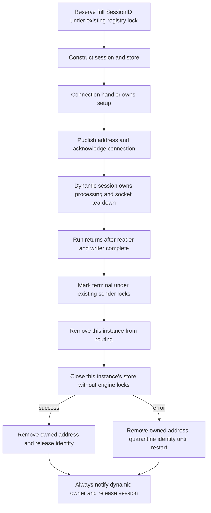

# Dynamic session retirement

Base: `986c69943a782ba521c6f1016a575aa05efec770`.
Runtime: Go 1.27.2, darwin/arm64, Apple M4 Pro, `-cpu=1`.
Source remains compatible with Go 1.23.

This change rejects duplicate identities before allocating session arenas or
opening another store, and releases completed dynamic sessions and their stores.
It does not change static acceptor/initiator reconnect ownership or promise that
arbitrary application/store implementations allocate nothing.

## Ownership



The separate setup/lifetime reservation contains no session or store pointer.
Public `UnregisterSession` still removes routing but cannot release a dynamic
identity while its old store remains alive. A conflicting creation returns the
existing duplicate-session error before store creation or recovery. Static
construction reserves identity only during setup; ordinary static disconnects
do not close the store.

Retirement waits for admitted send preparation through the existing
resend-before-send lock order. A sender holding an old session pointer then sees
the terminal guard before message mutation, sequence assignment or persistence.
Registry-owned sequence reads and target-sequence writes finish before routing
removal permits Close. Getters remain usable inside outbound callbacks. A raw
store retained from `GetMessageStore` remains an external lifetime boundary.

Shutdown prevents new setup admission and waits through acknowledged connection
or failed IO cleanup before stopping dynamic runs. Address removal compares the
owning session, so late cleanup cannot erase a replacement address. Logon/logout
timers are stopped at run teardown; already-firing callbacks select against that
run's stop channel and capture channels rather than the session.

On Close failure, the dynamic owner still completes and can release the session
and its arenas. The small identity claim remains until process restart. This is
deliberate error backpressure: a store's failed Close need not mean its asynchronous
workers joined, so a replacement must not begin recovery or persistence for the
same identity. This change does not claim to terminate failed external workers.

## Reproduction

The frozen allocation/retention fixture is `dynamic_retirement_benchmark_test.go`,
SHA-256 `4c2127965e41f5a30d490b025f6e93b351cfed2f9a9346aaf71967eb6b0124a0`.
It was added before production changes and used unchanged for both captures.

```sh
GOTOOLCHAIN=auto rtk proxy go test . -run '^$' -bench '^BenchmarkAllocationBaseline$' -benchmem -benchtime=1s -count=5 -cpu=1
GOTOOLCHAIN=auto rtk proxy go test . -run '^$' -bench '^BenchmarkDynamicSessionDuplicateCreation$' -benchmem -benchtime=1s -count=5 -cpu=1
GOTOOLCHAIN=auto rtk proxy go test . -run '^$' -bench '^BenchmarkDynamicSessionRetainedHeap$' -benchmem -benchtime=1x -count=5 -cpu=1
GOTOOLCHAIN=auto rtk proxy go test . -run '^$' -bench '^BenchmarkHeartbeatSessionIdentity$/without_formatting$' -benchmem -benchtime=1s -count=5 -cpu=1
```

The retention fixture runs eight real dynamic session loops with default limits,
unregisters before stopping, and samples retained heap after GC. Its factory
tracks ordinary MemoryStores without synthetic queue/payload allocations. The
buggy baseline cannot join its dynamic owner; each sample deliberately bounds
that observed leak to eight sessions, released when its test process exits.
`retained-B/session` is a heap delta, not allocations per FIX message. Its timed
duration includes the session's existing ticker alignment and is not wire latency.

The completed-heartbeat control warms setup before timing and waits for completed
writes and returned slots. It guards steady-state cost, rather than attributing
constructor savings to ordinary message throughput.

## Measured results

Five samples per row; timing and retained-heap values below are medians. Raw
before/after receipts are included alongside this document. The completed-heartbeat
baseline was captured from the unchanged base worktree at `986c6994`; the remaining
baseline captures ran here before production edits with the frozen fixture.

| Measurement | Before | After |
| --- | ---: | ---: |
| Duplicate construction, ns/op | 78,347 | 44.81 |
| Duplicate construction, B/op | 2,382,232 | 0 |
| Duplicate construction, allocs/op | 86 | 0 |
| Retired dynamic session, retained B/session | 2,383,062 | 133 |
| Open stores after eight retirements | 8 | 0 |
| Dynamic owner joined after eight retirements | 0 | 1 |
| Completed heartbeat, ns/op | 1,974 | 1,940 |
| Completed heartbeat, B/op / allocs/op | 0 / 0 | 0 / 0 |

Retained-heap samples range from 2,383,062–2,385,732 B/session before and
133–3,021 B/session after. The nonzero residue includes runtime/setup effects;
this does not claim exactly zero retained bytes. Session construction still
allocates. The duplicate reduction comes from rejecting the conflicting identity
before construction, while the retirement fixture measures memory release after
completed ownership. The completed-heartbeat timing is a steady-state control,
not evidence of a material latency improvement from this lifecycle change.

The mandatory `BenchmarkAllocationBaseline` preserves the same allocation rows
in all five samples before and after: valid decimal parsing, reused parsing with
and without dictionaries/groups, and valid NewOrderSingle validation remain
0 B/op and 0 allocs/op. Decimal overflow remains 168 B/op and 5 allocs/op;
legacy NewOrderSingle construction remains 152 B/op and 6 allocs/op; legacy
framed reads remain 160 B/op and 2 allocs/op. Those allocating paths are not
changed by this phase.

## Correctness boundary

Fixtures cover reservation before store creation, early public unregister,
delayed send/reset, an in-flight target-sequence mutation, same-ID replacement,
construction failure, Close failure, shutdown during construction, shutdown
between handoff and connection acknowledgement, and address ownership. A bounded
reader and blocked writer test double capture their completion state at Close
entry and verify all frame slots return. This fixture is not a deployed TCP load
test. Timeout fixtures cancel future callbacks and force late callback delivery.

Package qualification excludes only `TestMongoLogTestSuite`. The unexcluded run
reproduced the existing Mongo logging teardown failure and is retained separately
in `mongo-environment-failure.txt`; Mongo store tests remain enabled. Race tests
run separately from performance measurements.

Both final qualification commands passed on the final production source:

```sh
GOTOOLCHAIN=auto rtk proxy go test ./... -skip '^TestMongoLogTestSuite$' -count=1 -timeout=180s
GOTOOLCHAIN=auto rtk proxy go test -race . ./internal/... -count=1 -timeout=180s
```

See `correctness-all.txt` and `race-core-internal.txt`. All four before/after
benchmark commands passed. These are local library measurements, not a new
deployed load test or a whole-library zero-allocation claim.
