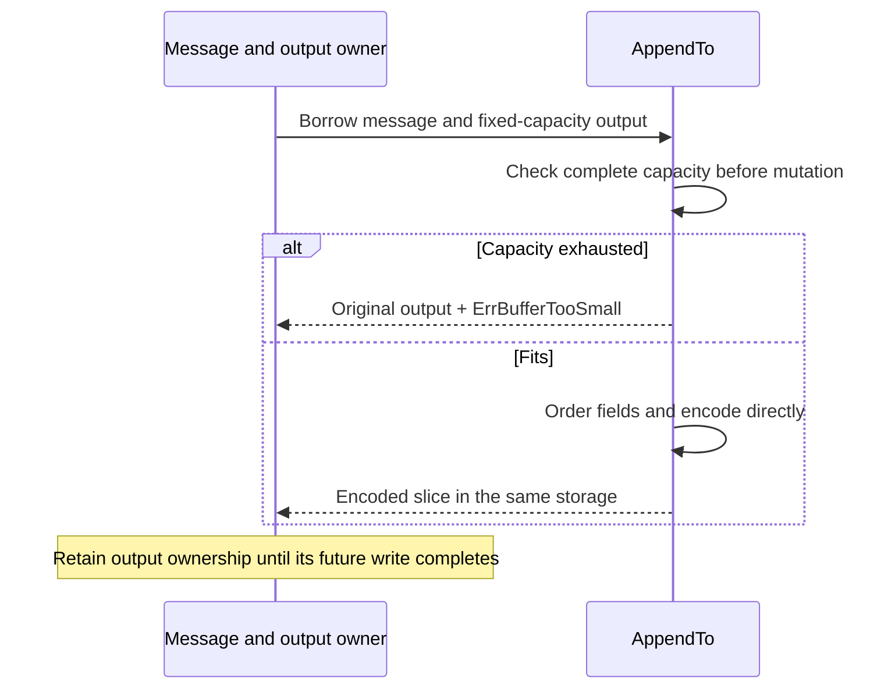

# Phase 2: bounded outbound encoding

`Message.AppendTo` and `Message.AppendWithBodyBytesTo` append FIX wire bytes to
caller-owned storage. They calculate BodyLength and checksum directly, preserve
field/group order, and never grow the destination. The explicit body overload
preserves original body bytes during resend even when the parsed map differs.
The message's stored BodyLength/checksum fields are not changed by these new APIs.

The caller exclusively owns the message and destination during encoding. The
destination must not alias field storage or the explicit body. On insufficient
capacity, the original destination, its backing bytes and the message remain
unchanged; the call returns the static `ErrBufferTooSmall` error. Preflight counts
the exact emitted tag indexes against available capacity, including duplicate
indexes left by legacy remove/re-add operations. Counting cannot overflow an int.



The existing allocating builders use shared append helpers while retaining their
BodyLength/checksum field updates, existing locks, cached `Bytes` behavior, and
returned-byte ownership. New scalar append APIs use `strconv.AppendInt` and
`time.AppendFormat`; their allocating `Write` methods remain available. Golden
tests preserve integer extremes, timestamp precision, UTC conversion, truncation,
unknown-precision defaults, and unusual years. Decimal writing is unchanged.

## Controlled baseline

Base: `8439f2102bc9865d1100b23eae0405bf0550e587` (phase 1).
Measured October 15, 2026, Go 1.25.3, darwin/arm64, Apple M4 Pro.
The baseline harness is unchanged (Git blob
`80bc8bf1fd51732a053235c53bdd76ab173cdabf`). Setup and warm-up are outside timing.

```sh
GOTOOLCHAIN=auto rtk proxy go test . -run '^$' -bench '^BenchmarkAllocationBaseline$' -benchmem -benchtime=1s -count=5 -cpu=1
```

| Warmed flow | Before B/op | Before allocs/op | After B/op | After allocs/op |
|---|---:|---:|---:|---:|
| Build NewOrderSingle, legacy API | 376 | 10 | 152 | 6 |
| Parse, reused message, no dictionary | 0 | 0 | 0 | 0 |
| Parse with dictionary | 112 | 7 | 112 | 7 |
| Parse with repeating group | 1,184 | 34 | 1,184 | 34 |
| Validate NewOrderSingle | 1,200 | 23 | 1,200 | 23 |
| Framed read | 160 | 2 | 160 | 2 |
| Decimal: short, signed fraction, maximum uint128 | 0 | 0 | 0 | 0 |
| Decimal: overflow, excluded | 168 | 5 | 168 | 5 |

Every row's allocation count was identical across five samples. Raw samples and
timings: [before](before-go1.25.3.txt), [after](after-go1.25.3.txt).

## New bounded APIs

The additive API has no pre-change implementation. Its separate benchmarks use
the same message fixtures and fixed output capacity allocated before timing.
They supplement the unchanged controlled baseline above.

```sh
GOTOOLCHAIN=auto rtk proxy go test . -run '^$' -bench '^BenchmarkBoundedEncoding$' -benchmem -benchtime=1s -count=5 -cpu=1
```

| Warmed bounded operation | B/op | allocs/op |
|---|---:|---:|
| NewOrderSingle append | 0 | 0 |
| Repeating-group append | 0 | 0 |
| Resend with preserved body | 0 | 0 |
| Integer append | 0 | 0 |
| Nanosecond timestamp append | 0 | 0 |

Raw samples: [bounded-go1.25.3.txt](bounded-go1.25.3.txt).

## Correctness boundary

Exact existing wire fixtures cover BodyLength, checksum, multiple and nested
repeating groups, constructed messages, updated parsed headers and preserved
resend-body order. Buffer checks cover prefixes, exact capacity, insufficient
capacity, nil output, source/output independence, no message mutation on failure,
stale tag indexes and zero-allocation rejection of oversized logical messages.

Verification ran after performance measurement:

| Check | Result | Evidence |
|---|---|---|
| Go 1.23.12 package tests, excluding the known unconfigured Mongo logger suite | PASS | [tests-go1.23.12.txt](tests-go1.23.12.txt) |
| Core QuickFIX race suite, Go 1.25.3 | PASS | [race.txt](race.txt) |
| Go 1.23.12 vet across all packages | PASS | Exit 0, no diagnostics |
| Independent review | PASS after fixing two capacity-sizing issues | Minimum int now uses native unsigned magnitude; size counting is bounded before adding |

```sh
GOTOOLCHAIN=go1.23.12+auto rtk proxy go test ./... -skip '^TestMongoLogTestSuite$' -count=1
GOTOOLCHAIN=go1.23.12+auto rtk proxy go vet ./...
GOTOOLCHAIN=auto rtk proxy go test -race . -count=1
```

The optional Mongo logger suite is excluded explicitly because its existing
unconfigured teardown bug was reproduced before and after phase 1; see the
[separate failure evidence](../phase-1/README.md#existing-optional-mongo-logger-test-failure).
Mongo integration coverage is not claimed. Its production code and tests are
unchanged.

This phase bounds output encoding only. Message construction, dictionary/group
parse state, validation scratch, inbound rings, completed socket writes and
resend-journal ownership still belong to subsequent phases. No session-wide
zero-allocation claim is made here.
