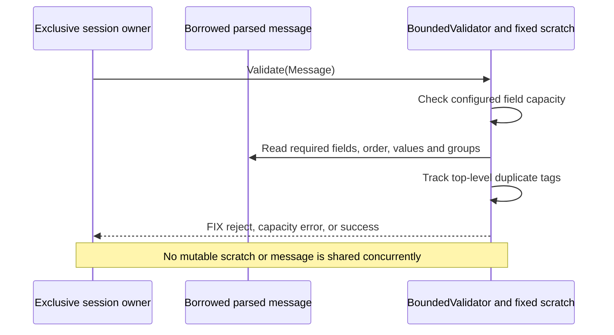

# Phase 4: bounded validation

Validation now reads scalar syntax directly from field bytes and scans multi-value
enums without splitting them. Timestamp validation retains the existing concrete
reader. The legacy validator keeps per-call duplicate-tag maps so existing shared
validator use remains safe; the additive `BoundedValidator` uses fixed scratch
owned by one session and detects capacity exhaustion before scratch mutation.



`NewBoundedValidator` allocates once. Its positive `maxFields` limit includes all
parsed fields, including repeated group members, header and trailer. The default
message-slot configuration uses 512 fields; the validator accepts an explicit
limit to match the slot. Oversized input returns `ErrValidationCapacity` separately
from a FIX reject. Validation changes no message, store or sequence state. Each
session owns its validator; dictionaries remain immutable.

The validation pass order, settings, required-field checks, enum rules, scalar
mapping, duplicate handling and group reject behavior remain intact. Integer
validation preserves legacy acceptance of negative and overflowing integer text.
Float validation preserves the legacy decimal-only grammar and finite-float64
range, including rounding just above MaxFloat64. It compares against the exact
overflow midpoint; differential tests derive that boundary independently and
cover long fractions beyond strconv's internal decimal precision. String-like
dictionary types retain the same validation as before. An unknown dictionary
type now yields an incorrect-format reject instead of a nil-reader panic.

## Controlled benchmark

Before source: `ca2494fa959b639623d0b1ad3a90b741f167ae6b` (phase 3).
Measured October 15, 2026, Go 1.25.3, darwin/arm64, Apple M4 Pro.
The baseline harness is unchanged (blob
`80bc8bf1fd51732a053235c53bdd76ab173cdabf`). The before file is the same controlled
run used to verify the final phase-3 parent. Setup and warm-up are outside timing;
no correctness tests, fuzzing or other benchmarks ran during these measurements.

```sh
GOTOOLCHAIN=auto rtk proxy go test . -run '^$' -bench '^BenchmarkAllocationBaseline$' -benchmem -benchtime=1s -count=5 -cpu=1
```

| Warmed flow | Before B/op | Before allocs/op | After B/op | After allocs/op |
|---|---:|---:|---:|---:|
| Parse without dictionary | 0 | 0 | 0 | 0 |
| Parse with dictionary | 0 | 0 | 0 | 0 |
| Parse with repeating group | 0 | 0 | 0 | 0 |
| Legacy validate NewOrderSingle | 1,200 | 23 | 936 | 5 |
| Legacy build NewOrderSingle | 152 | 6 | 152 | 6 |
| Framed read | 160 | 2 | 160 | 2 |
| Decimal short/fraction/uint128 | 0 | 0 | 0 | 0 |
| Decimal overflow, excluded | 168 | 5 | 168 | 5 |

All five allocation samples agree. Raw [before](before-go1.25.3.txt) and
[after](after-go1.25.3.txt) include every sample and timing.

```sh
GOTOOLCHAIN=auto rtk proxy go test . -run '^$' -bench '^BenchmarkBoundedValidation$' -benchmem -benchtime=1s -count=5 -cpu=1
```

The additive bounded validator measures **0 B/op, 0 allocs/op** for both
NewOrderSingle and nested groups, with construction, parsing and warm-up outside
timing: [raw evidence](bounded-go1.25.3.txt). Allocation assertions also cover
long valid integer, float, timestamp and multi-enum values.

## Verification

Fixtures cover existing FIX/FIXT rejects, reason/text/RefTagID compatibility,
paired-error precedence, all 32 setting combinations, enum whitespace, nested
groups, exact/exceeded capacity and recovery, and legacy concurrent validation.

```sh
GOTOOLCHAIN=go1.23.12+auto rtk proxy go test ./... -skip '^TestMongoLogTestSuite$' -count=1
GOTOOLCHAIN=go1.23.12+auto rtk proxy go vet ./...
GOTOOLCHAIN=auto rtk proxy go test -race . -count=1
GOTOOLCHAIN=auto rtk proxy go test . -run '^$' -fuzz '^FuzzValidFieldValueMatchesReader$' -fuzztime=30s -parallel=1
```

[Package tests](tests-go1.23.12.txt), [race tests](race.txt) and
[539,018 differential fuzz executions](fuzz.txt) passed. Go 1.23.12 vet exited zero
without diagnostics. Independent source review found no outstanding validation
semantics, scratch ownership or float-boundary issues.

The pre-existing optional Mongo logging teardown failure remains documented in
[phase 1](../phase-1/README.md#existing-optional-mongo-logger-test-failure); its
integration suite is explicitly excluded, not reported as passing.

This is valid-message validation qualification, not a complete-session guarantee.
FIX reject/error construction, legacy duplicate maps, allocating convenience
getters and arbitrary application/store/logger behavior remain outside this
phase's zero-allocation contract. Framing and session ownership remain phases 5–7.
