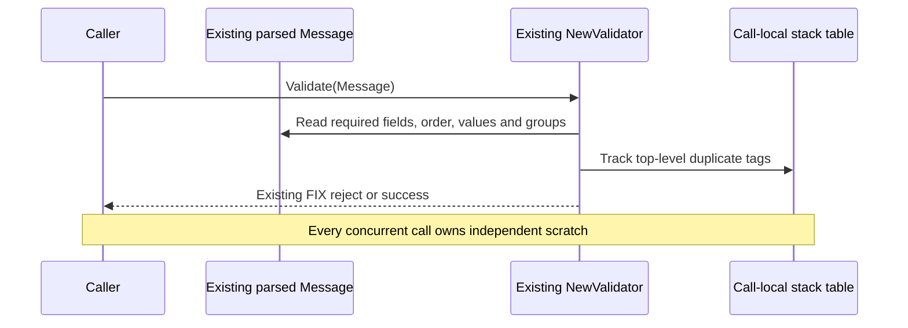

# Phase 4: ordinary validator allocation reduction

The existing `NewValidator(...).Validate(message)` API now uses call-local inline
storage for duplicate detection. It does not require a new validator type, a
message slot, a configuration switch, or application changes. Scalar validation
reads field bytes directly and multi-value enum validation scans without
splitting. Timestamp validation retains the existing concrete reader.

The unchanged ordinary-API NewOrderSingle benchmark measures **0 B/op and
0 allocs/op**, down from **936 B/op and 5 allocs/op** immediately before this
correction. Validation alone measured 852–874 ns/op; that does not measure
parsing, handler execution, encoding, persistence, or socket completion.

Each call tracks up to 512 distinct top-level tags in a fixed stack table. Group
members are validated in their existing group traversal and do not consume
top-level entries. A larger legacy message uses a private overflow map, retaining
unlimited input behavior; that case can allocate. The validator and parsed
message are not mutated, so one validator and immutable messages can still be
validated concurrently without locks, pools, or shared scratch.



The earlier additive `BoundedValidator` remains covered by its compatibility
tests, but is not selected by the ordinary-API qualification below. Its explicit
capacity errors and session-owned scratch are separate from the unchanged
`Validator` API. Dictionaries remain immutable during validation. Neither path
changes message, store, or sequence state.

The validation pass order, settings, required-field checks, enum rules, scalar
mapping, duplicate handling and group reject behavior remain intact. Integer
validation preserves legacy acceptance of negative and overflowing integer text.
Float validation preserves the legacy decimal-only grammar and finite-float64
range, including rounding just above MaxFloat64. It compares against the exact
overflow midpoint; differential tests derive that boundary independently and
cover long fractions beyond strconv's internal decimal precision. String-like
dictionary types retain the same validation as before. An unknown dictionary
type now yields an incorrect-format reject instead of a nil-reader panic.

## Controlled ordinary-API correction

Correction before source: `64484313d9aadbb62ea8f7a3180a01ecf565f2ae`.
Measured October 15, 2026, Go 1.25.3, darwin/arm64, Apple M4 Pro. The same baseline
harness and command were run before and after the change. Setup and warm-up stay
outside timing, and other builds, load tests, and benchmarks were paused.

```sh
GOTOOLCHAIN=auto rtk proxy go test . -run '^$' -bench '^BenchmarkAllocationBaseline$' -benchmem -benchtime=1s -count=5 -cpu=1
```

| Warmed flow | Correction before B/op | Before allocs/op | Correction after B/op | After allocs/op |
|---|---:|---:|---:|---:|
| Ordinary validate NewOrderSingle | 936 | 5 | 0 | 0 |
| Parse without dictionary | 0 | 0 | 0 | 0 |
| Parse with dictionary | 0 | 0 | 0 | 0 |
| Parse with repeating group | 0 | 0 | 0 | 0 |
| Legacy build NewOrderSingle | 152 | 6 | 152 | 6 |
| Framed read | 160 | 2 | 160 | 2 |
| Decimal short/fraction/uint128 | 0 | 0 | 0 | 0 |
| Decimal overflow, excluded | 168 | 5 | 168 | 5 |

All five allocation samples agree. Ordinary validation changed from
1,271–1,376 ns/op to 852–874 ns/op. Raw
[correction before](correction-before-go1.25.3.txt) and
[correction after](correction-after-go1.25.3.txt) preserve all samples.

Allocation assertions separately use only `NewMessage`, `ParseMessage`, and
`NewValidator` for NewOrderSingle, nested groups, and 512 dictionary-defined
fields. No alternative validator or parser storage selects those tests. Tests
also cover 513- and 2,049-field legacy messages, duplicates first seen before and
after overflow, zero/negative/full-width tag keys, and shared validators with the
same immutable messages. Validating larger legacy inputs remains supported and
can allocate; no new public capacity error or rejection rule is introduced.

## Initial phase-4 evidence

Before source: `ca2494fa959b639623d0b1ad3a90b741f167ae6b` (phase 3).
Measured October 15, 2026, Go 1.25.3, darwin/arm64, Apple M4 Pro.
The baseline harness is unchanged (blob
`80bc8bf1fd51732a053235c53bdd76ab173cdabf`). The before file is the same controlled
run used to verify the final phase-3 parent. Setup and warm-up are outside timing;
no correctness tests, fuzzing or other benchmarks ran during these measurements.

```sh
GOTOOLCHAIN=auto rtk proxy go test . -run '^$' -bench '^BenchmarkAllocationBaseline$' -benchmem -benchtime=1s -count=5 -cpu=1
```

| Warmed flow | Before B/op | Before allocs/op | After B/op | After allocs/op |
|---|---:|---:|---:|---:|
| Parse without dictionary | 0 | 0 | 0 | 0 |
| Parse with dictionary | 0 | 0 | 0 | 0 |
| Parse with repeating group | 0 | 0 | 0 | 0 |
| Legacy validate NewOrderSingle | 1,200 | 23 | 936 | 5 |
| Legacy build NewOrderSingle | 152 | 6 | 152 | 6 |
| Framed read | 160 | 2 | 160 | 2 |
| Decimal short/fraction/uint128 | 0 | 0 | 0 | 0 |
| Decimal overflow, excluded | 168 | 5 | 168 | 5 |

All five allocation samples agree. Raw [before](before-go1.25.3.txt) and
[after](after-go1.25.3.txt) include every sample and timing.

```sh
GOTOOLCHAIN=auto rtk proxy go test . -run '^$' -bench '^BenchmarkBoundedValidation$' -benchmem -benchtime=1s -count=5 -cpu=1
```

The additive bounded validator measures **0 B/op, 0 allocs/op** for both
NewOrderSingle and nested groups, with construction, parsing and warm-up outside
timing: [raw evidence](bounded-go1.25.3.txt). Allocation assertions also cover
long valid integer, float, timestamp and multi-enum values.

## Verification

The ordinary-API correction passed the Go 1.23.12
[all-package suite](correction-tests-go1.23.12.txt), with only the known Mongo
logger suite excluded. Go 1.23.12 vet exited zero without diagnostics
([output](correction-vet-go1.23.12.txt)). The focused validation
[race run](correction-race.txt) passed, including concurrent calls sharing the
same immutable messages and overflow-map inputs.

```sh
GOTOOLCHAIN=go1.23.12+auto rtk proxy go test ./... -skip '^TestMongoLogTestSuite$' -count=1
GOTOOLCHAIN=go1.23.12+auto rtk proxy go vet ./...
GOTOOLCHAIN=auto rtk proxy go test -race . -run '^(TestValidate|TestBoundedValidation|TestLegacyValidator|TestValidatorInline)' -count=1 -timeout=120s
```

The following additional checks and evidence were recorded for the initial
phase-4 scalar-validation implementation before this correction.

Fixtures cover existing FIX/FIXT rejects, reason/text/RefTagID compatibility,
paired-error precedence, all 32 setting combinations, enum whitespace, nested
groups, exact/exceeded capacity and recovery, and legacy concurrent validation.

```sh
GOTOOLCHAIN=go1.23.12+auto rtk proxy go test ./... -skip '^TestMongoLogTestSuite$' -count=1
GOTOOLCHAIN=go1.23.12+auto rtk proxy go vet ./...
GOTOOLCHAIN=auto rtk proxy go test -race . -count=1
GOTOOLCHAIN=auto rtk proxy go test . -run '^$' -fuzz '^FuzzValidFieldValueMatchesReader$' -fuzztime=30s -parallel=1
```

[Package tests](tests-go1.23.12.txt), [race tests](race.txt) and
[539,018 differential fuzz executions](fuzz.txt) passed. Go 1.23.12 vet exited zero
without diagnostics. Independent source review found no outstanding validation
semantics, scratch ownership or float-boundary issues.

The pre-existing optional Mongo logging teardown failure remains documented in
[phase 1](../phase-1/README.md#existing-optional-mongo-logger-test-failure); its
integration suite is explicitly excluded, not reported as passing.

This is valid-message validation qualification, not a complete-session or
sub-microsecond processing guarantee. FIX reject/error construction, overflow
beyond 512 distinct top-level tags, allocating convenience getters, and arbitrary
application/store/logger behavior remain outside this phase's zero-allocation
contract. Message, group, frame, and output retention lifetimes remain unchanged;
this change does not recycle independently retainable results. Framing and
session ownership remain separate work.
