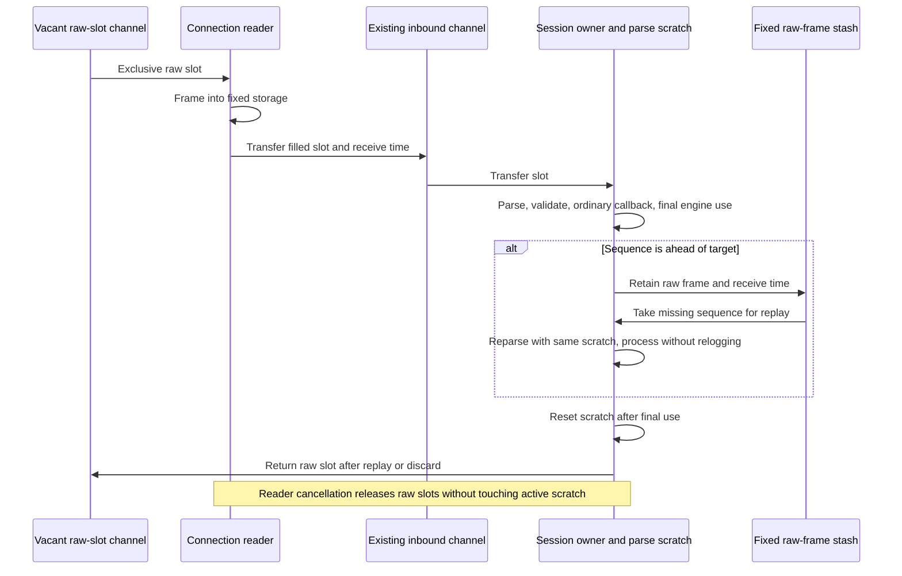

# Phase 5: ordinary inbound frame ownership

Ordinary sessions now read into a fixed raw-frame ring and use one session-owned
parse scratch. They dispatch the existing `Application.FromAdmin` and `FromApp`
callbacks through the ordinary validator. There is no mode flag or required new
application interface. Storage belongs to one owner at a time; channels transfer
raw slots, and the session alone accesses parse scratch.



## Configuration, ownership and compatibility

| Setting | Default |
|---|---:|
| `BoundedMaxFrameBytes` | 16,384 |
| `BoundedMaxFields` | 512 |
| `BoundedMaxGroupEntries` | 128 across the whole message |
| `BoundedMaxGroupDepth` | 8 |
| `InboundFrameQueueCapacity` | `min(InChanCapacity, 32)` |
| `BoundedInboundStashCapacity` | 32 |

`InChanCapacity` keeps its existing default of one and remains an upper bound on
queued frames. The numeric frame-queue allowance is clamped to that channel
capacity. The raw ring has `allowance + stash capacity + 2` slots; the extra slots
cover reader and active-session ownership. Thus the default channel uses 35 raw
slots, while a channel configured for 30,000 messages uses 66 raw slots unless the
frame allowance is explicitly increased. It does not allocate 30,000 parse slabs.
For the 66-slot case the frame arena is 1.031 MiB, plus one parse slab and indexes;
channel storage, dictionaries, reader buffers and other session state are additional.

Incoming messages and byte views are scoped to synchronous callback processing.
The original `*Message`, `GetBytes`, `Bytes`, and explicitly borrowed group views
must not be retained after their scope or used concurrently with the session.
Engine processing continues after callback return: reject construction and resend
handling finish before the raw slot is released. A stashed message retains its raw
frame until replay or discard. Arbitrary applications that previously retained the
original message pointer or byte views must copy their retained data; this is a
lifetime contract change, despite unchanged callback signatures.

Owned string APIs (`GetString`, `FIXString`, `Message.String`) remain owned.
`Message.CopyInto`, section `CopyInto`, and ordinary `GetGroup` from scoped input
detach the copied bytes, including repeating groups. Copies from ordinary
non-session messages retain their existing semantics. Legacy setters remain
mutable during the callback. If such a setter exhausts a section's fixed capacity,
that section detaches to an ordinary allocating map; the next input restores the
original fixed scratch. These allocating convenience operations are outside the
zero-allocation contract. Parsing, dictionary groups, validation and stash handling
never use that fallback.

Reset clears only touched field-map entries and the highest used parse-field
prefix, including failed extraction and group lookahead. Removed entries remain
tracked until cleared, so tag collisions and remove/reinsert cycles cannot retain
old byte references. Legacy convenience reparsing conservatively marks the entire
original field slab for cleanup; parsing and reset restore the original field and
group-stack storage so a convenience operation cannot enlarge the next input's
configured limits.

The existing null logger consumes incoming bytes without allocation. Optional
`BorrowedLog` support permits other synchronous loggers to do the same. Every other
existing `Log` receives an owned incoming-byte copy, preserving its retention
contract; that adapter and arbitrary logger allocations are outside the guarantee.
Diagnostic event arguments remain owned strings where necessary for retention.

A full channel or no vacant raw slot applies reader backpressure. Frame, field,
group, depth or stash exhaustion disconnects with a static capacity error before
sequence/store side effects for that input. Stash space is reserved before sending
a ResendRequest. Capacity failures preserve existing store and sequence state even
with `ResetOnDisconnect=Y`; later ordinary disconnects still follow that setting.
Duplicate stashes replace and release the previous raw slot. Gap fill, completed
replay, failed recovery and disconnect release retained slots. There is no implicit
eviction, parsing growth, pool, reference count or added hot-path mutex.

Framing checks positive, overflow-safe BodyLength arithmetic and requires the
three-digit checksum field at the declared boundary. Fragmented and coalesced
frames, including exact-capacity frames, fit without growth. This is stricter than
the allocating legacy parser's search for a later checksum. The legacy
`parser.ReadMessage` convenience API remains available and allocating.

Acceptor session discovery occurs before session limits are selected and remains
setup work. Its first frame is checked and copied into a raw slot; read-ahead bytes
transfer to the reader. Disconnect cancels blocked reads, slot acquisition and
channel sends, drains all transfers, and joins the reader before ring reuse on
reconnect. Failed initiator Logon preparation also returns every accepted slot.

## Allocation and latency evidence

Correction baseline: `32d79fc4955858e96e9a05ae7dd96ecfa1e27464`, including the
ordinary validator and router corrections. Measurements use Go 1.25.3,
darwin/arm64, Apple M4 Pro. Setup and warm-up are outside timing.

```sh
GOTOOLCHAIN=auto rtk proxy go test . -run '^$' -bench '^BenchmarkAllocationBaseline$' -benchmem -benchtime=1s -count=5 -cpu=1
GOTOOLCHAIN=auto rtk proxy go test . -run '^$' -bench '^BenchmarkScopedInboundSession$' -benchmem -benchtime=1s -count=5 -cpu=1
```

The mandatory [before baseline](scoped-before-go1.25.3.txt) and
[after baseline](scoped-after-go1.25.3.txt) preserve the original harness and every
allocation count: all three parsing rows and ordinary validation remain 0 B/op,
0 allocs/op; legacy building remains 152 B/op, 6 allocs/op; legacy framed reads
remain 160 B/op, 2 allocs/op. Decimal overflow remains 168 B/op, 5 allocs/op and is
outside the guarantee. Baseline latency is not claimed unchanged: validation ran
868.9–899.2 ns before versus 932.0–972.2 ns after, and legacy building ran
774.0–792.2 ns before versus 832.2–857.1 ns after. These measurements do not establish
the cause of that timing shift.

The ordinary inbound [before measurement](scoped-session-before-go1.25.3.txt) and
[after measurement](scoped-session-after-go1.25.3.txt) use the exact same timed
benchmark implementation. It creates an ordinary
session with its normal application interface, null logger, dictionary validation,
latency checking, and memory-store target-sequence accounting. Each operation
completes framing, inbound-channel transfer, parsing, dictionary/group traversal,
validation, callback, target-sequence advancement, timer reset and slot return.
All 66 raw slots are warmed before timing. The fixture is a deterministic in-memory
connection, not TCP or a completed-write/full-session benchmark.

| Ordinary inbound flow | Before ns/op | After ns/op | Before B/op | After B/op | Before allocs/op | After allocs/op |
|---|---:|---:|---:|---:|---:|---:|
| NewOrderSingle | 2,314–2,371 | 1,897–1,923 | 2,671 | 0 | 21 | 0 |
| Repeating groups | 4,705–5,062 | 2,736–2,767 | 5,208 | 0 | 30 | 0 |

Each range contains five one-second samples on one CPU. Every final sample reports
zero allocations, also enforced by `TestScopedInboundSessionAllocations` after
warm-up with completed callbacks, target-sequence advancement and all raw slots
returned. The requested sub-microsecond processing target is not met.

Both callbacks synchronously read ClOrdID with `GetBytes`. The group fixture
exercises dictionary parsing and validation of groups; it does not invoke the
allocating legacy `GetGroup` API, generated group getters, or owned string getters.
The memory store does not persist outbound messages in this inbound measurement.
Existing unbounded stores are not qualified as zero-allocation journals.

The [initial candidate](scoped-session-first-after-go1.25.3.txt) achieved 0 B/op and
0 allocs/op but took 5,619 ns for NewOrderSingle and 6,590 ns for groups. Its
[CPU profile](scoped-reset-cpu-top.txt) attributed 61.61% of samples to clearing
memory; full fixed-map clears accounted for 58.51% cumulatively. Those results
motivated clearing only touched entries and the used parse-field prefix. The
[final CPU profile](scoped-final-cpu-top.txt) reduces `fixedClear` to 1.86%
cumulatively. Remaining costs include dictionary validation, parsing, timestamp
parsing and channel scheduling. Raw profiles and profile-run output accompany the
text reports; profile timings are separate from the final controlled samples.

Earlier `before-*`, `after-*` and `bounded-*` files in this directory describe the
superseded opt-in implementation. They are retained as historical evidence, not
qualification of the ordinary path or its current lifetime contract.

## Correctness and remaining scope

Fixtures cover fragmented/coalesced/partial reads, checked length overflow, exact
frame capacity, retry, stalled readers, held slots, full channels, cancellation,
discovery read-ahead and reconnect. Session tests exercise `2,3,4,1` replay,
duplicate replacement, gap fills, chunked recovery, timeout wrappers, later missing
ranges, replacement/replay receive times, and failure returning the active retained
slot exactly once. Capacity categories preserve store/sequence state. Additional
fixtures preserve callback reject data through engine processing, prove reader
cancellation cannot reset active parse scratch, and retain owned logger bytes,
strings, copies and legacy group objects across ring reuse. Callback setter
detachment restores the original bounded parse storage for the next input.

```sh
GOTOOLCHAIN=go1.23.12+auto rtk proxy go test ./... -skip '^TestMongoLogTestSuite$' -count=1
GOTOOLCHAIN=go1.23.12+auto rtk proxy go vet ./...
GOTOOLCHAIN=auto rtk proxy go test -race . -count=1
```

The [Go 1.23.12 all-package suite](scoped-tests-go1.23.12.txt), Go 1.23.12 vet
(exit 0, no diagnostics), and [full core race suite](scoped-race.txt) passed.
The core test package completed in 7.385 seconds, and the race suite in 16.993
seconds. Focused compatibility and lifecycle tests also passed before qualification.
The known optional Mongo logger failure is documented in
[phase 1](../phase-1/README.md#existing-optional-mongo-logger-test-failure) and is
the only skipped suite. Race and correctness checks are separate from performance
timing.

This phase qualifies ordinary inbound processing within the configured limits.
Outbound construction, persistence/journal retention, completed socket writes,
arbitrary application work, malformed-input diagnostics and the complete session
path retain their separate qualification requirements. No whole-library zero
allocation or sub-microsecond full-session latency claim follows from this phase.
