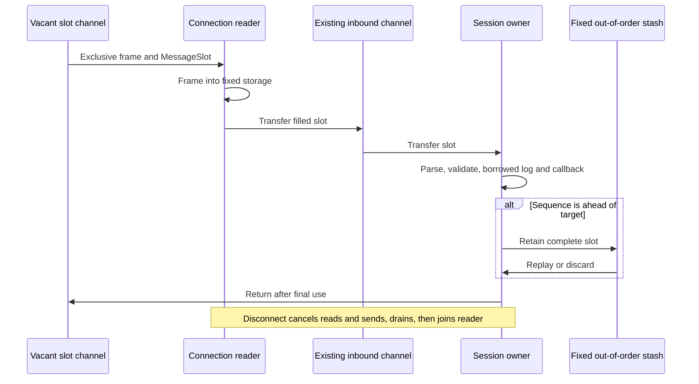

# Phase 5: inbound frame ownership

The opt-in bounded inbound path frames into fixed storage and transfers an entire
frame/message slot through the existing inbound channel. The session parses and
validates through that slot, calls explicit borrowed application/logger methods,
and returns ownership only after processing or retained-message replay completes.
Legacy callbacks and the allocating `ReadMessage` API keep their original lifetime.



## Configuration and lifetime

Set `BoundedInbound=Y`; setup requires `BorrowedApplication` and `BorrowedLog`.
Their borrowed methods must consume or copy bytes synchronously and cannot mutate
or retain the slot, message, field bytes or group views. Legacy methods remain
available when bounded mode is off. `Message.CopyInto` does not deeply copy
borrowed field values and is not a retention adapter. The existing null logger
implements the borrowed interface; other loggers explicitly opt in. Allocations
inside a caller-provided logger or handler are outside the guarantee.

| Setting | Default |
|---|---:|
| `BoundedMaxFrameBytes` | 16,384 |
| `BoundedMaxFields` | 512 |
| `BoundedMaxGroupEntries` | 128 |
| `BoundedMaxGroupDepth` | 8 |
| `InChanCapacity` in bounded mode | 32 |
| `BoundedInboundStashCapacity` | 32 |

The ring contains `InChanCapacity + BoundedInboundStashCapacity + 2` slots: 66 by
default. The two extra slots cover reader and active session ownership. Stashed
messages cannot consume the slots needed to receive missing resend frames.
Stash entries replace duplicate sequences explicitly and release previous owners.
Gap fills, completed replay, failed recovery and disconnect return retained slots.

A full channel or no vacant slot applies backpressure. Frame, field, group, depth
or stash exhaustion disconnects with a static capacity error, before assigning a
sequence or persisting a response for that input. Stash capacity is reserved before
sending a ResendRequest. Capacity failures preserve existing store and sequence
state, including when `ResetOnDisconnect=Y`; the exception applies to that failure
only. A subsequent ordinary disconnect still applies the configured reset policy.
There is no silent growth, automatic retention eviction, or mutex/pool addition.

Bounded framing checks positive, overflow-safe BodyLength arithmetic and requires
the three-digit checksum field at the declared boundary. Fragmented/coalesced
frames fit without growth, including a frame exactly equal to capacity. A short
destination leaves its bytes and the complete buffered frame intact for retry.
The bounded session uses configured full-size destinations.

The acceptor's initial session-discovery read precedes selection of session limits
and remains setup work. Once selected, its first frame is checked and copied into
a slot; read-ahead bytes transfer to the bounded reader. Connection establishment,
discovery and allocation of connection controls/scratch are outside warmed timing.
Disconnect cancels blocked reads, vacant acquisition and channel sends, drains all
transfers and joins the reader before reconnect can reuse the ring. Failed initiator
Logon preparation also reclaims an accepted reader even if state stayed latent.

## Evidence

Before source: `64484313d9aadbb62ea8f7a3180a01ecf565f2ae` (phase 4).
Measured October 15, 2026, Go 1.25.3, darwin/arm64, Apple M4 Pro.
The original controlled harness remains unchanged, blob
`80bc8bf1fd51732a053235c53bdd76ab173cdabf`:

```sh
GOTOOLCHAIN=auto rtk proxy go test . -run '^$' -bench '^BenchmarkAllocationBaseline$' -benchmem -benchtime=1s -count=5 -cpu=1
```

[Before](before-go1.25.3.txt) and [after](after-go1.25.3.txt) preserve the legacy
API baseline. The additive bounded framing benchmark uses the exact same order
wire and repeating-reader fixture as the legacy 160 B/op, 2 allocs/op framed read.

| Warmed flow | Legacy/reference B/op | Legacy/reference allocs/op | Bounded B/op | Bounded allocs/op |
|---|---:|---:|---:|---:|
| Same-fixture framed read | 160 | 2 | 0 | 0 |
| Framing through validated order handler and slot return | — | — | 0 | 0 |
| Framing through validated group handler and slot return | — | — | 0 | 0 |

All five bounded samples report zero allocations: [raw evidence](bounded-go1.25.3.txt).
The original controlled benchmark remains 0/0 for all parse rows, 936 B/5 for
legacy validation, 152 B/6 for legacy building and 160 B/2 for legacy framed reads.
The reduction here is the configured bounded path replacing those allocating
framed reads, while preserving the legacy API.

```sh
GOTOOLCHAIN=auto rtk proxy go test . -run '^$' -bench '^BenchmarkBounded(Framing|InboundOwnership)$' -benchmem -benchtime=1s -count=5 -cpu=1
```

The ownership benchmark uses the default 16 KiB/512-field/128-entry/eight-depth
limits and 66 slots. It includes framing, both ownership channel transfers,
dictionary/group parsing, validation, borrowed field/group access and slot return.
Each iteration completes only after its slot is returned; initialization, warming
every slot and shutdown are outside timing. This harness does not claim session
sequence/store processing or completed socket writes; those remain qualification
work in phases 6–7.

## Correctness

Tests cover fragmented/coalesced/partial reads, checked length overflow, exact
frame capacity, destination retry, stalled readers, held consumer slots, full
channels, cancellation, discovery read-ahead and reconnect. Session fixtures cover
`2,3,4,1` replay, duplicate replacement, gap fills, chunked recovery, timeout wrappers,
later missing ranges, and recovery failure returning the active retained slot
exactly once. Every capacity category preserves existing store/sequence state.
Legacy retained callbacks and explicit borrowed logging/handler lifetimes are
tested separately, including event loggers retaining owned diagnostic strings.

```sh
GOTOOLCHAIN=go1.23.12+auto rtk proxy go test ./... -skip '^TestMongoLogTestSuite$' -count=1
GOTOOLCHAIN=go1.23.12+auto rtk proxy go vet ./...
GOTOOLCHAIN=auto rtk proxy go test -race . -count=1
GOTOOLCHAIN=auto rtk proxy go test . -run '^$' -fuzz '^FuzzBoundedFraming$' -fuzztime=30s -parallel=2
```

[Package tests](tests-go1.23.12.txt), [race tests](race.txt), vet and
[656,738 framing fuzz executions](fuzz.txt) passed. Correctness, fuzz and race
runs were separate from performance measurements. The known optional Mongo
logging teardown failure is documented in [phase 1](../phase-1/README.md#existing-optional-mongo-logger-test-failure)
and its integration coverage remains explicitly excluded.

This phase bounds inbound storage/lifetime and validates its allocation reduction.
Outbound construction, writer completion, resend-journal retention and the complete
supported session path remain subsequent phases. Malformed-input diagnostics and
legacy convenience APIs are outside the valid-message allocation contract.
