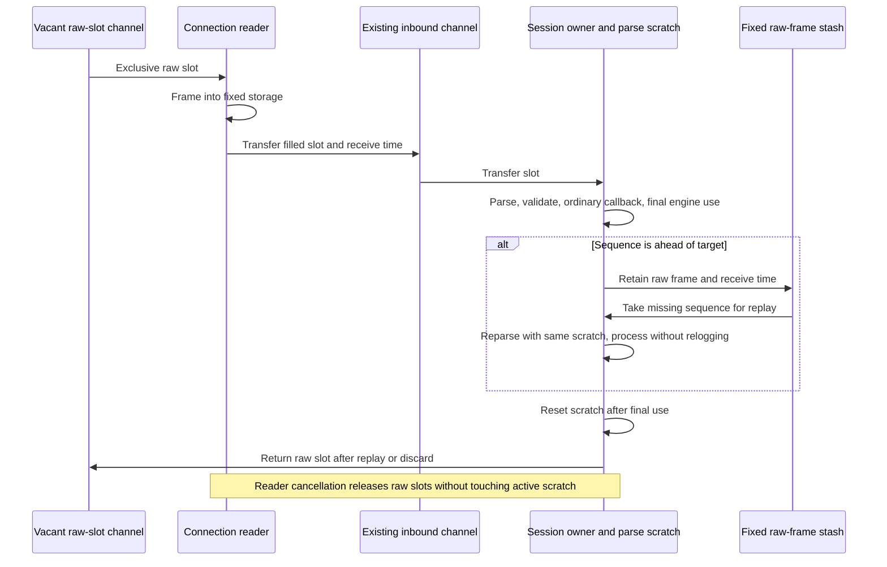

# Phase 5: ordinary inbound frame ownership

Ordinary sessions now read into a fixed raw-frame ring and use one session-owned
parse scratch. They dispatch the existing `Application.FromAdmin` and `FromApp`
callbacks through a private session-owned validator. There is no mode flag or required new
application interface. Storage belongs to one owner at a time; channels transfer
raw slots, and the session alone accesses parse scratch.



## Configuration, ownership and compatibility

| Setting | Default |
|---|---:|
| `BoundedMaxFrameBytes` | 16,384 |
| `BoundedMaxFields` | 512 |
| `BoundedMaxGroupEntries` | 128 across the whole message |
| `BoundedMaxGroupDepth` | 8 |
| `InboundFrameQueueCapacity` | `min(InChanCapacity, 32)` |
| `BoundedInboundStashCapacity` | 32 |

`InChanCapacity` keeps its existing default of one and remains an upper bound on
queued frames. The numeric frame-queue allowance is clamped to that channel
capacity. The raw ring has `allowance + stash capacity + 2` slots; the extra slots
cover reader and active-session ownership. Thus the default channel uses 35 raw
slots, while a channel configured for 30,000 messages uses 66 raw slots unless the
frame allowance is explicitly increased. It does not allocate 30,000 parse slabs.
For the 66-slot case the frame arena is 1.031 MiB, plus one parse slab and indexes;
channel storage, dictionaries, reader buffers and other session state are additional.

Incoming messages and byte views are scoped to synchronous callback processing.
The original `*Message`, `GetBytes`, `Bytes`, and explicitly borrowed group views
must not be retained after their scope or used concurrently with the session.
Engine processing continues after callback return: reject construction and resend
handling finish before the raw slot is released. A stashed message retains its raw
frame until replay or discard. Arbitrary applications that previously retained the
original message pointer or byte views must copy their retained data; this is a
lifetime contract change, despite unchanged callback signatures.

Owned string APIs (`GetString`, `FIXString`, `Message.String`) remain owned.
`Message.CopyInto`, section `CopyInto`, and ordinary `GetGroup` from scoped input
detach the copied bytes, including repeating groups. Copies from ordinary
non-session messages retain their existing semantics. Legacy setters remain
mutable during the callback. If such a setter exhausts a section's fixed capacity,
that section detaches to an ordinary allocating map; the next input restores the
original fixed scratch. These allocating convenience operations are outside the
zero-allocation contract. Parsing, dictionary groups, validation and stash handling
never use that fallback.

Reset clears only touched field-map entries and the highest used parse-field
prefix, including failed extraction and group lookahead. Removed entries remain
tracked until cleared, so tag collisions and remove/reinsert cycles cannot retain
old byte references. Legacy convenience reparsing conservatively marks the entire
original field slab for cleanup; parsing and reset restore the original field and
group-stack storage so a convenience operation cannot enlarge the next input's
configured limits.

The existing null logger consumes incoming bytes without allocation. Optional
`BorrowedLog` support permits other synchronous loggers to do the same. Every other
existing `Log` receives an owned incoming-byte copy, preserving its retention
contract; that adapter and arbitrary logger allocations are outside the guarantee.
Diagnostic event arguments remain owned strings where necessary for retention.

A full channel or no vacant raw slot applies reader backpressure. Frame, field,
group, depth or stash exhaustion disconnects with a static capacity error before
sequence/store side effects for that input. Stash space is reserved before sending
a ResendRequest. Capacity failures preserve existing store and sequence state even
with `ResetOnDisconnect=Y`; later ordinary disconnects still follow that setting.
Duplicate stashes replace and release the previous raw slot. Gap fill, completed
replay, failed recovery and disconnect release retained slots. There is no implicit
eviction, parsing growth, pool, reference count or added hot-path mutex.

Framing checks positive, overflow-safe BodyLength arithmetic and requires the
three-digit checksum field at the declared boundary. Fragmented and coalesced
frames, including exact-capacity frames, fit without growth. This is stricter than
the allocating legacy parser's search for a later checksum. The legacy
`parser.ReadMessage` convenience API remains available and allocating.

Acceptor session discovery occurs before session limits are selected and remains
setup work. Its first frame is checked and copied into a raw slot; read-ahead bytes
transfer to the reader. Disconnect cancels blocked reads, slot acquisition and
channel sends, drains all transfers, and joins the reader before ring reuse on
reconnect. Failed initiator Logon preparation also returns every accepted slot.

## Allocation and latency evidence

Correction baseline: `32d79fc4955858e96e9a05ae7dd96ecfa1e27464`, including the
ordinary validator and router corrections. Measurements use Go 1.25.3,
darwin/arm64, Apple M4 Pro. Setup and warm-up are outside timing.

```sh
GOTOOLCHAIN=auto rtk proxy go test . -run '^$' -bench '^BenchmarkAllocationBaseline$' -benchmem -benchtime=1s -count=5 -cpu=1
GOTOOLCHAIN=auto rtk proxy go test . -run '^$' -bench '^BenchmarkScopedInboundSession$' -benchmem -benchtime=1s -count=5 -cpu=1
```

The mandatory [before baseline](scoped-before-go1.25.3.txt) and
[after baseline](scoped-after-go1.25.3.txt) preserve the original harness and every
allocation count: all three parsing rows and ordinary validation remain 0 B/op,
0 allocs/op; legacy building remains 152 B/op, 6 allocs/op; legacy framed reads
remain 160 B/op, 2 allocs/op. Decimal overflow remains 168 B/op, 5 allocs/op and is
outside the guarantee. Baseline latency is not claimed unchanged: validation ran
868.9–899.2 ns before versus 932.0–972.2 ns after, and legacy building ran
774.0–792.2 ns before versus 832.2–857.1 ns after. These measurements do not establish
the cause of that timing shift.

The ordinary inbound [before measurement](scoped-session-before-go1.25.3.txt) and
[after measurement](scoped-session-after-go1.25.3.txt) use the exact same timed
benchmark implementation. It creates an ordinary
session with its normal application interface, null logger, dictionary validation,
latency checking, and memory-store target-sequence accounting. Each operation
completes framing, inbound-channel transfer, parsing, dictionary/group traversal,
validation, callback, target-sequence advancement, timer reset and slot return.
All 66 raw slots are warmed before timing. The fixture is a deterministic in-memory
connection, not TCP or a completed-write/full-session benchmark.

| Ordinary inbound flow | Before ns/op | After ns/op | Before B/op | After B/op | Before allocs/op | After allocs/op |
|---|---:|---:|---:|---:|---:|---:|
| NewOrderSingle | 2,314–2,371 | 1,897–1,923 | 2,671 | 0 | 21 | 0 |
| Repeating groups | 4,705–5,062 | 2,736–2,767 | 5,208 | 0 | 30 | 0 |

Each range contains five one-second samples on one CPU. Every final sample reports
zero allocations, also enforced by `TestScopedInboundSessionAllocations` after
warm-up with completed callbacks, target-sequence advancement and all raw slots
returned. The requested sub-microsecond processing target is not met.

Both callbacks synchronously read ClOrdID with `GetBytes`. The group fixture
exercises dictionary parsing and validation of groups; it does not invoke the
allocating legacy `GetGroup` API, generated group getters, or owned string getters.
The memory store does not persist outbound messages in this inbound measurement.
Existing unbounded stores are not qualified as zero-allocation journals.

The [initial candidate](scoped-session-first-after-go1.25.3.txt) achieved 0 B/op and
0 allocs/op but took 5,619 ns for NewOrderSingle and 6,590 ns for groups. Its
[CPU profile](scoped-reset-cpu-top.txt) attributed 61.61% of samples to clearing
memory; full fixed-map clears accounted for 58.51% cumulatively. Those results
motivated clearing only touched entries and the used parse-field prefix. The
[final CPU profile](scoped-final-cpu-top.txt) reduces `fixedClear` to 1.86%
cumulatively. Remaining costs include dictionary validation, parsing, timestamp
parsing and channel scheduling. Raw profiles and profile-run output accompany the
text reports; profile timings are separate from the final controlled samples.

Earlier `before-*`, `after-*` and `bounded-*` files in this directory describe the
superseded opt-in implementation. They are retained as historical evidence, not
qualification of the ordinary path or its current lifetime contract.

### Latency follow-up to afbd0127

The follow-up starts from `afbd0127b46341961f3491bbe819ecfa9f41484b`.
The `scoped-after-*` and `scoped-session-after-*` files above are its immediate
before evidence; the original `32d79fc4` comparison remains intact. The new
`scoped-latency-*` and `scoped-session-latency-after-*` results measure that head
with this follow-up applied, before its commit. They are library measurements.
Existing fix-server load results pinned to `afbd0127` do not qualify this follow-up.

The session factory now constructs fixed duplicate-tag scratch once. It clears
only occupied indexes between messages instead of initializing the public
validator's 8 KiB stack table for each input. At the default 512-field limit, the
tag table and touched-index array use 12 KiB, plus their descriptors. Only the
session owner accesses them. Public `NewValidator` retains independent call-local
scratch and its existing larger-message map fallback, so shared-validator and
shared immutable-message concurrency remain supported. The strict public
`BoundedValidator` still rejects capacity overflow before traversal. A private
session validator receiving a directly supplied oversized legacy message uses the
old validator; framed input is rejected earlier by the fixed parser limits.

Private session setup also compiles immutable required-tag slices. They prove
the successful required-field check without iterating maps; any missing tag runs
the original complete required-map traversal to preserve section precedence and
reject selection. Public validators do not cache these dictionary lists. Scalar,
enum, duplicate, order and group checks retain their original pass order. The
walker looks up the body definition once, and scalar validation no longer looks
up an unused message tag set or copies each `TagValue`. Fixed parsing skips the
unused SOH-count scan and looks up a body group definition once. Extraction,
capacity, BodyLength and group-boundary checks remain active.

Canonical timestamp reads scan the four exact FIX layouts directly and check
calendar/time ranges before constructing the UTC value. Noncanonical input and
errors still use the former `time.Parse` path, preserving accepted comma
fractions, error strings and receiver state. Differential fixtures compare against
the previous reader, including every byte replacement at each position, leap-year
boundaries and a nonzero receiver. The [differential fuzz run](timestamp-fuzz.txt)
passed 276,398 executions in ten seconds with two workers.

The timestamp component has one [before sample](timestamp-before-go1.25.3.txt)
and five [after samples](timestamp-after-go1.25.3.txt), each one second on one CPU.
Every sample reports 0 B/op and 0 allocs/op:

| Canonical timestamp | Before ns/op (one sample) | After ns/op (five-sample range) |
|---|---:|---:|
| Seconds | 56.43 | 13.76–13.97 |
| Milliseconds | 73.26 | 15.17–15.47 |
| Microseconds | 75.08 | 15.93–16.24 |
| Nanoseconds | 78.01 | 16.90–17.22 |

```sh
GOTOOLCHAIN=auto rtk proxy go test . -run '^TestFIXUTCTimestampReadLegacyParity$' -bench '^BenchmarkFIXUTCTimestampRead$' -benchmem -benchtime=1s -count=1 -cpu=1
GOTOOLCHAIN=auto rtk proxy go test . -run '^$' -bench '^BenchmarkFIXUTCTimestampRead$' -benchmem -benchtime=1s -count=5 -cpu=1
GOTOOLCHAIN=auto GOMAXPROCS=2 rtk proxy go test . -run '^$' -fuzz '^FuzzFIXUTCTimestampReadLegacyParity$' -fuzztime=10s -parallel=2
```

The unchanged ordinary session harness produced these five one-second samples on
one CPU, with the same Go 1.25.3 / Apple M4 Pro environment:

| Ordinary inbound flow | afbd0127 ns/op | Follow-up ns/op | Before B/op | After B/op | Before allocs/op | After allocs/op |
|---|---:|---:|---:|---:|---:|---:|
| NewOrderSingle | 1,897–1,923 | 1,358–1,388 | 0 | 0 | 0 | 0 |
| Repeating groups | 2,736–2,767 | 2,032–2,080 | 0 | 0 | 0 | 0 |

Median latency changed from 1,908 to 1,382 ns for NewOrderSingle (27.6% lower), and
from 2,752 to 2,050 ns for groups (25.5% lower). The sub-microsecond target remains
unmet. The [final ordinary samples](scoped-session-latency-after-go1.25.3.txt) are
separate from the [initial scratch/lookup trial](scoped-session-latency-trial-go1.25.3.txt)
and [integrated diagnostic trial](timestamp-session-trial-go1.25.3.txt), each of
which used only one sample.

The [mandatory follow-up baseline](scoped-latency-after-go1.25.3.txt) preserves
every allocation count. Public ordinary validation measured 705.1–721.0 ns/op,
0 B/op and 0 allocs/op, versus 932.0–972.2 ns/op at `afbd0127`. All three parsing
rows remain 0/0. Legacy building remains 152 B/op and 6 allocs/op, legacy framed
reads 160 B/op and 2 allocs/op, and decimal overflow 168 B/op and 5 allocs/op.
Those allocating convenience and overflow paths remain outside the guarantee.

The two original benchmark files were unchanged during this follow-up:

| File | SHA-256 |
|---|---|
| `scoped_inbound_benchmark_test.go` | `a2131b006ab16692bdd54b072d95456aac5179ae04311ba4568f2178e9101e26` |
| `allocation_baseline_test.go` | `ad521a9f8acb7bea2afed51f7ae1de23d68dd95379fcbc7f2f5489d68b3dd78a` |

The [follow-up Go 1.23.12 suite](scoped-latency-tests-go1.23.12.txt) passed with
only the known Mongo logger suite excluded; its core package took 7.587 seconds.
Go 1.23.12 vet exited zero with no diagnostics
([raw output](scoped-latency-vet-go1.23.12.txt)), and the
[full core race suite](scoped-latency-race.txt) passed in 17.271 seconds.
Tests additionally cover fixed scratch reuse at non-power-of-two limits, direct
legacy validation beyond the configured session limit, required-tag failure and
recovery, FIXT admin/application dictionaries, all validator setting combinations,
and the existing public-validator concurrency and rejection corpus. Performance
measurement ran only after these checks, with no concurrent builds or load tests.

### Lookup and clock follow-up to 05a6676a

This follow-up starts from `05a6676ab553f1d2e43bc549da6a3c6dba987e3b`.
The preceding `scoped-latency-after-*` and `scoped-session-latency-after-*`
samples are the immediate before evidence. The new `scoped-lookups-*` and
`scoped-session-lookups-after-*` files measure that head with this follow-up
applied, before its commit. The original phase baseline remains unchanged.

The [NewOrderSingle CPU profile](scoped-latency-nos-cpu-top.txt) and
[group CPU profile](scoped-latency-groups-cpu-top.txt) were captured at that exact
head, before these edits. The NewOrderSingle profile attributed 7.70% cumulatively
to the private required-tag helper, including public `FieldMap.Has` value-copy
and lock-dispatch overhead. `runtime.duffcopy` accounted for 3.49% flat; the
[source report](scoped-latency-nos-cpu-lines.txt) identifies private group checks
among its callers. `time.Now` accounted for 10.61% cumulatively across three
different callers; only the unused read for an unrestricted session schedule was
removed. These overlapping profile percentages are not additive savings claims.

```sh
GOTOOLCHAIN=auto rtk proxy go test . -run '^$' -bench '^BenchmarkScopedInboundSession$/^new_order_single$' -benchmem -benchtime=5s -count=1 -cpu=1 -cpuprofile benchmarks/zero-allocation/phase-5/scoped-latency-nos-cpu.pprof -o benchmarks/zero-allocation/phase-5/scoped-latency-profile.test
GOTOOLCHAIN=auto rtk proxy go test . -run '^$' -bench '^BenchmarkScopedInboundSession$/^repeating_group$' -benchmem -benchtime=5s -count=1 -cpu=1 -cpuprofile benchmarks/zero-allocation/phase-5/scoped-latency-groups-cpu.pprof -o benchmarks/zero-allocation/phase-5/scoped-latency-profile.test
```

The session-owned required-tag helper now reads its fixed map directly. Public
`FieldMap.Has` and shared public-validator behavior are unchanged. Private group
checks inspect `len(fieldDef.Fields)` directly instead of copying the definition
through its value-receiver `IsGroup` method. Incoming processing still calls
`CheckSessionTime` for every input; a nil schedule skips only the clock read whose
value the unrestricted schedule ignores. Configured schedules, lifecycle
transitions, session-time notifications, receive timestamps and SendingTime
latency checks remain active. Focused fixtures cover missing required fields in
each section, successful scratch reuse after rejection, and entry into session
time with no schedule and a pending notification.

The same two benchmark files and hashes above remain unchanged. Five one-second
samples on one CPU, using Go 1.25.3 / Apple M4 Pro, produced:

| Ordinary inbound flow | 05a6676a ns/op | Follow-up ns/op | Before B/op | After B/op | Before allocs/op | After allocs/op |
|---|---:|---:|---:|---:|---:|---:|
| NewOrderSingle | 1,358–1,388 | 1,199–1,237 | 0 | 0 | 0 | 0 |
| Repeating groups | 2,032–2,080 | 1,871–1,938 | 0 | 0 | 0 | 0 |

Median latency changed from 1,382 to 1,211 ns for NewOrderSingle (12.4% lower),
and from 2,050 to 1,892 ns for groups (7.7% lower). Both remain above one
microsecond. The [final ordinary results](scoped-session-lookups-after-go1.25.3.txt)
are separate from the [single diagnostic trial](scoped-session-lookups-trial-go1.25.3.txt).
The measurement retains the inbound-only, in-memory connection boundary described
above; it does not qualify TCP, outbound persistence or completed writes.

The [mandatory count-five baseline](scoped-lookups-after-go1.25.3.txt) preserves
all allocation counts. Parsing without a dictionary measured 370.2–377.1 ns/op,
dictionary parsing 428.8–434.9 ns/op, group parsing 817.8–842.6 ns/op, and public
ordinary validation 674.6–695.8 ns/op, all at 0 B/op and 0 allocs/op. Legacy
building remains 152 B/op and 6 allocs/op, legacy framing 160 B/op and 2 allocs/op,
and decimal overflow 168 B/op and 5 allocs/op. Those paths remain outside the
zero-allocation guarantee.

The [Go 1.23.12 all-package suite](scoped-lookups-tests-go1.23.12.txt) passed
with only the separately documented Mongo logger suite excluded; its core package
took 7.710 seconds. [Go 1.23.12 vet](scoped-lookups-vet-go1.23.12.txt) exited zero
with no diagnostics. The [full core race suite](scoped-lookups-race.txt) passed in
17.384 seconds. The commands above were reused, and performance measurement ran
after correctness and race testing with no simultaneous builds or load tests.

## Correctness and remaining scope

Fixtures cover fragmented/coalesced/partial reads, checked length overflow, exact
frame capacity, retry, stalled readers, held slots, full channels, cancellation,
discovery read-ahead and reconnect. Session tests exercise `2,3,4,1` replay,
duplicate replacement, gap fills, chunked recovery, timeout wrappers, later missing
ranges, replacement/replay receive times, and failure returning the active retained
slot exactly once. Capacity categories preserve store/sequence state. Additional
fixtures preserve callback reject data through engine processing, prove reader
cancellation cannot reset active parse scratch, and retain owned logger bytes,
strings, copies and legacy group objects across ring reuse. Callback setter
detachment restores the original bounded parse storage for the next input.

```sh
GOTOOLCHAIN=go1.23.12+auto rtk proxy go test ./... -skip '^TestMongoLogTestSuite$' -count=1
GOTOOLCHAIN=go1.23.12+auto rtk proxy go vet ./...
GOTOOLCHAIN=auto rtk proxy go test -race . -count=1
```

The [Go 1.23.12 all-package suite](scoped-tests-go1.23.12.txt), Go 1.23.12 vet
(exit 0, no diagnostics), and [full core race suite](scoped-race.txt) passed.
The core test package completed in 7.385 seconds, and the race suite in 16.993
seconds. Focused compatibility and lifecycle tests also passed before qualification.
The known optional Mongo logger failure is documented in
[phase 1](../phase-1/README.md#existing-optional-mongo-logger-test-failure) and is
the only skipped suite. Race and correctness checks are separate from performance
timing.

This phase qualifies ordinary inbound processing within the configured limits.
Outbound construction, persistence/journal retention, completed socket writes,
arbitrary application work, malformed-input diagnostics and the complete session
path retain their separate qualification requirements. No whole-library zero
allocation or sub-microsecond full-session latency claim follows from this phase.
