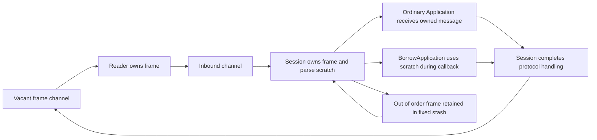

# Callback ownership correction

The fixed reader, parse scratch, validation scratch and raw-frame stash remain
the ordinary session path. Existing `Application` implementations now receive
owned incoming messages. `BorrowApplication(application)` explicitly permits
callback-scoped delivery; it changes only the ownership adapter, not the engine.

The owned adapter copies the validated raw frame once, copies field descriptors
into one slab and rebuilds ordinary section/group indexes. The raw buffer
descriptor lives with the owned message. The three section tag lists use disjoint
capacity-limited portions of one allocation. Callback edits remain visible to
subsequent protocol handling. Raw/getter/body aliases and dictionary group ranges
are preserved. No retained application message refers to an engine parse slot.



## Measurements

Go 1.25.3, darwin/arm64, Apple M4 Pro; one CPU, five one-second samples. Setup and
66-frame warm-up are outside timing. Each sample completes inbound processing,
sequence accounting and frame return. This deterministic reader fixture does not
measure a socket write or the full session round trip.

The initial correctness baseline copied and reparsed the owned frame. The same
benchmark then measured the final materializer. Apply
[`owned-reparse-control.patch`](owned-reparse-control.patch) to reproduce that
control; it restores only the ownership adapter. `git apply --check` passed.

| Inbound flow | Copy/reparse ns/op | Materialize ns/op | Before B/op / allocs | After B/op / allocs |
|---|---:|---:|---:|---:|
| Owned NewOrderSingle | 2,394–2,458 | 2,256–2,371 | 2,704 / 22 | 2,568 / 13 |
| Owned repeating groups | 4,757–4,880 | 4,412–4,521 | 5,240 / 31 | 4,904 / 19 |
| Borrowed NewOrderSingle | 1,175–1,205 | 1,200–1,230 | 0 / 0 | 0 / 0 |
| Borrowed repeating groups | 1,840–1,876 | 1,818–1,879 | 0 / 0 | 0 / 0 |

Sources: [correctness baseline](owned-reparse-before.txt), [final measurement](inbound-after.txt).
The compatible default still allocates. Its reductions are also real against the
original phase-5 allocating reader baseline: orders 2,671 B / 21 allocations to
2,568 B / 13; groups 5,208 B / 30 to 4,904 B / 19. Those older samples are in the
parent directory and are not a current timing comparison.

[`inbound-before.txt`](inbound-before.txt) records the previous unsafe callback
behavior at `23f58fe592c9699afa8f128924fc0ca4d2a93ec9`: 0/0 while silently reusing
ordinary callback messages. It is not a compatible baseline. Restoring ownership
adds the allocations listed above; zero allocation is qualified only with the
explicit borrowed handler contract and supported nonallocating operations.

The mandatory baseline ran before and after. All allocation columns are
identical: reused parsing and validation 0/0; legacy build 152 B/6; legacy framed
read 160 B/2; decimal overflow 168 B/5 remains excluded. See
[`baseline-before.txt`](baseline-before.txt) and [`baseline-after.txt`](baseline-after.txt).

```sh
GOTOOLCHAIN=auto rtk proxy go test . -run '^$' -bench '^BenchmarkAllocationBaseline$' -benchmem -benchtime=1s -count=5 -cpu=1
GOTOOLCHAIN=auto rtk proxy go test . -run '^$' -bench '^BenchmarkScopedInboundSession$' -benchmem -benchtime=1s -count=5 -cpu=1
```

## Correctness

Fixtures retain ordinary incoming pointers, shallow copies, raw/getter bytes and
nested groups across repeated ring reuse and disconnect/reconnect. Concurrent
reads of retained data run under the race detector. TestRequest callback edits
are checked in the resulting heartbeat. Eleven differential inputs cover groups,
embedded-SOH XML, duplicates, malformed group counts and accepted order anomalies.
The owned representation matches fixed parsing, including aliases and encoding.
Header/trailer grouping already differs between fixed and convenience parsing;
the materializer preserves the fixed parser's group ranges explicitly.

The first full suite exposed two internal reader tests that still assumed every
application received borrowed scratch. Those fixtures now explicitly select
`BorrowApplication`; the new legacy retention tests cover owned delivery.
[`tests-first-go1.23.12.txt`](tests-first-go1.23.12.txt) retains the initial failure.

Validation commands and final output:

| Check | Result | Evidence |
|---|---|---|
| Go 1.23.12 all packages, known Mongo logger suite excluded | PASS | [output](tests-go1.23.12.txt) |
| Go 1.23.12 vet | PASS, exit 0 | [output](vet-go1.23.12.txt) |
| Full core race suite, separate from benchmarks | PASS, 17.432 s | [output](race.txt) |

```sh
GOTOOLCHAIN=go1.23.12 rtk proxy go test ./... -skip '^TestMongoLogTestSuite$' -count=1
GOTOOLCHAIN=go1.23.12 rtk proxy go vet ./...
GOTOOLCHAIN=auto rtk proxy go test -race . -count=1
```

The pre-existing optional Mongo logger teardown failure remains documented in
phase 1 and is the only excluded suite. These results do not qualify the later
outbound/control boundary corrections or the deployed fix-server image.
