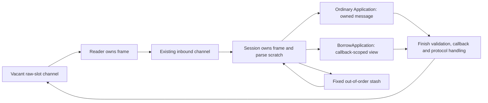

Ordinary sessions now frame into a fixed raw-slot ring, transfer ownership over
the existing inbound channel, and reuse session-owned parsing and validation
scratch. The default `Application` boundary preserves retained message pointers,
raw/getter bytes, shallow copies and groups. `BorrowApplication(application)`
explicitly permits callback-scoped delivery without the ownership copy. Both
contracts use the same engine, with no bounded-mode flag or benchmark-only path.

Stacked on #23. This is phase 5; completed output writes and resend journal
retention remain in #21 and full-session qualification in #22. The ownership
correction here does not qualify those later branches or the deployed FIX server.

The owned adapter copies the validated frame and descriptors once, preserving
raw/value aliases and dictionary group ranges without parsing twice. Protocol
handling uses that same owned message after the callback, so edits such as
TestReqID changes still affect the response.

Five one-second samples, one CPU, Go 1.25.3, darwin/arm64 M4 Pro; setup and
66-frame warm-up excluded. Every operation completes processing and slot return.

| Inbound flow | Correct copy/reparse control B/op / allocs | Final B/op / allocs | Final ns/op |
|---|---:|---:|---:|
| Owned NewOrderSingle | 2,704 / 22 | **2,568 / 13** | 2,256–2,371 |
| Owned repeating groups | 5,240 / 31 | **4,904 / 19** | 4,412–4,521 |
| Explicitly borrowed NewOrderSingle | 0 / 0 | **0 / 0** | 1,200–1,230 |
| Explicitly borrowed repeating groups | 0 / 0 | **0 / 0** | 1,818–1,879 |

Against the original phase-5 allocating reader, compatible owned orders fall
from 2,671 B/21 allocations to 2,568 B/13; groups from 5,208 B/30 to 4,904 B/19.
The previous candidate's zero rows silently shortened callback lifetime and are
not compatible default-path evidence. The default ownership adapter allocates;
the library as a whole is not claimed zero allocation.

The mandatory `BenchmarkAllocationBaseline` ran before and after with every
allocation column unchanged. This inbound fixture does not measure TCP output
or full-session latency. [Commands, raw samples, reproducible control patch,
ownership contract and tests](https://github.com/railbirdexchange/quickfix/blob/perf/bounded-inbound-ownership/benchmarks/zero-allocation/phase-5/callback-boundary/README.md).

Defaults remain 16 KiB frames, 512 fields, 128 group entries, depth 8, 32 stashed
frames and `min(InChanCapacity, 32)` queued frames. Exhausted raw slots apply
backpressure. Parse/stash limit failures disconnect before input sequence/store
effects; capacity failures preserve state even with ResetOnDisconnect enabled.
No pool, reference count, new hot-path mutex, silent eviction or dependency.
Legacy allocating stores/loggers/convenience APIs remain outside the guarantee.

Go 1.23.12 all-package tests and vet pass; full core race suite passes separately.
Coverage includes retained callback data across slot reuse and reconnect,
concurrent retained reads, callback edits affecting responses, framing limits,
slow consumers, cancellation, stash replay, capacity-state atomicity and eleven
representation/alias differential fixtures. The pre-existing optional Mongo
logger teardown failure is documented separately in phase 1 and is the sole
suite exclusion. No Mongo code changed.
