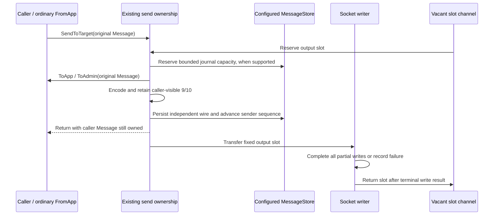

# Phase 6: ordinary outbound ownership and retained recovery

Ordinary `SendToTarget` prepares the original caller-owned `Message`
synchronously, encodes into a fixed session output slot, and transfers only
independent wire bytes to the writer. Existing `Application` callbacks and send
signatures remain in use. There is no alternate builder or outbound mode flag.

The current [callback ownership qualification](callback-boundary/README.md)
preserves ordinary callback lifetimes. Completed ordinary sends now measure
88 B/4 allocations for NewOrderSingle and 96 B/4 for groups/custom types,
down from the original compatible 343 B/20, 551 B/22 and 503 B/24 baselines.
Explicit `BorrowApplication` delivery measures 0 B/0 allocations through the
same engine. The older zero-allocation candidate rows and source hashes below
are historical: they preceded the callback-lifetime correction and do not
qualify the current default ownership contract.



The sender uses the existing send/resend locks. The writer returns slots directly
through a channel and never needs those locks or session event-loop dispatch.
Ordinary `FromApp -> SendToTarget` therefore retains synchronous preparation.
Socket completion is distinct from queue admission.

## Limits, retention and compatibility

| Setting or resource | Default / measured configuration |
|---|---:|
| `OutboundFrameQueueCapacity` | 32 pending frames |
| Fixed output slots | queue capacity + 1 = 33 |
| `BoundedMaxFrameBytes` | 16,384 bytes, shared inbound/output bound |
| `OutboundWriteTimeout` | 30 seconds per complete frame |
| `SocketOutboundBufferSize` | existing setting, capped at pending capacity; zero remains unbuffered |
| Measured store factory | `NewBoundedStoreFactory(1024, 16384)` |
| Fixed journal bytes | 16 MiB |
| Resend parse limits | 512 fields, 128 group entries, nesting depth 8 |

Frame/queue capacity is reserved before header sequence assignment, callbacks,
or persistence. An oversized frame returns `ErrBufferTooSmall`; a full output
ring returns `ErrOutboundCapacity`. The bounded journal reserves capacity before
mutation. These failures preserve committed sender/target and retained bytes;
they do not trigger a secondary Logout or `ResetOnDisconnect` reset. Logon
resets remain staged until encoding succeeds. A failed scheduled rollover keeps
its reset intent across ticks/disconnect and retries through an admitted Logon.
Before a prepared journal commit, capacity-only parsing of the encoded frame
also enforces the configured field/group/depth bounds. Semantic parse errors do
not introduce new outgoing dictionary validation. Valid retained frames therefore
fit the replay scratch limits as well as the output byte capacity.
Generic store failures retain the configured store's existing failure semantics;
the public store interface cannot make arbitrary Reset-plus-Save transactional.

`BoundedStore` is a fixed in-memory `MessageStore` implementation with a resend
journal, not crash-durable persistence. Existing durable stores
are never replaced. A direct bounded store accepts prepared commits; decorators,
including ones embedding it, continue through their public Save/Reset overrides.
Other stores receive owned bytes. Retaining stores such as the unbounded
`MemoryStore` remain compatible and allocate outside this measurement's guarantee.

Journal capacity bounds a sequence window beginning at the explicit recovery
floor, including gaps. Reservation and lookup use a fixed sequence-indexed ring;
entries are never evicted. Only independently acknowledged `RetireBefore` or an
explicit reset releases history. Socket completion alone is not acknowledgement.
Out-of-window replay fails before target advancement. The configured store's
iteration remains authoritative. Replay preserves original body/group ordering,
original sending time, PossDup, callback header edits and veto/gap-fill behavior.

Bounded-store sequence getters and independent target operations are atomic.
Sender/journal operations use existing engine serialization. Direct store
mutation, retirement and creation-time access require a quiescent owner;
external administrative resets must not race an inbound transaction.
`SetNextSenderMsgSeqNum` serializes with send/resend and must run outside send
callbacks. No new hot mutex, pool, reference count, dependency or slice growth
is introduced.

The caller's `Message` remains usable/mutable after Send returns; the writer
never holds it. Ordinary `ToApp` and `ToAdmin` receive the original pointer.
Previously returned engine scalar byte views stay valid across later sends;
each new scalar owns separate wire/getter bytes. Ordinary resend callbacks
receive an owned message whose raw bytes, fields and groups survive replay
completion and journal reuse. `BorrowApplication` explicitly substitutes a
callback-scoped lifetime for engine-owned messages, and permits engine-field
views on caller-created outgoing messages to be reused on later sends. This
wrapper changes the ownership boundary, not engine routing. Ordinary body
setters and fresh construction still allocate in this phase.

Logging finishes before slot transfer. Existing synchronous borrowed logging can
consume bytes directly; arbitrary legacy loggers receive owned copies. Logging,
callbacks, observers and persistence remain enabled. Disabled send observation
avoids clock reads and message-type string construction; enabled observers keep
the existing synchronous event contract.

Disconnect joins readers/writers and reclaims slots before reuse. Partial,
zero-progress and terminal write failures preserve committed journal state
because receipt is uncertain. Successful teardown keeps ResetOnDisconnect
behavior. Resend may exceed the ring depth: the writer returns capacity
independently, and writer failure propagates before target advancement.

## Historical controlled evidence (superseded callback contract)

This section records the original measurement pair. Its zero-allocation
candidate silently borrowed callback-visible storage and is not a compatible
default implementation. Use the [current evidence](callback-boundary/README.md)
for corrected owned and explicitly borrowed results. The original allocating
baseline below remains the compatible allocation-reduction reference.

The isolated pair uses ordinary inbound parent `afbd0127`; later phase-5 latency
commits are deliberately excluded. Both sides use the same harness and inputs.
The superseded opt-in experiment's original files remain for provenance; its
builder measurements do not qualify the ordinary runtime described here.

```sh
GOTOOLCHAIN=auto rtk proxy go test . -run '^$' -bench '^BenchmarkAllocationBaseline$' -benchmem -benchtime=1s -count=5 -cpu=1
GOTOOLCHAIN=auto rtk proxy go test . -run '^$' -bench '^BenchmarkScopedOutboundSession$' -benchmem -benchtime=1s -count=5 -cpu=1
```

The ordinary harness includes reused Message preparation, ordinary ToApp,
encoding, persistence, completed write, slot return, peer parsing and explicit
retirement after peer processing. It preloads 1,023 of 1,024 journal entries and
warms all 33 output slots twice outside timing. The fixed peer sink copies every
byte before Write returns; each timed operation ends after write completion and
ownership return. It is a completed-write component measurement, not actual TCP,
the full inbound session, or round-trip latency. The group case preserves/parses
group wire data; it does not invoke allocating legacy GetGroup or build a
variable response body.

Before evidence: [original baseline](scoped-before-go1.25.3.txt),
[ordinary completed writes](scoped-session-before-go1.25.3.txt).
After evidence: [original baseline](scoped-after-go1.25.3.txt),
[ordinary completed writes](scoped-session-after-go1.25.3.txt).

Go 1.25.3, Apple M4 Pro, CPU=1, five repetitions:

| Historical completed-write flow | Before ns/op | Before B/op | Before allocs/op | Incompatible candidate ns/op | Candidate B/op | Candidate allocs/op |
|---|---:|---:|---:|---:|---:|---:|
| NewOrderSingle | 2,958–3,038 | 343 | 20 | 1,950–2,081 | 0 | 0 |
| Repeating group | 3,959–4,075 | 551 | 22 | 3,061–3,321 | 0 | 0 |
| Long custom message type | 2,963–3,043 | 503 | 24 | 1,950–2,078 | 0 | 0 |

The mandatory baseline preserves the earlier allocation results. These cases
do not measure the new ordinary outbound ownership path:

| Baseline flow | Before ns/op | After ns/op | B/op before → after | allocs/op before → after |
|---|---:|---:|---:|---:|
| Decimal, short | 11.26–11.73 | 11.70–12.13 | 0 → 0 | 0 → 0 |
| Decimal, signed fraction | 27.52–28.67 | 29.12–29.51 | 0 → 0 | 0 → 0 |
| Decimal, maximum uint128 | 54.55–56.05 | 54.53–60.82 | 0 → 0 | 0 → 0 |
| Decimal, arbitrary-precision overflow | 320.2–327.4 | 321.5–333.2 | 168 → 168 | 5 → 5 |
| Parse, no dictionary | 370.4–380.3 | 370.5–376.3 | 0 → 0 | 0 → 0 |
| Parse with dictionary | 442.5–451.1 | 438.6–449.2 | 0 → 0 | 0 → 0 |
| Parse with repeating group | 869.6–895.5 | 859.5–873.6 | 0 → 0 | 0 → 0 |
| Validate NewOrderSingle | 868.2–879.2 | 855.1–876.5 | 0 → 0 | 0 → 0 |
| Legacy build NewOrderSingle | 746.8–769.8 | 753.3–916.1 | 152 → 152 | 6 → 6 |
| Legacy framed read | 109.5–110.7 | 108.6–109.9 | 160 → 160 | 2 → 2 |

Both complete after commands passed: mandatory baseline in 79.494 seconds and
ordinary completed writes in 20.541 seconds. CPU-heavy qualification work was
serialized. A prior baseline run was interrupted; its
[partial diagnostic output](scoped-diagnostic-interrupted-after-go1.25.3.txt.gz)
is excluded from every result above. The complete mandatory command was rerun
from its first case.

The unchanged harness SHA-256 values within that historical pair were:

| File | SHA-256 |
|---|---|
| `allocation_baseline_test.go` | `ad521a9f8acb7bea2afed51f7ae1de23d68dd95379fcbc7f2f5489d68b3dd78a` |
| `scoped_outbound_benchmark_test.go` | `9cadc954f11c1284760eec13eba8abd6b1f282a86ed46822561c4a9a5eaa23fb` |

The [historical source manifest](scoped-qualified-source.sha256) records root Go
sources/tests and `config/bounded.go` at isolated phase-6 commit
`74902566548297bfdcb598962654a69333b10a2b`, measured on 2026-10-16; its
[post-measurement verification](scoped-qualified-source-check.txt) passed.
That isolated candidate retains the phase-5 `afbd0127` parent. Its evidence
does not include the later inbound latency changes.

These completed-write results exceed one microsecond. Full inbound-to-completed-
write qualification and variable response construction remain phase-7 work;
the whole library is not claimed to be allocation-free.

## Historical correctness qualification

These checks predate the newly added retained-callback regression fixtures.
Current Go 1.23.12 package tests/vet and the full core race run (19.389 seconds)
are recorded in the [callback ownership qualification](callback-boundary/README.md#correctness-qualification).

Fixtures cover partial/zero-progress writes, buffered/unbuffered completion,
slow-consumer ownership, full rings, journal bounds/aborts, reset atomicity,
callback pointer identity and tag34 edits, observable 9/10, stale encoded header
identity canonicalization, detached copies, retaining stores/loggers, decorators,
FromApp sending, reconnect, replay beyond ring capacity, short-range writer
failure, Logout/gap-fill errors, and scheduled reset retry/preservation.

```sh
GOTOOLCHAIN=go1.23.12+auto rtk proxy go test ./... -skip '^TestMongoLogTestSuite$' -count=1
GOTOOLCHAIN=go1.23.12+auto rtk proxy go vet ./...
GOTOOLCHAIN=auto rtk proxy go test -race . -count=1
```

The [Go 1.23.12 package suite](scoped-tests-go1.23.12.txt) passed, including the
core package in 8.026 seconds. [Go 1.23.12 vet](scoped-vet-go1.23.12.txt) exited
successfully without diagnostics. The [full core race run](scoped-race.txt)
passed in 18.506 seconds. That historical source was unchanged after those
checks and through both historical after measurements.
`TestOrdinaryOutboundWarmedAllocations` exercises
100 completed ordinary sends per scenario after visiting every output slot.

The existing Mongo logger environment failure remains documented in
[phase 1](../phase-1/README.md#existing-optional-mongo-logger-test-failure). Only
that suite is skipped. Race/correctness checks are separate from performance.

## Historical combined qualification with phase-5 latency changes

The zero-allocation rows and manifests in this section also predate the
callback-lifetime correction. They describe the incompatible prior candidate,
not the current ordinary ownership contract.

On 2026-10-16, phase-5 commit
`23f58fe592c9699afa8f128924fc0ca4d2a93ec9` was merged into the qualified isolated
phase-6 commit `74902566548297bfdcb598962654a69333b10a2b`. This section measures
that combined source, without replacing the isolated before/after evidence.
The merge retains the private session validator and canonical timestamp fast
path, and keeps phase-6 scheduled reset retry/preservation. The nil-schedule
clock optimization still calls `CheckSessionTime` for lifecycle transitions.

The [combined Go 1.23.12 package suite](combined-tests-go1.23.12.txt) passed
(core 7.616 seconds), [vet](combined-vet-go1.23.12.txt) exited successfully
without diagnostics, and the [full core race run](combined-race.txt) passed
in 18.967 seconds. The same Mongo logger suite was excluded.

```sh
GOTOOLCHAIN=auto rtk proxy go test . -run '^$' -bench '^BenchmarkAllocationBaseline$' -benchmem -benchtime=1s -count=5 -cpu=1
GOTOOLCHAIN=auto rtk proxy go test . -run '^$' -bench '^BenchmarkScoped(Inbound|Outbound)Session$' -benchmem -benchtime=1s -count=5 -cpu=1
```

Both commands passed: [mandatory baseline](combined-after-go1.25.3.txt) in
80.010 seconds and [ordinary session components](combined-sessions-after-go1.25.3.txt)
in 31.918 seconds. CPU-heavy work remained serialized. Go 1.25.3, Apple M4 Pro,
CPU=1, five repetitions:

| Historical component (borrowed lifetimes) | ns/op | B/op | allocs/op |
|---|---:|---:|---:|
| Inbound NewOrderSingle | 1,267–1,356 | 0 | 0 |
| Inbound repeating group | 2,005–2,064 | 0 | 0 |
| Completed outbound NewOrderSingle | 2,000–2,169 | 0 | 0 |
| Completed outbound repeating group | 3,119–3,317 | 0 | 0 |
| Completed outbound long custom message type | 1,947–2,011 | 0 | 0 |

The combined mandatory baseline remains 0 B/op and 0 allocs/op for decimal
fast parsing, reused parsing and validation. Its parser ranges are
364.8–370.8 ns without a dictionary, 433.5–445.6 ns with a dictionary, and
815.4–873.8 ns with groups; public validation is 668.7–691.6 ns. Legacy build
remains 152 B/6 allocations, legacy framed read 160 B/2, and decimal overflow
168 B/5.

All three benchmark harnesses were unchanged within that historical comparison.
The historical inbound harness SHA-256 is
`a2131b006ab16692bdd54b072d95456aac5179ae04311ba4568f2178e9101e26`;
baseline and outbound hashes are listed above. The
[combined source manifest](combined-qualified-source.sha256) and
[post-measurement verification](combined-qualified-source-check.txt) identify
the exact tested source separately from commit `74902566`'s isolated manifest.

The combined inbound samples are higher than phase-5-only measurements
(1,199–1,237 ns for orders and 1,871–1,938 ns for groups). These are separate
component measurements and do not establish complete-session or TCP latency.
The one-microsecond target is still unmet, and full ordinary inbound-to-completed-
write qualification remains required.
