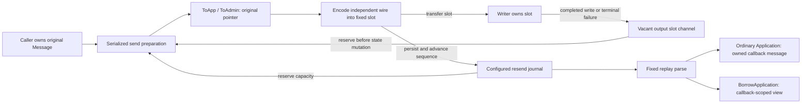

# Phase 6: compatible outbound callback ownership

The ordinary outbound engine uses fixed output slots while preserving the
existing `Application` lifetime contract. `ToApp` and `ToAdmin` receive the
original caller-created `Message`; sending does not transfer that object to the
writer. Previously returned engine-field byte slices stay valid across later
sends. Ordinary resend callbacks receive an owned message whose raw bytes,
fields and groups survive replay completion and journal reuse.

The earlier candidate silently reused those callback-visible bytes. That was a
compatibility defect, even though its benchmark reported zero allocations.
This correction copies each engine-generated scalar's wire and getter bytes
into separate regions of one owned allocation. Replay first performs the same
bounded parse, then materializes an owned callback message from that parsed
representation. It preserves the original retained wire body and group order,
callback header edits, rejection and gap-fill behavior.

`BorrowApplication(application)` explicitly declares callback-scoped use of
engine-owned messages. It changes ownership at the callback boundary, not engine
routing: output slots, bounded parsing, persistence and the writer are shared.
Incoming, generated admin and replay messages must not escape a borrowed
callback. Caller-created outgoing messages remain caller-owned, but their
engine-field byte views must not be retained across later sends with this
wrapper. Ordinary applications require no wrapper or signature change.



For ordinary sends, owned scalar bytes remain with the caller's message after
the sender returns. The writer never holds the caller's message. For replay,
the owned delivery remains valid after the scratch slot is reset; an explicit
borrowed delivery ends at callback return. Socket completion releases an output
slot, not resend history. History is retired only through the store's explicit
recovery-floor or reset operations.

## Allocation reduction and current measurements

The compatible allocating baseline is the original phase-6 implementation in
[scoped-session-before-go1.25.3.txt](../scoped-session-before-go1.25.3.txt).
The final ordinary callback path still reduces allocations against that
baseline:

| Completed-write flow | Original B/op | Original allocs/op | Current owned B/op | Current owned allocs/op |
|---|---:|---:|---:|---:|
| NewOrderSingle | 343 | 20 | 88 | 4 |
| Repeating group | 551 | 22 | 96 | 4 |
| Long custom message type | 503 | 24 | 96 | 4 |

These original and current samples are separate qualification runs with
intervening inbound changes. The allocation comparison does not isolate a
latency improvement caused by this callback correction.

Current [completed-write evidence](outbound-after.txt), Go 1.25.3,
darwin/arm64, Apple M4 Pro, CPU=1, five one-second repetitions:

| Completed-write flow | Owned ns/op | Owned B/op / allocs/op | Explicitly borrowed ns/op | Borrowed B/op / allocs/op |
|---|---:|---:|---:|---:|
| NewOrderSingle | 1,867–1,946 | 88 / 4 | 1,820–1,863 | 0 / 0 |
| Repeating group | 2,962–3,018 | 96 / 4 | 2,886–2,923 | 0 / 0 |
| Long custom message type | 1,851–1,880 | 96 / 4 | 1,780–1,838 | 0 / 0 |

The [immediate pre-correction samples](outbound-before.txt) at `c41682e9`
reported 0 B/op and 0 allocs/op while violating the default callback lifetime.
They are retained as evidence of the incompatible prior candidate, not as a
compatible allocation baseline. The owned correction adds four allocations in
these fixtures relative to that unsafe candidate. The new `/owned` and
`/borrowed` benchmark names make the lifetime distinction explicit.

## Harness and configured limits

Both delivery cases use ordinary `SendToTarget`, the same reused caller-owned
message, normal callbacks, header preparation, persistence, encoding and writer.
The fixed peer sink copies every byte before `Write` returns. Each operation
waits for write completion and output-slot return, parses the received frame,
then explicitly retires acknowledged history. Queue admission alone is never
counted as a completed write.

Setup preloads 1,023 of 1,024 journal entries. All 33 output slots are warmed
twice outside the timed loop. The group fixture preserves and parses group wire
data; it does not invoke allocating legacy `GetGroup` or construct a variable
response body inside the timed loop. These rows measure ordinary sends;
retained replay lifetime is covered by correctness tests, not a resend timing
claim.

| Resource | Configuration |
|---|---:|
| Pending output capacity | 32 frames |
| Output slots | 33 |
| Maximum frame | 16,384 bytes |
| Complete-frame write timeout | 30 seconds |
| Store | `NewBoundedStoreFactory(1024, 16384)` |
| Fixed journal bytes | 16 MiB |
| Replay bounds | 512 fields, 128 group entries, depth 8 |

Output and journal capacity are reserved before sequence assignment, callbacks
or persistence. Exhaustion returns an error before committed sequence/store
state changes. The bounded journal never silently evicts retained messages.
It is in-memory storage, not crash-durable persistence. Existing stores and
loggers retain their configured behavior; retaining implementations receive
owned bytes where required. The complete capacity and failure contract is in
the [phase-6 overview](../README.md#limits-retention-and-compatibility).

The same controlled commands were run before and after the correction, with
CPU-heavy work serialized:

```sh
GOTOOLCHAIN=auto rtk proxy go test . -run '^$' -bench '^BenchmarkAllocationBaseline$' -benchmem -benchtime=1s -count=5 -cpu=1
GOTOOLCHAIN=auto rtk proxy go test . -run '^$' -bench '^BenchmarkScopedOutboundSession$' -benchmem -benchtime=1s -count=5 -cpu=1
```

The mandatory [before](baseline-before.txt) and [after](baseline-after.txt)
results preserve every allocation count:

| Mandatory baseline flow | B/op before → after | allocs/op before → after |
|---|---:|---:|
| Decimal short / signed fraction / maximum uint128 | 0 → 0 | 0 → 0 |
| Decimal arbitrary-precision overflow | 168 → 168 | 5 → 5 |
| Reused parse without dictionary | 0 → 0 | 0 → 0 |
| Reused parse with dictionary | 0 → 0 | 0 → 0 |
| Reused parse with repeating group | 0 → 0 | 0 → 0 |
| Validate NewOrderSingle | 0 → 0 | 0 → 0 |
| Legacy build NewOrderSingle | 152 → 152 | 6 → 6 |
| Legacy framed read | 160 → 160 | 2 → 2 |

The mandatory commands passed in 78.857 seconds before and 78.841 seconds
after. The outbound commands passed in 19.155 seconds before and 39.247 seconds
after; the latter includes both delivery contracts. Timing variation remains in
the raw samples; unchanged allocation counts do not mean unchanged latency.

## Correctness qualification

The [pre-fix regression output](ownership-before.txt) demonstrates the lifetime
defect: a saved sequence getter changed from `1024` to `1025` on a later send,
and retained replay raw bytes were replaced when replay scratch was reset.
The same focused ownership checks [pass after the correction](ownership-after.txt).

`TestOutboundLegacyRetainedGettersSurviveRepeatedSends` verifies original caller
pointer identity in both `ToApp` and `ToAdmin`, and saved sequence, timestamp,
last-processed sequence, BodyLength and checksum bytes across second and third
sends. Mutating an old getter cannot alter the current field or encoded wire,
including when scalar values happen to be equal between sends.

`TestOutboundLegacyReplaySurvivesJournalReuseAndAnotherResend` retains the
replay message, raw bytes, field views and group data through completed resend,
explicit journal retirement, reuse of the same journal entry, and a second
resend. It also verifies that callback convenience-field/group edits preserve
the original persisted replay body. Fixtures wait for actual writes and slot
return and validate BodyLength and checksum.

Existing tests retain coverage of callback rejection/veto, header mutation,
partial writes, slow consumers, capacity exhaustion, store/logger retention,
reset atomicity, disconnect/reconnect and replay beyond the output ring depth.

```sh
GOTOOLCHAIN=go1.23.12+auto rtk proxy go test ./... -skip '^TestMongoLogTestSuite$' -count=1
GOTOOLCHAIN=go1.23.12+auto rtk proxy go vet ./...
GOTOOLCHAIN=auto rtk proxy go test -race . -count=1
```

The [Go 1.23.12 package suite](tests-go1.23.12.txt) passed, including the core
package in 7.654 seconds. [Go 1.23.12 vet](vet-go1.23.12.txt) passed without
diagnostics. The [full core race run](race.txt) passed in 19.389 seconds.
Race and correctness work ran separately from performance measurement.
Only the previously reproduced Mongo logger teardown failure is excluded from
the package suite; its environment evidence remains in
[phase 1](../../phase-1/README.md#existing-optional-mongo-logger-test-failure).
This correction does not change Mongo logging.

These are completed-write component measurements with a fixed peer sink, not
TCP, full-session FIX-server load-test or deployment results. They exceed one
microsecond. The default ownership boundary allocates; the explicit borrowed
fixtures measure zero allocations within the configured limits. Unbounded
stores, allocating loggers, arbitrary-precision decimal overflow, ordinary
body construction and legacy convenience APIs remain outside that guarantee.
No validation, persistence, resend handling or logging was removed.
