# Phase 7: ordinary construction, control scopes and full-session qualification

This phase removes allocation from changing ordinary outgoing fields and from
ordinary session control/recovery work. The application still implements
`Application` and calls `SendToTarget` with its own reusable `Message`. Fixed
session storage is configured by default. The complete limits, ownership,
lifetime and exhaustion contract is in
[ZERO_ALLOCATION.md](../../../ZERO_ALLOCATION.md).

Before source: `c41682e932a1429906c5786c6929a3f41918e485`.
Frozen candidate source: `0572f01bace8c2edce06c8fb6fa225f96de4f00f`.
Performance host: Apple M4 Pro, darwin/arm64, Go 1.25.3, October 16, 2026.
Compatibility checks use Go 1.23.12. Frozen-source correctness, race, exact
allocation checks, the seven-scenario full TCP benchmark, the mandatory baseline
and individual completion-latency benchmark have passed. All warmed full-session
AFTER samples report 0 B/op and 0 allocs/op. Candidate diagnostic results below
are identified separately. The sub-microsecond latency target remains unmet.

The current ordinary-path evidence uses the `scoped-` filename prefix. Earlier
unprefixed phase-7 logs describe the superseded borrowed-builder implementation
and different operation units. They remain historical diagnostics; their zero
rows do not qualify this ordinary API implementation. The benchmark's retained
name, `BenchmarkBoundedFullSession`, does not select an alternate production path.

## Runtime changes

A caller-owned message attaches a fixed arena on its second ordinary send.
Subsequent scalar updates reuse its wire and getter-value planes, stage
overlapping inputs before moves and enforce the complete frame/field budget.
Changing ClOrdID, ExecID and quantities therefore no longer constructs temporary
scalar field slices. Getter-byte mutation preserves the existing separation
between a getter value and already encoded wire. Capacity errors are atomic and
remain latched across unrelated section initialization, assignment and copying.

One session-owned control cell builds heartbeat, TestRequest, Logon, Logout,
ResendRequest, gap-fill and reject messages through the original callbacks. It
stays acquired through synchronous callback and encoding. Its private original
representation is restored before reuse, so callback section/whole-message
replacement cannot transfer ownership of foreign storage to recycling. Internal
copies of request identifiers, routing fields, reject references and original
time have independent getter and wire bytes. Nested control acquisition fails
before modifying the active cell.

The session's fixed resend cursor supplies one stable store visitor instead of a
new escaping closure/message on every ResendRequest. Recovery and timeout cells,
direct byte/scalar checks and fixed event scratch preserve the original reject,
callback, persistence and logging behavior. Missing optional fields are checked
for presence before reading them, avoiding construction of discarded rejects.

## Ownership and fixed profile

```mermaid
flowchart LR
    FreeIn[Vacant frame] --> Reader[Reader owns frame]
    Reader -->|input channel| Session[Session owns frame and parse scratch]
    Session -->|out of order| Stash[Retained frame stash]
    Stash -->|ordered replay| Session
    Session -->|processing or discard complete| FreeIn
    Session --> Callback[Ordinary application callback]
    Callback --> Message[Caller-owned reusable response]
    Message --> Send[Synchronous SendToTarget]
    Control[Session-owned control cell] --> Send
    Send --> Reserve[Reserve output and journal capacity]
    Reserve --> Encode[Callback and encoding into output slot]
    Encode --> Commit[Commit sequence and independent journal copy]
    Commit -->|writer channel| Writer[Writer owns output slot]
    Writer -->|complete write returns| FreeOut[Vacant output slot]
    Commit --> Journal[Retained journal bytes]
    Peer[Peer validates and acknowledges] --> Retire[Session owner retires acknowledged history]
    Journal --> Retire
```



The measured profile uses FIX44 dictionary validation, `NewNullLogFactory`,
`NewBoundedStoreFactory(1024, 16384)`, `InChanCapacity=32`,
`InboundFrameQueueCapacity=32`, `SocketOutboundBufferSize=32` and
`OutboundFrameQueueCapacity=32`. Default parse limits are 16,384 frame bytes,
512 complete-wire fields, 128 group entries and depth 8. The stash holds 32
frames; there are 66 raw inbound slots and 33 output slots. The complete-write
timeout is the ordinary 30-second default.

Raw frame storage is 1,081,344 inbound bytes and 540,672 output bytes; the journal
byte arena is 16 MiB, plus metadata and parser/validator scratch. A default caller
arena has an illustrative cold construction cost of 440,840 B / 54 allocations
in [the construction fixture](construction-cold-go1.25.3.txt), versus 1,688 B /
31 allocations without it. The control cell owns another arena of the same kind
and 32,786 bytes of text/event buffers plus fixed engine-field scratch. These
setup costs are explicit and are excluded from warmed measurements.

An incoming callback borrows its message and bytes until return. `CopyInto` and
string/convenience APIs can produce owned copies and allocate. Outgoing caller
messages remain caller-owned after synchronous encoding; writer slots are
independent. No new application callback interface, builder lease or send method is needed.
Repeated `NewMessage`, legacy `GetGroup`/per-request group construction,
allocating handlers/loggers/observers and unbounded stores are outside the
measured zero-allocation path. The group case includes dictionary/nested-group
validation and ordinary count access; it does not hide a per-request legacy
`GetGroup` allocation inside the guarantee.

`BoundedStore` supplies process-local persistence, not crash durability. Other
configured stores retain their public persistence callbacks and owned-copy
behavior. Output exhaustion returns `ErrOutboundCapacity` before the failing
send changes sender sequence or journal; input vacant-slot exhaustion
backpressures the reader. Journal exhaustion returns `ErrJournalFull`, and
unavailable history returns `ErrJournalRangeUnavailable`, without eviction.
If the application handles a send-capacity error and returns `nil`, normal input
target advancement still occurs. The slow-consumer fixture retries the failed
business ID under a new inbound FIX sequence after capacity returns.

## Real TCP measurement and operation units

The harness runs the production reader, session loop and writer over real
loopback TCP. Its ordinary handler updates response tags 11/37 with `SetBytes`
and 17/38/151 with `SetInt` on every request. Groups 453/802 are validated on each
input, and static response groups are constructed before timing. The peer
independently validates dictionaries, BodyLength/checksum, group bytes, changing
identifiers/quantities and replay body contents.

Before measurement, actual responses fill and read all 1,024 journal entries;
66 single-request cycles visit all input slots and rotate the 33 output slots.
Resend and heartbeat paths also warm. Sequence counters continue above 1,024
without resets. Setup, Logon, warm-up, reconnect setup and cleanup are untimed.

Every cycle includes peer ACK processing, completed writes, output-slot return
and acknowledged journal retirement. On the session owner, the ACK handler waits
for all 33 output slots, calls `RetireBefore(acknowledged+1)` and publishes a
copied checkpoint. The original request's raw slot has returned before this ACK
is processed. The fixture's tag-369 ACK agreement establishes receipt; a socket
write or an arbitrary counterparty's tag 369 alone does not establish that
retention policy.

| Scenario | One benchmark operation |
|---|---|
| `ordinary` | 32 requests/responses, followed by the completion ACK |
| `groups` | 32 grouped requests/responses, followed by the completion ACK |
| `outbound_resend` | 40 original responses, ResendRequest and all 40 exact-body replays |
| `inbound_gap` | Two ordered responses after out-of-order retention and server ResendRequest |
| `slow_consumer` | 33 accepted 8 KiB responses, rejection of the 34th send, drain and successful retry of its business ID |
| `warmed_post_reconnect` | 32 grouped requests after untimed reconnect and another warm-up |
| `heartbeat_test_request` | Peer TestRequest, server heartbeat and completion ACK |

The slow-consumer fixture gates an actual TCP `Write`, observes output
exhaustion, fingerprints all retained bytes and sequence state around the
rejected send, then releases the writer and validates accepted bytes over TCP.
Its gate and fingerprint checks are included in its cycle cost. Batch costs are
throughput measurements; dividing them by 32 does not produce per-request
latency percentiles.

## Controlled full-session results

The [BEFORE source record](scoped-full-session-before-source.txt) and
[frozen AFTER source record](scoped-full-session-after-source.txt) pin production
commits and commands. The four ordinary harness files are identical on both
sources; [their SHA-256 manifest](scoped-full-session-harness.sha256) and the
[separate latency manifest](scoped-full-session-latency-harness.sha256) identify
the exact test inputs. Runs use one CPU and five 1-second samples, without other
Go test/build workloads competing for the host.

| Full TCP cycle | Before ns/op range | After ns/op range | Before B/op | Before allocs/op | After B/op / allocs/op |
|---|---:|---:|---:|---:|---:|
| Ordinary, 32 requests | 273,207–283,822 | 271,715–295,605 | 3,471–3,482 | 344–345 | 0 / 0 |
| Groups, 32 requests | 309,321–327,731 | 309,526–318,741 | 3,461–3,470 | 344 | 0 / 0 |
| Outbound resend, 40 original + 40 replay | 1,499,570–1,539,629 | 1,519,551–1,874,730 | 5,696–5,713 | 535–536 | 0 / 0 |
| Inbound gap | 85,214–86,911 | 83,016–94,543 | 3,875–3,876 | 70 | 0 / 0 |
| Slow consumer | 12,911,283–13,668,405 | 12,521,186–12,924,631 | 334,040 | 350 | 0 / 0 |
| Warmed post-reconnect, 32 requests | 310,365–335,093 | 308,564–315,545 | 3,486–3,493 | 345–346 | 0 / 0 |
| Heartbeat/TestRequest | 44,366–46,327 | 42,580–51,147 | 3,432 | 42 | 0 / 0 |

[Raw BEFORE](scoped-full-session-before-go1.25.3.txt) and
[AFTER](scoped-full-session-after-go1.25.3.txt) full-session results both end with
PASS; the final AFTER capture completed in 146.867 seconds. All 35 AFTER samples
report 0 B/op and 0 allocs/op. Timing ranges overlap, and some AFTER maxima are
higher, especially resend. These results establish the allocation reduction;
they do not establish a uniform CPU or network-latency improvement.

The mandatory [BEFORE allocation baseline](scoped-allocation-baseline-before-go1.25.3.txt)
and [AFTER baseline](scoped-allocation-baseline-after-go1.25.3.txt) both passed
(79.308 and 80.498 seconds respectively). All five samples preserve these
allocations:

| Controlled baseline flow | Before B/op / allocs/op | After B/op / allocs/op |
|---|---:|---:|
| Decimal, short/signed fraction/max uint128 | 0 / 0 | 0 / 0 |
| Decimal, arbitrary-precision overflow | 168 / 5 | 168 / 5 |
| Reused parse, no dictionary | 0 / 0 | 0 / 0 |
| Reused parse, dictionary | 0 / 0 | 0 / 0 |
| Reused parse, repeating group | 0 / 0 | 0 / 0 |
| Validate NewOrderSingle | 0 / 0 | 0 / 0 |
| Legacy standalone build convenience API | 152 / 6 | 152 / 6 |
| Legacy standalone framed-read API | 160 / 2 | 160 / 2 |

The legacy build/read rows exercise their compatibility APIs. The ordinary
session measured above uses its fixed output and input slots. Decimal overflow
and allocating convenience calls retain their stated exclusion from the warmed
session guarantee.

```sh
GOTOOLCHAIN=auto rtk proxy go test . -run '^$' -bench '^BenchmarkAllocationBaseline$' -benchmem -benchtime=1s -count=5 -cpu=1
GOTOOLCHAIN=auto rtk proxy go test . -run '^$' -bench '^BenchmarkBoundedFullSession$' -benchmem -benchtime=1s -count=5 -cpu=1 -timeout=10m
```

## Exact allocation totals

Rounded B/op and allocs/op can hide sparse allocations. The separate
`TestBoundedFullSessionExactAllocations` measures whole-process `Mallocs` and
`TotalAlloc` deltas over 100 completed warmed cycles, with `GOMAXPROCS=1`, setup
and assertions outside the interval. Both deltas must be exactly zero. The
BEFORE assertions intentionally fail:

| Scenario, 100 cycles | Before total allocations | Before total bytes | After total allocations / bytes |
|---|---:|---:|---:|
| Ordinary | 25,600 | 204,800 | 0 / 0 |
| Groups | 25,600 | 204,800 | 0 / 0 |
| Outbound resend | 44,800 | 430,400 | 0 / 0 |
| Inbound gap | 6,600 | 380,000 | 0 / 0 |
| Slow consumer | 35,000 | 33,404,000 | 0 / 0 |
| Warmed post-reconnect | 25,600 | 204,800 | 0 / 0 |
| Heartbeat/TestRequest | 4,200 | 343,200 | 0 / 0 |

The [BEFORE log](scoped-full-session-exact-before-go1.25.3.txt) is retained as
failed zero-allocation evidence. Its finite interval uses different counter
ranges from the calibrated benchmark; the totals must not be inferred from
rounded per-operation rows. BEFORE used Go 1.25.3; the frozen candidate's
[Go 1.23.12 exact run](scoped-full-session-exact-after-go1.23.12.txt) passed all
seven intervals with exactly zero allocations and bytes (8.201 seconds overall).
This establishes the exact zero result on the compatibility toolchain; the
matched Go 1.25.3 benchmark comparison is recorded separately.

An [intermediate candidate run](scoped-full-session-exact-candidate-diagnostic-2.txt)
passed all seven 100-cycle intervals with exactly **0 allocations and 0 bytes**.
This preceded the final control replacement/owned-byte fixes, so it is diagnostic
evidence, not qualification of frozen source `0572f01b`. The linked frozen-source
run above supersedes it. Exact-allocation assertions are excluded from race builds; the same
TCP correctness and lifetime behavior runs separately with the race detector.

```sh
GOTOOLCHAIN=go1.23.12 rtk proxy go test . -run '^TestBoundedFullSessionExactAllocations$' -count=1 -v -timeout=5m
```

## Individual completion latency

`BenchmarkOrdinaryFullSessionRoundTrip` times one request from before client
encoding through actual TCP, server processing, peer validation and the extra
ACK/owner barrier that proves completed writes and returned slots. This includes
ACK latency; it is not an engine-only processing measurement. A fixture holds
the writer after the peer received all response bytes and proves the measurement
cannot complete until the output slot is returned.

A fixed 65,536-sample window supplies exact nearest-rank p50/p95/p99 for the final
`min(N, 65536)` requests. Maximum covers all measured requests; the raw log gives
the actual sample count. Clock/sample-recording overhead is included in ns/op and
requests/s. Percentile sorting happens after timing stops.

| Single-request completion | ns/op range | p50 range, ns | p95 range, ns | p99 range, ns | B/op / allocs/op |
|---|---:|---:|---:|---:|---:|
| Ordinary BEFORE | 46,315–51,662 | 44,667–45,583 | 61,167–83,709 | 72,708–146,375 | 103 / 10 |
| Ordinary AFTER | 45,481–48,477 | 44,166–45,166 | 59,875–67,042 | 72,375–93,708 | 0 / 0 |
| Groups BEFORE | 48,316–50,218 | 46,708–48,334 | 64,333–66,875 | 75,625–81,584 | 103 / 10 |
| Groups AFTER | 47,687–48,418 | 46,291–46,666 | 61,584–65,417 | 73,917–80,833 | 0 / 0 |

These are ranges across five runs, not merged percentiles. The
[BEFORE](scoped-full-session-latency-before-go1.25.3.txt) and
[AFTER latency logs](scoped-full-session-latency-after-go1.25.3.txt) both end with
PASS; AFTER completed in 51.329 seconds and all ten samples report 0 B/op and
0 allocs/op. Ordinary AFTER per-run maxima range from 139,958 to **6,971,709 ns**;
grouped maxima range from 141,542 to 313,583 ns. The 6.97 ms outlier is retained.
These samples do not establish a statistically significant latency improvement,
and they do not satisfy the sub-microsecond goal.

```sh
GOTOOLCHAIN=auto rtk proxy go test . -run '^$' -bench '^BenchmarkOrdinaryFullSessionRoundTrip$' -benchmem -benchtime=1s -count=5 -cpu=1 -timeout=5m
```

## Correctness and remaining qualification

The subsequent [diagnostic CPU profiles](latency-profile.md) distinguish the
remaining transport/runtime cost from outbound construction, encoding and
retention-capacity parsing. They identify candidates for further work without
replacing the unprofiled timing above. The [nine supplied design references](design-references.md)
are reviewed against the Go 1.23 and single-owner requirements.

The frozen candidate's focused Go 1.23 control/arena/ordinary-construction tests
passed, including completed writes, public section/whole-message replacement,
owned copies, getter mutation, overlap moves, capacity rollback and nested
control rejection. Frozen-source [Go 1.23 package tests](scoped-full-session-tests-after-go1.23.12.txt)
passed (core 22.374 seconds), [vet](scoped-full-session-vet-after-go1.23.12.txt)
passed with empty output, and the [Go 1.25.3 core race run](scoped-full-session-race-after-go1.25.3.txt)
passed in 27.014 seconds. The focused [Go 1.23 checkptr run](scoped-construction-control-checkptr-go1.23.12.txt)
also passed (0.716 seconds). The complete benchmark captures above use the same
frozen runtime and test source. Earlier `*-candidate*` logs are intermediate and
must not substitute for frozen-source evidence.

```sh
GOTOOLCHAIN=go1.23.12 rtk proxy go test ./... -skip '^TestMongoLogTestSuite$' -count=1 -timeout=5m
GOTOOLCHAIN=go1.23.12 rtk proxy go vet ./...
GOTOOLCHAIN=auto rtk proxy go test -race . -count=1 -timeout=5m
```

Lifecycle fixtures cover disconnect/reset retention, reconnect replay, full
journal refusal, real queue saturation, retry after capacity returns and writer
completion ownership. The only full-suite exclusion is the previously reproduced
optional Mongo logger teardown failure: absent `MONGODB_TEST_CXN` causes setup
to skip, then teardown dereferences an uninitialized logger. It predates phase 1
and is [recorded separately](../phase-1/README.md#existing-optional-mongo-logger-test-failure).
No Mongo implementation change or live Mongo coverage is claimed here.

The isolated fix-server load-test worktree currently pins QuickFIX
`v0.9.10-railbird.3.0.20261016031228-afbd0127b463`, an older phase-5 revision.
Its earlier load results cannot qualify this frozen phase-7 candidate. Updating
that integration and repeating the isolated dev load test remain outstanding.
