# Phase 7: ordinary construction, control scopes and full-session qualification

This phase removes allocation from changing ordinary outgoing fields and from
ordinary session control/recovery work. The application still implements
`Application` and calls `SendToTarget` with its own reusable `Message`. Fixed
session storage is configured by default. The complete limits, ownership,
lifetime and exhaustion contract is in
[ZERO_ALLOCATION.md](../../../ZERO_ALLOCATION.md).

Current production runtime is `8033f27d5f154fd0f0ec69dd1ed5facbfff38cae`.
The [cached-length change](cached-length/README.md) removes redundant outbound
length scans for intact caller-owned construction arenas. Completed outbound
component medians improve 2.3–5.0% and full TCP 32-request batch medians improve
1.5–2.5% versus the first control on the shared Linux VM; a final unchanged-binary
control supports those descriptive gains. Direct individual latency did not
improve. Current exact allocation checks pass all seven warmed
TCP scenarios, 100 completed cycles each, with zero additional objects and
bytes. Fresh Go 1.23 package tests, vet and the complete core race run also pass.
The current Linux candidate's ordinary direct p50 ranges from 6.708 to 6.917
microseconds across five runs. Older platform measurements remain below with
their original source identities.

**Not ready to merge:** the sub-microsecond target is unmet. All 35 refreshed
full TCP AFTER samples report zero bytes and allocations; the mandatory baseline
also passes. Final `a2fb11b9` fix-server steady and burst loads pass delivery,
audit, ordering and three-session recovery assertions. Whole-process allocated
bytes are +0.369% steady / −0.522% burst versus the matched baseline, one run
each. Those runs still allocate and do not establish statistical improvement or
a zero-allocation integration result.

## Current qualification at `8033f27d`

The [complete latest evidence](cached-length/README.md) includes unchanged-source
A–B–A controls, frozen executable/source/fixture identities and all raw samples.

| Check | Result |
|---|---|
| All seven exact TCP allocation intervals | PASS, 100 cycles each, zero `Mallocs` and `TotalAlloc` deltas; [log](cached-length/exact-go1.23.12.txt), 10.427 s |
| Go 1.23 all-package tests | PASS, core 26.742 s; [log](cached-length/tests-go1.23.12.txt). Only the existing optional `TestMongoLogTestSuite` is excluded |
| New cached-length boundary/aliasing fixtures | PASS; [log](cached-length/focused-cached-go1.23.12.txt), 0.546 s |
| Go 1.23 vet | PASS; [empty successful output](cached-length/vet-go1.23.12.txt) |
| Separate Go 1.23 complete core race run | PASS; [log](cached-length/race-go1.23.12.txt), 29.742 s |
| Completed outbound components | All 45 before/candidate/control rows 0/0; candidate median reduction 2.3–5.0% versus first control |
| Full TCP ordinary/group batches | All 30 before/candidate/control rows 0/0; candidate medians 297404/332882 ns per 32 requests |
| Direct final-read-to-completed-write | All 30 before/candidate/control rows 0/0; ordinary p50 medians 6833/6833/6916 ns. No demonstrated gain |
| Mandatory allocation baseline | PASS, all 50 candidate rows retain baseline allocation categories. Legacy group parsing remains 3 B/op and 0 reported allocs/op |

The runtime change preserves the existing length walk for explicit resend
bodies, copies and replaced sections. Exact-size and one-byte-short destination
fixtures check atomic failure, BodyLength digit boundaries, nested groups,
all-section mutation, aliasing and byte-for-byte wire parity.

## Prior full qualification at `a2fb11b9`

The host is Apple M4 Pro, darwin/arm64. Toolchains and exact source/harness hashes
are recorded with each capture. Historical `0572f01b` results below retain their
original runtime and rejection/retry semantics; they do not substitute for
current qualification.

| Check at `a2fb11b9` | Result and evidence |
|---|---|
| All seven exact TCP allocation intervals | PASS, 100 cycles each, zero `Mallocs` and `TotalAlloc` deltas; [Go 1.23 log](cold-scalars/full-session-exact-go1.23.12.txt), 9.709 s |
| Go 1.23 all-package tests | PASS, core 26.441 s; [log](final-qualification/tests-go1.23.12.txt). Only the existing optional `TestMongoLogTestSuite` is excluded |
| Go 1.23 vet | PASS; [empty successful output](final-qualification/vet-go1.23.12.txt) |
| Separate Go 1.23 complete core race run | PASS, 28.492 s; [log](final-qualification/race-go1.23.12.txt) |
| Direct final-read-to-write latency, matched before/after fixture | PASS, five samples per ordinary/group scenario; [results and boundary](read-to-write/README.md). All ten AFTER rows report 0 B/op and 0 allocs/op; target latency is unmet |
| Refreshed full TCP throughput comparison | Six comparable BEFORE flows PASS, 141.061 s ([log](final-qualification/full-session-before-go1.25.3.txt)); seven AFTER flows PASS, 156.671 s, all 35 rows 0/0 ([log](final-qualification/full-session-after-go1.25.3.txt)). The revised slow-consumer operation rejects on BEFORE and cannot supply a matching timing baseline |
| Mandatory final allocation baseline | PASS, 78.820 s; allocation rows preserved ([log](final-qualification/allocation-baseline-after-go1.25.3.txt)) |
| Final isolated fix-server steady/burst loads | PASS for `a2fb11b9`, all delivery/audit/order/recovery assertions; allocation +0.369% steady / −0.522% burst versus `afbd0127`, one run each. [Integration PR 1362](https://github.com/railbirdexchange/draftkings-exchange/pull/1362) records exact pins and raw results |

Evidence is separated into [backpressure](backpressure/),
[first-send scratch](first-send/README.md), [cold scalar packing](cold-scalars/README.md),
[direct latency](read-to-write/README.md) and [final qualification](final-qualification/).
The integration retains production handlers, Kafka persistence and logging;
see [PR 1362](https://github.com/railbirdexchange/draftkings-exchange/pull/1362).
Original raw evidence and manifests are preserved.

## Runtime changes

A caller-owned message attaches a fixed arena on its second ordinary send.
Subsequent scalar updates reuse its wire and getter-value planes, stage
overlapping inputs before moves and enforce the complete frame/field budget.
Changing ClOrdID, ExecID and quantities therefore no longer constructs temporary
scalar field slices. Getter-byte mutation preserves the existing separation
between a getter value and already encoded wire. Capacity errors are atomic and
remain latched across unrelated section initialization, assignment and copying.

Fresh sends and convenience reparsing retain their allocating compatibility
behavior, with smaller cold storage. The [first-send change](first-send/README.md)
removes the 1,152-byte fresh-message scratch and repeated arena attachment after
reparsing. [Cold scalar packing](cold-scalars/README.md) then saves another
63 bytes and six allocations per completed-send operation: the current fresh
parse/send fixture is 2,760 B / 24 allocations, while convenience reparsing into
the same message is 88 B / 4 allocations. Neither cold lifecycle is included in
the warmed zero-allocation claim.

One session-owned control cell builds heartbeat, TestRequest, Logon, Logout,
ResendRequest, gap-fill and reject messages through the original callbacks. It
stays acquired through synchronous callback and encoding. Its private original
representation is restored before reuse, so callback section/whole-message
replacement cannot transfer ownership of foreign storage to recycling. Internal
copies of request identifiers, routing fields, reject references and original
time have independent getter and wire bytes. Nested control acquisition fails
before modifying the active cell.

The session's fixed resend cursor supplies one stable store visitor instead of a
new escaping closure/message on every ResendRequest. Recovery and timeout cells,
direct byte/scalar checks and fixed event scratch preserve the original reject,
callback, persistence and logging behavior. Missing optional fields are checked
for presence before reading them, avoiding construction of discarded rejects.

## Connected-send correction at `88f1e22d`

Ordinary nonreplacement sends now backpressure the synchronous caller when a
logged-on session's fixed output capacity is full and its writer is live. Under
the existing send/resend ownership, admission drains previously committed
pending frames toward the writer and waits for a returned slot or writer
failure. It does not depend on a message-event notification from the blocked
session loop. Until admission succeeds, the waiting send does not invoke
`ToApp`/`ToAdmin`, advance sender sequence, change retained bytes, or keep a
journal reservation outstanding.

Offline, pre-logon and replacement paths keep immediate finite admission and
`ErrOutboundCapacity`. Pending/scheduled reset and journal-admission errors
return before a slow-path flush or wait. A reset Logon with `141=Y` also preserves
immediate capacity refusal rather than flushing bytes it intends to discard.
A failed writer wakes the sending owner with its error; the waiting message
does not commit. This restores bounded backpressure for existing application
callers without adding a handler interface, retry wrapper or unbounded queue.

The revised `slow_consumer` operation has 34 requests and 34 completed 8 KiB
responses. A test gate holds one real TCP write while all 33 output slots fill.
Request 34 must reach its owner-copied pre-send checkpoint and remain blocked
without preparation or completion for a one-millisecond observation interval.
The peer releases the gate independently of that blocked sender, then verifies
all 34 responses and the completion/retirement barrier. There is no rejected
business ID or application retry. Owner-copied `ToApp` snapshots check unchanged
committed history and counters after capacity arrives, allowing only the normal
new journal reservation. A separate lifecycle case injects writer failure
during the wait and checks unchanged state plus retained-prefix replay.

Channels and the timer are created during setup; no goroutine is created per
cycle. The intentional one-millisecond interval and additional state observations
are part of the slow-cycle cost. Its timing must not be compared directly with
the old rejection/retry row. The revised blocked-send fixture
[fails on the phase-6 base `c41682e9`](backpressure/before-regression-c41682e9-go1.23.12.txt)
with `ErrOutboundCapacity` on request 34. Source `0572f01b` retained that same
capacity-refusal behavior; its real integration failure is recorded separately.

The original correction's [source](backpressure/after-source.txt),
[harness hashes](backpressure/harness.sha256),
[Go 1.23 correctness](backpressure/after-focused-go1.23.12.txt),
[separate race check](backpressure/after-focused-race-go1.23.12.txt) and
[exact slow-consumer allocation interval](backpressure/after-exact-slow-consumer-go1.23.12.txt)
remain recorded under [`backpressure/`](backpressure/). The current `a2fb11b9`
runtime additionally passes all seven exact allocation intervals and fresh
full-package/vet/core-race checks as listed above. The first-send allocation
regression identified after `88f1e22d` is addressed by the two subsequent cold
storage changes; both final integration loads pass as recorded above.

## Ownership and fixed profile

```mermaid
flowchart LR
    FreeIn[Vacant frame] --> Reader[Reader owns frame]
    Reader -->|input channel| Session[Session owns frame and parse scratch]
    Session -->|out of order| Stash[Retained frame stash]
    Stash -->|ordered replay| Session
    Session -->|processing or discard complete| FreeIn
    Session --> Callback[Ordinary application callback]
    Callback --> Message[Caller-owned reusable response]
    Message --> Send[Synchronous SendToTarget]
    Control[Session-owned control cell] --> Send
    Send --> Admission[Output admission]
    Admission -->|capacity available| Reserve[Reserve output and journal capacity]
    Admission -->|logged on and exhausted| Wait[Sending owner waits for writer progress]
    Wait -->|slot returned| Reserve
    Reserve --> Encode[Callback and encoding into output slot]
    Encode --> Commit[Commit sequence and independent journal copy]
    Commit -->|writer channel| Writer[Writer owns output slot]
    Writer -->|complete write returns| FreeOut[Vacant output slot]
    Commit --> Journal[Retained journal bytes]
    Peer[Peer validates and acknowledges] --> Retire[Session owner retires acknowledged history]
    Journal --> Retire
```



The measured profile uses FIX44 dictionary validation, `NewNullLogFactory`,
`NewBoundedStoreFactory(1024, 16384)`, `InChanCapacity=32`,
`InboundFrameQueueCapacity=32`, `SocketOutboundBufferSize=32` and
`OutboundFrameQueueCapacity=32`. Default parse limits are 16,384 frame bytes,
512 complete-wire fields, 128 group entries and depth 8. The stash holds 32
frames; there are 66 raw inbound slots and 33 output slots. The complete-write
timeout is the ordinary 30-second default.

Raw frame storage is 1,081,344 inbound bytes and 540,672 output bytes; the journal
byte arena is 16 MiB, plus metadata and parser/validator scratch. A default caller
arena has a historical illustrative cold construction cost of 440,840 B / 54 allocations
in [the construction fixture](construction-cold-go1.25.3.txt), versus 1,688 B /
31 allocations without it. The control cell owns another arena of the same kind
and 32,786 bytes of text/event buffers plus fixed engine-field scratch. These
setup costs are explicit and are excluded from warmed measurements.

An incoming callback borrows its message and bytes until return. `CopyInto` and
string/convenience APIs can produce owned copies and allocate. Outgoing caller
messages remain caller-owned after synchronous encoding; writer slots are
independent. No new application callback interface, builder lease or send method is needed.
Repeated `NewMessage`, legacy `GetGroup`/per-request group construction,
allocating handlers/loggers/observers and unbounded stores are outside the
measured zero-allocation path. The group case includes dictionary/nested-group
validation and ordinary count access; it does not hide a per-request legacy
`GetGroup` allocation inside the guarantee.

`BoundedStore` supplies process-local persistence, not crash durability. Other
configured stores retain their public persistence callbacks and owned-copy
behavior. Ordinary logged-on output exhaustion now waits for writer progress;
offline, pre-logon and replacement exhaustion keep `ErrOutboundCapacity`.
Sender sequence and journal remain unchanged while waiting or on failed
admission. Input vacant-slot exhaustion backpressures the reader. Journal
exhaustion returns `ErrJournalFull`, and unavailable history returns
`ErrJournalRangeUnavailable`, without eviction. If the application handles an
immediate send error and returns `nil`, normal input target advancement can
still occur. The historical `0572f01b` slow-consumer fixture used that behavior
and retried a rejected business ID; the corrected fixture requires all 34
responses without retry.

## Prior macOS direct latency at `a2fb11b9`

The [new direct fixture](read-to-write/README.md) uses `Message.ReceiveTime`,
stamped immediately after the final socket read returns. The interval includes
remaining framing/check/copy work, input queues, parsing, dictionary/groups,
validation, ordinary handling, encoding, persistence and writer waits. It ends
after the final successful underlying TCP write. Network arrival, read blocking
and framing work before that final read are excluded; this is not an exact
post-framing timestamp.

The full client TCP/ACK RTT is measured separately from the same requests.
Every direct sample still requires peer validation, ACK processing, all output
slots returned and explicit journal retirement before acceptance. Clock,
identity and channel instrumentation remains included; no RTT subtraction or
overhead deduction is used. Fixed windows hold up to 65,536 samples, and the
original RTT benchmark remains unchanged.

| Current direct interval, five Go 1.23 samples | p50 µs | p99 µs | Per-sample maximum µs |
|---|---:|---:|---:|
| Ordinary | 8.875–8.959 | 13.166–13.875 | 50.208–89.583 |
| Groups | 9.875–10.000 | 14.416–16.042 | 48.792–106.708 |

All ten instrumented request/ACK benchmark rows report 0 B/op and 0 allocs/op;
these rounded measurements are separate from the exact seven-scenario totals.
The matched BEFORE direct p50 ranges are 8.625–8.792 and 9.709–9.834 microseconds,
respectively. These samples show an allocation reduction, not a latency
improvement. The sub-microsecond target remains unmet at this direct boundary.

## Historical integration failure at `0572f01b`

The unchanged fix-server fixture received 197 of 320 expected global drop-copy
messages during warm-up. Both the Kafka topic and committed consumer offset
reached 320. A fresh WARN-level diagnostic confirmed 171 outbound-frame-capacity
warnings and also failed warm-up. The existing drop-copy processor logs send
errors but returns success. Neither failed run provides performance evidence.

The connected-send correction at `88f1e22d` restored delivery. A profile then
identified 34.54 MiB of first-send scratch behind a 2.94% whole-process allocation
increase. The first-send correction at `aa38f334` passed both unchanged integration
loads, with allocated bytes +0.525% steady / −0.293% burst versus baseline in
one run each; this is not a statistical significance claim. Final `a2fb11b9`
also passes both loads, with allocation +0.369% steady / −0.522% burst. These
single-pair whole-process results do not establish an allocation or latency
improvement. All integration history is retained in
[PR 1362](https://github.com/railbirdexchange/draftkings-exchange/pull/1362).

## Historical TCP measurement and operation units at `0572f01b`

Historical before source: `c41682e932a1429906c5786c6929a3f41918e485`.
Historical frozen candidate: `0572f01bace8c2edce06c8fb6fa225f96de4f00f`.
The performance captures below used Apple M4 Pro, darwin/arm64, Go 1.25.3 on
October 16, 2026; compatibility checks used Go 1.23.12. They qualify only that
runtime and original harness semantics.

These historical ordinary-path files use the `scoped-` prefix. Earlier
unprefixed phase-7 logs describe the superseded borrowed-builder implementation
and different operation units; they remain diagnostics. The retained name
`BenchmarkBoundedFullSession` does not select an alternate production path.

The harness runs the production reader, session loop and writer over real
loopback TCP. Its ordinary handler updates response tags 11/37 with `SetBytes`
and 17/38/151 with `SetInt` on every request. Groups 453/802 are validated on each
input, and static response groups are constructed before timing. The peer
independently validates dictionaries, BodyLength/checksum, group bytes, changing
identifiers/quantities and replay body contents.

Before measurement, actual responses fill and read all 1,024 journal entries;
66 single-request cycles visit all input slots and rotate the 33 output slots.
Resend and heartbeat paths also warm. Sequence counters continue above 1,024
without resets. Setup, Logon, warm-up, reconnect setup and cleanup are untimed.

Every cycle includes peer ACK processing, completed writes, output-slot return
and acknowledged journal retirement. On the session owner, the ACK handler waits
for all 33 output slots, calls `RetireBefore(acknowledged+1)` and publishes a
copied checkpoint. The original request's raw slot has returned before this ACK
is processed. The fixture's tag-369 ACK agreement establishes receipt; a socket
write or an arbitrary counterparty's tag 369 alone does not establish that
retention policy.

| Scenario | One benchmark operation |
|---|---|
| `ordinary` | 32 requests/responses, followed by the completion ACK |
| `groups` | 32 grouped requests/responses, followed by the completion ACK |
| `outbound_resend` | 40 original responses, ResendRequest and all 40 exact-body replays |
| `inbound_gap` | Two ordered responses after out-of-order retention and server ResendRequest |
| Historical `slow_consumer` | 33 accepted 8 KiB responses, rejection of the 34th send, drain and successful retry of its business ID |
| `warmed_post_reconnect` | 32 grouped requests after untimed reconnect and another warm-up |
| `heartbeat_test_request` | Peer TestRequest, server heartbeat and completion ACK |

The historical slow-consumer fixture gates an actual TCP `Write`, observes output
exhaustion, fingerprints all retained bytes and sequence state around the
rejected send, then releases the writer and validates accepted bytes over TCP.
Its gate and fingerprint checks are included in its cycle cost. Batch costs are
throughput measurements; dividing them by 32 does not produce per-request
latency percentiles. The corrected case is described above and has different
semantics; its current qualification is listed separately above.

## Historical controlled full-session results at `0572f01b`

The [BEFORE source record](scoped-full-session-before-source.txt) and
[frozen AFTER source record](scoped-full-session-after-source.txt) pin production
commits and commands. The four ordinary harness files were identical on both
sources for these captures; [their SHA-256 manifest](scoped-full-session-harness.sha256) and the
[separate latency manifest](scoped-full-session-latency-harness.sha256) identify
the exact test inputs. Runs use one CPU and five 1-second samples, without other
Go test/build workloads competing for the host.

| Full TCP cycle | Before ns/op range | After ns/op range | Before B/op | Before allocs/op | After B/op / allocs/op |
|---|---:|---:|---:|---:|---:|
| Ordinary, 32 requests | 273,207–283,822 | 271,715–295,605 | 3,471–3,482 | 344–345 | 0 / 0 |
| Groups, 32 requests | 309,321–327,731 | 309,526–318,741 | 3,461–3,470 | 344 | 0 / 0 |
| Outbound resend, 40 original + 40 replay | 1,499,570–1,539,629 | 1,519,551–1,874,730 | 5,696–5,713 | 535–536 | 0 / 0 |
| Inbound gap | 85,214–86,911 | 83,016–94,543 | 3,875–3,876 | 70 | 0 / 0 |
| Historical slow consumer, rejection/retry | 12,911,283–13,668,405 | 12,521,186–12,924,631 | 334,040 | 350 | 0 / 0 |
| Warmed post-reconnect, 32 requests | 310,365–335,093 | 308,564–315,545 | 3,486–3,493 | 345–346 | 0 / 0 |
| Heartbeat/TestRequest | 44,366–46,327 | 42,580–51,147 | 3,432 | 42 | 0 / 0 |

[Raw BEFORE](scoped-full-session-before-go1.25.3.txt) and
[AFTER](scoped-full-session-after-go1.25.3.txt) full-session results both end with
PASS; the final AFTER capture completed in 146.867 seconds. All 35 AFTER samples
report 0 B/op and 0 allocs/op. Timing ranges overlap, and some AFTER maxima are
higher, especially resend. These results establish the allocation reduction;
they do not establish a uniform CPU or network-latency improvement.

The mandatory [BEFORE allocation baseline](scoped-allocation-baseline-before-go1.25.3.txt)
and [AFTER baseline](scoped-allocation-baseline-after-go1.25.3.txt) both passed
(79.308 and 80.498 seconds respectively). All five samples preserve these
allocations:

| Controlled baseline flow | Before B/op / allocs/op | After B/op / allocs/op |
|---|---:|---:|
| Decimal, short/signed fraction/max uint128 | 0 / 0 | 0 / 0 |
| Decimal, arbitrary-precision overflow | 168 / 5 | 168 / 5 |
| Reused parse, no dictionary | 0 / 0 | 0 / 0 |
| Reused parse, dictionary | 0 / 0 | 0 / 0 |
| Reused parse, repeating group | 0 / 0 | 0 / 0 |
| Validate NewOrderSingle | 0 / 0 | 0 / 0 |
| Legacy standalone build convenience API | 152 / 6 | 152 / 6 |
| Legacy standalone framed-read API | 160 / 2 | 160 / 2 |

The legacy build/read rows exercise their compatibility APIs. The ordinary
session measured above uses its fixed output and input slots. Decimal overflow
and allocating convenience calls retain their stated exclusion from the warmed
session guarantee.

```sh
GOTOOLCHAIN=auto rtk proxy go test . -run '^$' -bench '^BenchmarkAllocationBaseline$' -benchmem -benchtime=1s -count=5 -cpu=1
GOTOOLCHAIN=auto rtk proxy go test . -run '^$' -bench '^BenchmarkBoundedFullSession$' -benchmem -benchtime=1s -count=5 -cpu=1 -timeout=10m
```

## Historical exact allocation totals at `0572f01b`

Rounded B/op and allocs/op can hide sparse allocations. The separate
`TestBoundedFullSessionExactAllocations` measures whole-process `Mallocs` and
`TotalAlloc` deltas over 100 completed warmed cycles, with `GOMAXPROCS=1`, setup
and assertions outside the interval. Both deltas must be exactly zero. The
BEFORE assertions intentionally fail:

| Scenario, 100 cycles | Before total allocations | Before total bytes | After total allocations / bytes |
|---|---:|---:|---:|
| Ordinary | 25,600 | 204,800 | 0 / 0 |
| Groups | 25,600 | 204,800 | 0 / 0 |
| Outbound resend | 44,800 | 430,400 | 0 / 0 |
| Inbound gap | 6,600 | 380,000 | 0 / 0 |
| Historical slow consumer, rejection/retry | 35,000 | 33,404,000 | 0 / 0 |
| Warmed post-reconnect | 25,600 | 204,800 | 0 / 0 |
| Heartbeat/TestRequest | 4,200 | 343,200 | 0 / 0 |

The [BEFORE log](scoped-full-session-exact-before-go1.25.3.txt) is retained as
failed zero-allocation evidence. Its finite interval uses different counter
ranges from the calibrated benchmark; the totals must not be inferred from
rounded per-operation rows. BEFORE used Go 1.25.3; the frozen candidate's
[Go 1.23.12 exact run](scoped-full-session-exact-after-go1.23.12.txt) passed all
seven intervals with exactly zero allocations and bytes (8.201 seconds overall).
This establishes the exact zero result on the compatibility toolchain; the
matched Go 1.25.3 benchmark comparison is recorded separately.
The slow-consumer totals describe the original rejection/retry operation. They
do not establish allocation behavior for the revised blocked-send operation.

An [intermediate candidate run](scoped-full-session-exact-candidate-diagnostic-2.txt)
passed all seven 100-cycle intervals with exactly **0 allocations and 0 bytes**.
This preceded the final control replacement/owned-byte fixes, so it is diagnostic
evidence, not qualification of frozen source `0572f01b`. The linked frozen-source
run above supersedes it. Exact-allocation assertions are excluded from race builds; the same
TCP correctness and lifetime behavior runs separately with the race detector.

```sh
GOTOOLCHAIN=go1.23.12 rtk proxy go test . -run '^TestBoundedFullSessionExactAllocations$' -count=1 -v -timeout=5m
```

## Historical individual completion latency at `0572f01b`

`BenchmarkOrdinaryFullSessionRoundTrip` times one request from before client
encoding through actual TCP, server processing, peer validation and the extra
ACK/owner barrier that proves completed writes and returned slots. This includes
ACK latency; it is not an engine-only processing measurement. A fixture holds
the writer after the peer received all response bytes and proves the measurement
cannot complete until the output slot is returned.

A fixed 65,536-sample window supplies exact nearest-rank p50/p95/p99 for the final
`min(N, 65536)` requests. Maximum covers all measured requests; the raw log gives
the actual sample count. Clock/sample-recording overhead is included in ns/op and
requests/s. Percentile sorting happens after timing stops.

| Single-request completion | ns/op range | p50 range, ns | p95 range, ns | p99 range, ns | B/op / allocs/op |
|---|---:|---:|---:|---:|---:|
| Ordinary BEFORE | 46,315–51,662 | 44,667–45,583 | 61,167–83,709 | 72,708–146,375 | 103 / 10 |
| Ordinary AFTER | 45,481–48,477 | 44,166–45,166 | 59,875–67,042 | 72,375–93,708 | 0 / 0 |
| Groups BEFORE | 48,316–50,218 | 46,708–48,334 | 64,333–66,875 | 75,625–81,584 | 103 / 10 |
| Groups AFTER | 47,687–48,418 | 46,291–46,666 | 61,584–65,417 | 73,917–80,833 | 0 / 0 |

These are ranges across five runs, not merged percentiles. The
[BEFORE](scoped-full-session-latency-before-go1.25.3.txt) and
[AFTER latency logs](scoped-full-session-latency-after-go1.25.3.txt) both end with
PASS; AFTER completed in 51.329 seconds and all ten samples report 0 B/op and
0 allocs/op. Ordinary AFTER per-run maxima range from 139,958 to **6,971,709 ns**;
grouped maxima range from 141,542 to 313,583 ns. The 6.97 ms outlier is retained.
These samples do not establish a statistically significant latency improvement,
and they do not satisfy the sub-microsecond goal.

```sh
GOTOOLCHAIN=auto rtk proxy go test . -run '^$' -bench '^BenchmarkOrdinaryFullSessionRoundTrip$' -benchmem -benchtime=1s -count=5 -cpu=1 -timeout=5m
```

## Historical correctness at `0572f01b`

The subsequent [diagnostic CPU profiles](latency-profile.md) distinguish the
remaining transport/runtime cost from outbound construction, encoding and
retention-capacity parsing. They identify candidates for further work without
replacing the unprofiled timing above. The [nine supplied design references](design-references.md)
are reviewed against the Go 1.23 and single-owner requirements.

The frozen candidate's focused Go 1.23 control/arena/ordinary-construction tests
passed, including completed writes, public section/whole-message replacement,
owned copies, getter mutation, overlap moves, capacity rollback and nested
control rejection. Frozen-source [Go 1.23 package tests](scoped-full-session-tests-after-go1.23.12.txt)
passed (core 22.374 seconds), [vet](scoped-full-session-vet-after-go1.23.12.txt)
passed with empty output, and the [Go 1.25.3 core race run](scoped-full-session-race-after-go1.25.3.txt)
passed in 27.014 seconds. The focused [Go 1.23 checkptr run](scoped-construction-control-checkptr-go1.23.12.txt)
also passed (0.716 seconds). The complete benchmark captures above use the same
frozen runtime and test source. Earlier `*-candidate*` logs are intermediate and
must not substitute for frozen-source evidence.

```sh
GOTOOLCHAIN=go1.23.12 rtk proxy go test ./... -skip '^TestMongoLogTestSuite$' -count=1 -timeout=5m
GOTOOLCHAIN=go1.23.12 rtk proxy go vet ./...
GOTOOLCHAIN=auto rtk proxy go test -race . -count=1 -timeout=5m
```

Historical lifecycle fixtures cover disconnect/reset retention, reconnect
replay, full journal refusal, real queue saturation, retry after capacity returns
and writer completion ownership. The revised fixtures replace connected
capacity rejection/retry with blocking, all-request delivery, and failure during
the wait; their current full-package and core-race checks pass as recorded in
[final qualification](final-qualification/). The only full-suite exclusion is
the previously reproduced optional Mongo logger teardown failure: absent
`MONGODB_TEST_CXN` causes setup
to skip, then teardown dereferences an uninitialized logger. It predates phase 1
and is [recorded separately](../phase-1/README.md#existing-optional-mongo-logger-test-failure).
No Mongo implementation change or live Mongo coverage is claimed here.

The original `0572f01b` integration failure and subsequent corrections are
recorded separately above. Historical package, allocation and RTT passes never
qualified that failed integration run.
