# Complete-session qualification with compatible callback ownership

The production reader, parser, validator, session loop and writer use fixed
storage for both delivery contracts. An unchanged `Application` receives owned
incoming messages, generated controls and replay messages. `BorrowApplication`
explicitly permits callback-scoped views and reusable response construction.
It selects the ownership boundary, not another engine. The complete limits and
retention policy are in [ZERO_ALLOCATION.md](../../../../ZERO_ALLOCATION.md).

This phase removes changing-response scalar allocations and generated-control,
resend-cursor and timeout-state allocations. Fixed construction records cache
wire lengths while preserving the ordinary encoding fallback for replaced
sections and explicit resend bodies. Logged-on send exhaustion backpressures
the sending owner until the writer returns capacity or fails, before assigning
sequence numbers or reserving journal history for the waiting message.

```mermaid
flowchart LR
    Vacant[Vacant input slot] --> Reader[Socket reader]
    Reader -->|channel transfer| Session[Session owns frame and fixed parse state]
    Session -->|out of order| Stash[Fixed retained-frame stash]
    Stash -->|ordered processing| Session
    Session --> Boundary[Application ownership boundary]
    Boundary -->|default| Owned[Owned message]
    Boundary -->|explicit BorrowApplication| Borrowed[Callback-scoped view]
    Owned --> Handler[Existing Application callback]
    Borrowed --> Handler
    Handler --> Send[Synchronous SendToTarget]
    Send --> Reserve[Reserve output and journal capacity]
    Reserve --> Encode[Encode independent output slot]
    Encode --> Journal[Commit independent retained bytes and sequence]
    Journal -->|writer channel| Writer[Complete socket write]
    Writer --> FreeOut[Return output slot]
    Session -->|processing or discard complete| Vacant
```



## Matched source and operation boundaries

The compatible BEFORE production source is phase 6 at
`8c31805a` ([exact commit](compatible-parent-source.txt)). Its current owned and
explicitly borrowed application boundaries match the AFTER contract. The six
full-session fixture files are byte-identical on both sides:
[manifest](compatible-harness.sha256), [parent verification](compatible-parent-harness-check.txt).
The [fixture-only patch](compatible-parent-harness.patch) reproduces those
fixtures on the BEFORE checkout; it is supporting evidence in this production
optimization PR, not a separate benchmark-only PR.

AFTER source is recorded in [the source manifest](qualified-source.sha256),
including production, tests, module files and configured limits. The final
[manifest verification](qualified-source-check.txt) detects changes during
qualification. Measurements use Go 1.25.3, darwin/arm64, Apple M4 Pro, one CPU,
five one-second samples. Builds/tests and performance runs are serialized.

The earlier immediate pre-correction `814fefe5` snapshot is retained in
[before-source.txt](before-source.txt), [baseline-before.txt](baseline-before.txt)
and [full-before.txt](full-before.txt). It implicitly borrowed callback storage
and is **not** the compatible allocation-reduction baseline.

Every measured cycle includes actual TCP, dictionary/group validation,
application handling, persistence, completed writes, returned output slots,
peer parsing and an explicit acknowledgement/retirement barrier. All 1,024
journal entries and all input/output slots are visited during untimed warm-up.
The configured store is `NewBoundedStoreFactory(1024, 16384)` and logger is
`NewNullLogFactory`. Incoming grouped messages contain nested Parties/PartySubIDs;
the handler updates response identifiers and numeric fields on every request.
Static response groups are constructed before timing. Allocating legacy
`GetGroup`/per-request group construction is not included.

| Benchmark operation | Completed work |
|---|---|
| Ordinary / groups / warmed post-reconnect | 32 request/response pairs and final ACK barrier |
| Outbound resend | 40 original responses, resend request and 40 exact-body replays |
| Inbound gap | Two ordered responses after retained out-of-order input and a resend request |
| Slow consumer | 34 large responses, with the final send blocked until writer capacity returns |
| Heartbeat/TestRequest | TestRequest, server heartbeat and ACK barrier |

Setup, Logon, reconnect setup, warm-up and cleanup are outside timing. The slow
consumer's controlled writer stall is inside its operation. Phase 6 rejects the
34th send; it cannot supply a comparable timing baseline for the phase-7
blocked-send operation. The historical rejection/retry case is not substituted.

## Allocation and timing results

The full AFTER run passed in 204.871 seconds: all 35 explicit borrowed samples
report 0 B/op and 0 allocs/op. Default owned delivery is reported separately.

Compatible [BEFORE full TCP results](compatible-parent-full-before.txt) passed
in 191.254 seconds. The ordinary owned rows are measured independently; zero
allocation is not claimed for the default ownership copies.

| Explicit borrowed flow | BEFORE B/op | BEFORE allocs/op | AFTER B/op / allocs/op |
|---|---:|---:|---:|
| Ordinary, 32 requests | 3,493–3,498 | 346 | 0 / 0 |
| Groups, 32 requests | 3,469–3,489 | 344–346 | 0 / 0 |
| Outbound resend | 5,766–5,798 | 537–539 | 0 / 0 |
| Inbound gap | 3,908 | 70 | 0 / 0 |
| Warmed post-reconnect | 3,485–3,501 | 345–346 | 0 / 0 |
| Heartbeat/TestRequest | 3,464 | 42 | 0 / 0 |
| Slow consumer, blocked send | Not comparable | Not comparable | 0 / 0 |

| Explicit borrowed flow | BEFORE ns/op range | AFTER ns/op range |
|---|---:|---:|
| Ordinary, 32 requests | 244,461–253,275 | 256,662–265,153 |
| Groups, 32 requests | 277,130–301,411 | 289,838–295,470 |
| Outbound resend | 1,426,057–1,448,282 | 1,432,243–1,497,948 |
| Inbound gap | 81,100–83,140 | 77,139–82,803 |
| Warmed post-reconnect | 274,972–288,257 | 287,855–302,408 |
| Heartbeat/TestRequest | 40,115–42,880 | 41,440–41,906 |
| Slow consumer, blocked send | Not comparable | 30,735,303–31,739,565 |

Ordinary and group batch medians are 3.6% and 5.0% higher in this pair. The
allocation reduction does not establish a latency improvement. No timing gain
is claimed, and the controlled slow-consumer stall is not processing latency.

| Default owned flow, 32 requests | BEFORE B/op / allocs/op | AFTER B/op / allocs/op | BEFORE ns/op | AFTER ns/op |
|---|---:|---:|---:|---:|
| Ordinary | 97,249–97,254 / 901 | 100,397–100,420 / 900–901 | 282,426–289,217 | 299,286–309,251 |
| Groups | 131,257–131,371 / 995–996 | 134,461–134,515 / 995–996 | 331,638–351,796 | 342,582–355,325 |

The larger message representation increases owned-copy bytes in this phase;
owned allocation counts are essentially unchanged. Default ownership is a
compatibility contract, not a zero-allocation measurement.

Raw AFTER: [complete TCP cases](full-after.txt),
[individual final-read-to-completed-write interval](read-to-write-after.txt).
Batch throughput is not individual latency; no timing improvement is inferred
from allocation counts. The direct interval begins after the final socket read
returns and ends after the final successful underlying write. It includes
remaining framing, parsing, validation, handling, persistence and writer waits;
it excludes read blocking and earlier framing work. Instrumentation is included,
and every accepted sample still requires peer validation and slot return.

| AFTER direct interval, five samples | p50 ns | p99 ns | Per-sample maximum ns |
|---|---:|---:|---:|
| Ordinary | 8,833–8,958 | 13,041–14,834 | 53,167–89,084 |
| Groups | 9,750–9,833 | 13,834–14,500 | 39,208–65,250 |

All ten direct benchmark rows report 0 B/op / 0 allocs/op; the run passed in
49.772 seconds. These are ranges across runs, not merged percentiles. They do
not meet one microsecond and are not a production or port-forward latency claim.

The mandatory baseline ran before and after. All allocation categories match:
decimal fast parsing, reused parsing with/without dictionary/groups and order
validation remain 0 B/op / 0 allocs/op; decimal overflow remains 168/5, legacy
construction 152/6 and legacy framed read 160/2. Raw
[compatible BEFORE](compatible-parent-baseline-before.txt) and
[AFTER](baseline-after.txt) passed in 78.224 and 79.327 seconds.

```sh
GOTOOLCHAIN=auto rtk proxy go test . -run '^$' -bench '^BenchmarkAllocationBaseline$' -benchmem -benchtime=1s -count=5 -cpu=1
GOTOOLCHAIN=auto rtk proxy go test . -run '^$' -bench '^(BenchmarkBoundedFullSession|BenchmarkOwnedFullSession)$' -benchmem -benchtime=1s -count=5 -cpu=1 -timeout=10m
GOTOOLCHAIN=auto rtk proxy go test . -run '^$' -bench '^BenchmarkOrdinaryFullSessionReadToWrite$' -benchmem -benchtime=1s -count=5 -cpu=1 -timeout=5m
```

For the compatible BEFORE full-session command, append the subtest selector
`/^(ordinary|groups|outbound_resend|inbound_gap|warmed_post_reconnect|heartbeat_test_request)$`
to omit only the incompatible slow-consumer operation.

## Correctness and exact allocation totals

The [focused Go 1.23 run](focused-third-go1.23.12.txt) passed in 18.835 seconds.
Final checks passed on Go 1.23.12:

| Check | Result |
|---|---|
| [Exact allocation totals](exact-go1.23.12.txt) | All seven scenarios, 100 completed warmed cycles each, exactly zero `Mallocs` and `TotalAlloc` deltas; 10.379 s |
| [All-package correctness](tests-go1.23.12.txt) | PASS, core 29.302 s; only the existing Mongo logger teardown suite excluded |
| [Vet](vet-go1.23.12.txt) | PASS, no diagnostics |
| [Separate complete core race run](race-go1.23.12.txt) | PASS, 32.751 s |
| [Source verification](qualified-source-check.txt) | Every production/test/module/limit hash unchanged during qualification |

The [ownership audit](../callback-lifetime-audit.md) links the concrete fixtures.
New tests retain actual callback pointers, raw/getter bytes and shallow sections
through reuse; they do not hide a lifetime bug with test-side copies. Generated
controls cover all seven families. Field/section/whole-message replacements
reach persistence and completed writes. Construction overflow returns an error
before `CopyInto` can panic or committed state can change. Moving a message from
borrowed to ordinary delivery detaches its arena and preserves the original
caller pointer. Public `NewAcceptor`/`NewInitiator` tests exercise both contracts,
96 real TCP request/response exchanges, disconnect/reconnect and joined teardown.

The first focused attempt found the inherited resend fixture needed its phase-7
pointer signature; the second exposed two scratch-identity tests that needed
explicit borrowed applications. Those diagnostic logs remain alongside the
passing focused run. New ownership regressions then passed without changes to
their assertions.

```sh
GOTOOLCHAIN=go1.23.12 rtk proxy go test . -run '^TestBoundedFullSessionExactAllocations$' -count=1 -v -timeout=5m
GOTOOLCHAIN=go1.23.12 rtk proxy go test ./... -skip '^TestMongoLogTestSuite$' -count=1 -timeout=5m
GOTOOLCHAIN=go1.23.12 rtk proxy go vet ./...
GOTOOLCHAIN=go1.23.12 rtk proxy go test -race . -count=1 -timeout=5m
```

Only the previously reproduced optional Mongo logger teardown suite is excluded
from the package run; it is documented separately in [phase 1](../../phase-1/README.md#existing-optional-mongo-logger-test-failure).
The full core race run is separate from performance. No validation, persistence,
resend handling or logging is removed. Unbounded stores, allocating loggers,
arbitrary-precision decimal overflow and legacy owning convenience operations
remain outside the zero-allocation contract. The whole library and whole
FIX-server are not claimed to be allocation-free.
