## Remove warmed construction and control allocations with compatible callbacks

Changing response fields, generated session controls and resend processing
still allocate after fixed framing and outbound-slot encoding. This phase adds
fixed caller construction storage, a session control cell and a reusable resend
cursor, and caches encoded lengths while preserving wire formatting and the
ordinary fallback for replaced sections. Logged-on sends backpressure on output
exhaustion before assigning sequence numbers or reserving retained history.

The ordinary session always uses the same fixed reader/parser/validator/writer.
Unchanged `Application` implementations receive owned incoming messages,
generated controls and replays. Caller-created outgoing messages keep their
original pointer and saved getter bytes. `BorrowApplication` explicitly permits
callback-scoped views and fixed response construction on repeated sends; it does
not select another engine. Moving a message back to an owned application detaches
its reusable construction storage. No existing interface signature changes.

```mermaid
flowchart LR
    FreeIn[Vacant frame] --> Reader[Socket reader]
    Reader -->|channel ownership transfer| Session[Parse and validate in session scope]
    Session -->|out of order| Stash[Fixed retained-frame stash]
    Stash -->|ordered replay| Session
    Session --> Boundary[Owned default or explicit borrowed delivery]
    Boundary --> Handler[Existing Application callback]
    Handler --> Send[SendToTarget with caller-owned response]
    Control[Private control cell] --> Boundary
    Send --> Admission[Reserve output and journal capacity]
    Admission --> Encode[Encode independent output slot]
    Encode --> Commit[Commit journal copy and sequence]
    Commit -->|writer channel| Writer[Complete socket write]
    Writer --> FreeOut[Return output slot]
    Session -->|processing or discard complete| FreeIn
```

### Measured allocation reduction

The matched BEFORE is the compatible phase-6 parent `8c31805a`; both revisions
run the same six full-session fixture files with explicit borrowed callbacks.
Go 1.25.3, Apple M4 Pro, CPU=1, five one-second samples. Every operation includes
real TCP, dictionary/group validation, handler field updates, persistence,
completed writes, slot return, peer validation and acknowledged retirement.

| Borrowed TCP operation | BEFORE B/op / allocs/op | AFTER B/op / allocs/op |
|---|---:|---:|
| 32 ordinary requests | 3,493–3,498 / 346 | 0 / 0 |
| 32 grouped requests | 3,469–3,489 / 344–346 | 0 / 0 |
| 40 originals plus 40 replays | 5,766–5,798 / 537–539 | 0 / 0 |
| Inbound sequence gap | 3,908 / 70 | 0 / 0 |
| 32 requests after reconnect | 3,485–3,501 / 345–346 | 0 / 0 |
| TestRequest and heartbeat | 3,464 / 42 | 0 / 0 |
| 34 large responses with a blocked writer | Different admission behavior | 0 / 0 |

All 35 AFTER borrowed samples report zero. Separate Go 1.23 exact counters also
show zero allocations and bytes across 100 warmed completed cycles in each of
the seven scenarios. Setup/warm-up is untimed, including all 1,024 journal
entries and every input/output slot. The old implicitly borrowed `814fefe5`
candidate is retained as diagnostic provenance, not the compatible baseline.

This pair does **not** establish a latency improvement: ordinary/group batch
medians are 3.6%/5.0% higher. AFTER individual final-read-to-completed-write p50
is 8.833–8.958 µs ordinary and 9.750–9.833 µs grouped; ordinary p99 is
13.041–14.834 µs. That instrumented boundary excludes read blocking and earlier
framing work. One microsecond remains a stretch target, not a merge gate.

Default owned delivery is measured separately and still allocates. Its 32-request
ordinary batch is 100,397–100,420 B / 900–901 allocations; groups are
134,461–134,515 B / 995–996. The larger message representation adds roughly
3 KiB per batch compared with the parent; allocation counts are essentially
unchanged. Neither the whole library nor FIX-server is claimed zero-allocation.

The mandatory `BenchmarkAllocationBaseline` ran before and after with
`-benchmem -benchtime=1s -count=5 -cpu=1`. Allocation categories are unchanged:
reused parsing and validation 0/0, decimal overflow 168/5, legacy build 152/6,
legacy framed read 160/2.

### Correctness and supported contract

- Go 1.23.12 all-package tests passed (core 29.302 s), vet passed and the separate
  complete core race run passed (32.751 s). Exact allocation checks passed in
  10.379 s. Source hashes remained unchanged throughout qualification.
- New fixtures retain actual messages, raw/getter bytes and shallow sections
  across reuse; cover all seven generated control types, callback section/whole
  replacements, capacity errors before copy/state mutation, and borrowed-to-owned
  outgoing transitions. Public acceptor/initiator tests cover both contracts,
  96 TCP exchanges, disconnect/reconnect, normal logout and full slot return.
- Earlier tests continue to cover exact wire fixtures, dictionaries/groups,
  rejects, original serialized resend bodies, veto/gap fills, partial/failed
  writes, bounded retention and slow-consumer recovery. No validation,
  persistence, resend handling or logging is removed.
- The only excluded package suite is the pre-existing optional Mongo logger
  teardown failure, recorded separately in phase 1.

The measured profile uses 16,384-byte frames, 512 fields, 128 group entries,
depth 8, 66 inbound slots including a 32-frame stash, 33 output slots, a 30-second
complete-write timeout, `NewBoundedStoreFactory(1024,16384)` and `NewNullLogFactory`.
Journal history is never silently evicted; independently acknowledged retirement
or explicit reset releases it. Other stores/loggers remain supported with their
ownership copies and allocations. Fresh builders, allocating handlers/loggers,
unbounded stores, decimal overflow and owning convenience APIs remain outside
the guarantee. No new mutex, pool, reference count, dependency or automatic
hot-path growth is added.

[Reproduction, source/fixture manifests, raw results and ownership contract](https://github.com/railbirdexchange/quickfix/blob/perf/bounded-session-qualification/benchmarks/zero-allocation/phase-7/callback-boundary/README.md).
The completed 100-session PREPROD test in integration PR 1362 used the earlier
`8033f27d` dependency and is not new-revision deployed qualification.
