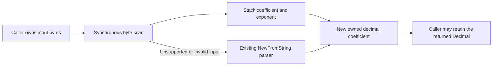

Reading a normal price through `FIXDecimal.Read` allocated two temporary parsing strings before constructing its owned decimal. Parse plain decimal bytes with an `int64` coefficient directly, then construct the same owned shopspring value. Method signatures, retained-value lifetimes, `Scale` and `Write` formatting remain unchanged. Scientific notation, larger coefficients and invalid input retain the original parser and exact error behavior.

Before/after: Go 1.25.3, Apple M4 Pro, one CPU, five one-second samples, identical warmed harness. Allocation profiles and compiler escape reports identified the string-conversion and decimal-point-removal allocations before implementation; the after profile confirms their removal from the price fixture.

| Component | Before B/op / allocs/op | After B/op / allocs/op | Median ns/op before → after |
|---|---:|---:|---:|
| Quantity `100`, `Read` | 48 / 3 | 40 / 2 | 46.75 → 26.84 |
| Price `123.45`, `Read` | 56 / 4 | 40 / 2 | 73.55 → 28.40 |
| Price, equivalent generated getter call shape | 80 / 5 | 64 / 3 | 101.3 → 50.91 |
| Minimum `int64`, `Read` | 96 / 4 | 40 / 2 | 169.7 → 40.16 |

The getter fixture is a local equivalent call shape, not the actual generated package or a full-service/socket benchmark. Returned decimals still allocate owned coefficient storage. Scientific-notation and arbitrary-precision fallback allocations are unchanged; the initial scan adds 9.05 ns and 19.3 ns respectively to their read medians in this capture. There are no dependency, pool, mutex, service or infrastructure changes.

Mandatory `BenchmarkAllocationBaseline` before/after rows retain their allocation counts. Focused tests pass, the full Go 1.23.12 core suite passes (31.286 s), the separate full core race suite passes (34.132 s), and bounded Go 1.23.12 fuzzing passes 260,150 executions. Fixtures cover exact coefficient/exponent, signed zero, int64 limits, stored scale, wire rounding, malformed inputs/errors and earlier values retained across input overwrite, another read and an error. The known Mongo logger teardown issue is separate; that integration package is not part of the core-package run.

[Complete measurements, raw profiles and reproduction commands](benchmarks/zero-allocation/phase-7/decimal-byte-read/README.md). This PR is stacked on `perf/bounded-group-construction` at `00b2f152`.
