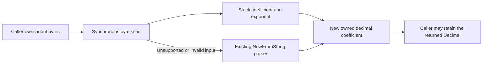

# Owned decimal reads without temporary parsing strings

`FIXDecimal.Read` previously converted every input to a heap string. For
fractional values, `shopspring/decimal.NewFromString` also concatenated the
integer and fractional portions into another temporary string. The current
fixture's [allocation profile](alloc-objects-before.txt),
[source attribution](alloc-source-before.txt) and
[compiler escape report](escapes-before.txt) establish both sites before the
runtime change. This phase changes only that codec; it does not change the
service, its generated packages, persistence or infrastructure.

Baseline: `00b2f152e901ad0ed8e5f1c27632bff9c2df1443`. Before/after use Go 1.25.3,
darwin/arm64, Apple M4 Pro, five one-second samples and `-cpu=1`. Performance,
profiling, builds and correctness runs are serialized. The benchmark harness
is unchanged between measurements; [source hashes](before-source.sha256) pin
the initial codec, harness, parity tests and module files.

## Change and ownership

Ordinary decimal bytes with an `int64` coefficient are scanned directly, then
`decimal.New` constructs the result. The coefficient and exponent are stack
scalars; each returned decimal still has its own coefficient storage. The
codec does not reuse a prior result's mutable backing, borrow the input,
change method signatures or add dependencies, pools or locks.



Signed zero, explicit plus signs, leading/trailing decimal points and zeroes,
both `int64` coefficient limits, and the exact stored exponent are preserved.
`Scale` remains untouched on both success and failure. `Write` is unchanged;
goldens check its existing scale, rounding and fractional-digit behavior after
reading. Scientific notation, larger coefficients and malformed inputs use
the original parser and assignment, including its exact errors and replacement
of the previous decimal on failure. Scientific notation is deliberately
outside this fast path.

## Measured reduction

Setup, input construction and one warm-up read are untimed. Every timed result
escapes to a retained decimal sink. `read` measures `FIXDecimal.Read` directly;
`field_getter` uses a local field/getter with the same call shape as a generated
OrderQty getter (`FieldMap.Get`, embedded `FIXDecimal`, owned decimal return).
It is not a benchmark of the actual generated package or the full service.
No generated dependency was added. These measurements do not include socket
writes or claim a zero-allocation getter.

| Input / operation | Before B/op | Before allocs/op | After B/op | After allocs/op | Before median ns/op | After median ns/op |
|---|---:|---:|---:|---:|---:|---:|
| Quantity `100`, read | 48 | 3 | 40 | 2 | 46.75 | 26.84 |
| Quantity `100`, getter shape | 72 | 4 | 64 | 3 | 77.16 | 49.23 |
| Price `123.45`, read | 56 | 4 | 40 | 2 | 73.55 | 28.40 |
| Price `123.45`, getter shape | 80 | 5 | 64 | 3 | 101.3 | 50.91 |
| `-124.3456`, read | 64 | 4 | 40 | 2 | 67.46 | 30.62 |
| `-124.3456`, getter shape | 88 | 5 | 64 | 3 | 97.06 | 53.49 |
| Signed zero `-0.0000`, read | 48 | 3 | 32 | 1 | 69.09 | 22.44 |
| Maximum `int64`, read | 96 | 4 | 40 | 2 | 168.5 | 40.19 |
| Minimum `int64`, read | 96 | 4 | 40 | 2 | 169.7 | 40.16 |
| Scientific notation `1.2345e+2`, read | 64 | 4 | 64 | 4 | 66.75 | 75.80 |
| Overflow `9223372036854775808.12345`, read | 176 | 6 | 176 | 6 | 230.6 | 249.9 |

[Before](read-before.txt) and [after](read-after.txt) retain all 80 samples each.
Normal nonzero reads still allocate the owned coefficient and its word storage;
the equivalent getter additionally allocates its field wrapper. This phase
removes temporary parsing objects. The unchanged fallback allocations and its
extra scan cost are visible above; no fallback speed improvement is claimed.

The [mandatory baseline before](baseline-before.txt) and
[mandatory baseline after](baseline-after.txt) use the original controlled
command without changing that benchmark. Their fixtures measure `FIXUDecimal`,
parsing, validation, convenience building and legacy framing, separately from
the new `FIXDecimal` fixture. All allocation rows are unchanged: normal
`FIXUDecimal`, all parse rows and validation remain 0 B/0 allocations;
arbitrary-precision overflow is 168 B/5, convenience building is 152 B/6 and
legacy framing is 160 B/2.

Profiles use the price getter shape for exactly 100,000 iterations with
`-memprofilerate=1`; profile timing is diagnostic, not benchmark latency.
Profiles include process setup/calibration, and pprof object attribution is not
the exact per-operation allocation counter. The unprofiled benchmark rows
provide the per-operation counts.

The [after profile](alloc-objects-after.txt) and
[source attribution](alloc-source-after.txt) retain the owned coefficient and
field-wrapper allocations while removing both temporary-string sites from the
price fixture. [Before bytes](alloc-space-before.txt) and
[after bytes](alloc-space-after.txt), raw profiles, compiler escape reports and
[profile-binary hashes](profile-binaries.sha256) are retained alongside the
results. Test executables stay local and are ignored. The
[candidate source hashes](after-source.sha256) identify the final codec and
unchanged harness.

## Correctness and reproduction

Golden tests cover stored coefficient/exponent, unchanged `Scale` and exact
wire rendering. Parity tests compare the old shopspring parser across signs,
decimal placement, trailing zeroes, coefficient limits, extreme exponents,
arbitrary precision, invalid bytes and exact error messages. Retention tests
keep prior direct-read and getter results alive across input overwrite, a
second read and a failed read. The fuzz target compares the same contract for
bounded arbitrary inputs without formatting enormous scientific exponents.

The focused [before](tests-before.txt) and [after](tests-after.txt) checks pass.
The [full core package on Go 1.23.12](core-go1.23.12.txt) passes in 31.286 seconds,
including the existing exact full-session allocation checks. The
[20-second Go 1.23.12 fuzz run](fuzz-go1.23.12.txt) passes with 260,150 executions.
The separate [full core race run on Go 1.23.12](core-race-go1.23.12.txt) passes
in 34.132 seconds; performance was measured without race instrumentation.

Commands from the repository root:

```sh
GOTOOLCHAIN=auto rtk proxy go test . -run '^$' -bench '^BenchmarkAllocationBaseline$' -benchmem -benchtime=1s -count=5 -cpu=1
GOTOOLCHAIN=auto rtk proxy go test . -run '^$' -bench '^BenchmarkFIXDecimalOwnedRead$' -benchmem -benchtime=1s -count=5 -cpu=1
GOTOOLCHAIN=auto rtk proxy go test . -run '^(TestFIXDecimalRead|TestFIXDecimalWrite)' -count=1
GOTOOLCHAIN=go1.23.12 rtk proxy go test . -run '^$' -fuzz '^FuzzFIXDecimalReadParity$' -fuzztime=20s -parallel=1
GOTOOLCHAIN=go1.23.12 rtk proxy go test . -count=1
GOTOOLCHAIN=go1.23.12 rtk proxy go test -race . -count=1
```

The matching profile captures use the same command with `before` or `after`
artifact names, on the corresponding source:

```sh
GOTOOLCHAIN=auto rtk proxy go test . -run '^$' -bench '^BenchmarkFIXDecimalOwnedRead$/^price$/^field_getter$' -benchmem -benchtime=100000x -count=1 -cpu=1 -memprofilerate=1 -memprofile=benchmarks/zero-allocation/phase-7/decimal-byte-read/after.alloc.pprof -o benchmarks/zero-allocation/phase-7/decimal-byte-read/quickfix-after.test
GOTOOLCHAIN=auto rtk proxy go tool pprof -top -alloc_objects -nodecount=25 -focus='FIXDecimal.*Read|readDecimalQuantity' benchmarks/zero-allocation/phase-7/decimal-byte-read/quickfix-after.test benchmarks/zero-allocation/phase-7/decimal-byte-read/after.alloc.pprof
```

The known separate Mongo logger teardown failure is unrelated. This phase's
core-package qualification does not run that integration package, deploy to
PREPROD or repeat the service load test.
