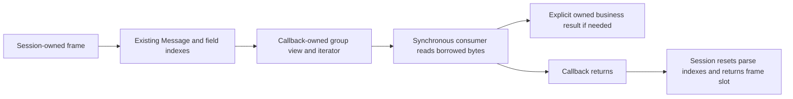

# Callback group access without group reconstruction

`Message.BorrowGroup` exposes the existing dictionary-backed group view to a
synchronous `BorrowApplication` callback. It reads the current message sections
and consumes the session's existing parsed field indexes; it does not create a
`RepeatingGroup`, `Group`, map, template clone, or owned field-byte copy. Public
`GetGroup` retains its independently owned results and unchanged lifetime.

This is used by FIX-server's NewOrderSingle mapper in PR 1362. Its owned
protobuf result remains separate from the borrowed view. This does not make
generated string/decimal accessors or new outgoing message builders allocation
free.



The five-sample component comparison reads the same party field from the same
callback-scoped parsed message. Setup and 100 warm-up iterations are untimed.
The owned row uses the existing `GetGroup` contract; the borrowed row uses the
new accessor. It excludes framing, parsing, business-result construction and
socket writes and must not be presented as a whole-message/session result.

| Callback group access | B/op | allocs/op | ns/op range |
|---|---:|---:|---:|
| Owned `GetGroup` | 1,352 | 31 | 763.4–808.4 |
| Borrowed view | 0 | 0 | 87.62–89.07 |

The required `BenchmarkAllocationBaseline` was run before and after this
increment using Go 1.25.3, darwin/arm64, Apple M4 Pro, one CPU, five one-second
samples. Existing B/op and allocs/op rows are unchanged. Source before this
increment is `e4501ec7826d02adc64d1d4bd2941f12269775ba`. Raw evidence:
[before](baseline-before.txt), [after and group comparison](baseline-and-groups-after.txt).

Focused correctness covers message/slot access, current-section replacement,
reset invalidation, ordinary unparsed messages, group parsing/validation and
exact zero-allocation parse/access/reset. The existing owned GetGroup path is
unchanged. [Focused tests](tests.txt) and [Go 1.23.12 checks](tests-go1.23.12.txt)
passed. Performance and tests were serialized.

Commands, from the repository root:

```sh
GOTOOLCHAIN=auto rtk proxy go test . -run '^$' -bench '^BenchmarkAllocationBaseline$' -benchmem -benchtime=1s -count=5 -cpu=1
GOTOOLCHAIN=auto rtk proxy go test . -run '^(TestMessageBorrowGroup|TestMessageSlot|TestBorrowedGroup)' -count=1
GOTOOLCHAIN=auto rtk proxy go test . -run '^$' -bench '^Benchmark(AllocationBaseline|CallbackGroupAccess)$' -benchmem -benchtime=1s -count=5 -cpu=1
GOTOOLCHAIN=auto rtk proxy /Users/a.alamer/go/pkg/mod/golang.org/toolchain@v0.0.1-go1.23.12.darwin-arm64/bin/go test . -run '^(TestMessageBorrowGroup|TestMessageSlot|TestBorrowedGroup|TestInboundCallback|TestOrdinaryInbound|TestBounded.*Allocation)' -count=1
```
