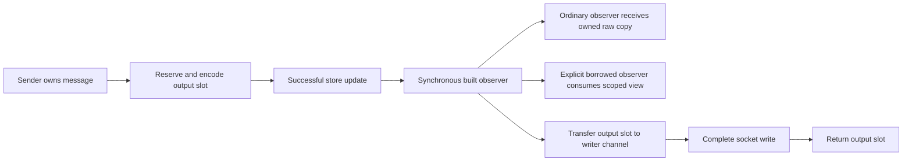

# Preserve merged send observers in the bounded engine

PR #39 incorporates main merge `0fe02d313411a669831b0266c51221af3defda4e`
(BrandonArmand's PR #14) into the previously qualified
`f0570a11fbaa1c8e332f68c2d083d1a10c676df1`. This preserves the public
`BuiltMessageObserver`, queue-depth observer and three lock-timing events.
The built hook supplies the final encoded bytes so applications can avoid
building the message again. The merge does not claim a new latency improvement.

## Ownership



The normal hook follows successful store handling; `DisableMessagePersist`
still governs whether the payload is saved. Replay calls the hook after
rebuilding with the original serialized body/group order, before enqueue.
Gap-fill notification behavior remains unchanged from PR #14. These hooks do
not establish write completion or peer receipt.

Ordinary observers may retain their independent raw bytes. Owned engine
control/replay messages survive reusable storage changes. `BorrowApplication`
forwards the capability exactly once with callback-scoped engine messages and
raw bytes. `CopyInto` and `GetGroup` inside that scope produce owned snapshots,
including on first send. Observer callbacks must return promptly, leave their
inputs unchanged and must not send on the same session.

Queue depth counts bounded pending slots, excluding the writer's queue.
Observer registration uses atomic publication rather than a per-event global
mutex. Disabled lock timing avoids clock reads. Timing-event message types are
empty, as in PR #14; existing preparation and writer event types are preserved.

## Controlled baseline preservation

Go 1.27.2, Apple M4 Pro, darwin/arm64, one CPU, five one-second samples.
Setup/warm-up are outside measurement. No task-owned build, test or profile ran
alongside either benchmark. The before source is `f0570a11`; the after runtime
and new ownership tests are pinned by [source.sha256](source.sha256).

| Existing harness operation | Before median ns/op | After median ns/op | B/op before → after | Allocs/op before → after |
|---|---:|---:|---:|---:|
| Decimal short | 11.25 | 11.65 | 0 → 0 | 0 → 0 |
| Decimal signed fraction | 28.04 | 27.08 | 0 → 0 | 0 → 0 |
| Decimal max uint128 | 53.63 | 54.09 | 0 → 0 | 0 → 0 |
| Decimal overflow | 313.5 | 311.4 | 168 → 168 | 5 → 5 |
| Reused parse, no dictionary | 364.7 | 360.0 | 0 → 0 | 0 → 0 |
| Reused parse, dictionary | 431.4 | 427.7 | 0 → 0 | 0 → 0 |
| Reused parse, group | 802.6 | 815.9 | 0 → 0 | 0 → 0 |
| NewOrderSingle validation | 688.6 | 679.5 | 0 → 0 | 0 → 0 |
| Legacy build | 758.9 | 752.7 | 144 → 144 | 5 → 5 |
| Legacy framed read | 113.3 | 112.7 | 160 → 160 | 2 → 2 |

These component results preserve the existing allocation boundary. Decimal
overflow and allocating convenience APIs remain outside the bounded guarantee.
Raw samples: [before](allocation-before.txt), [after](allocation-after.txt).

```sh
GOTOOLCHAIN=auto rtk proxy go test . -run '^$' \
  -bench '^BenchmarkAllocationBaseline$' -benchmem -benchtime=1s -count=5 -cpu=1
```

## Correctness and exact allocation evidence

The eight `TestBuiltObserver*` fixtures verify construction-time capability
resolution, store/enqueue timing, final wire
bytes, ordinary retained raw/message lifetimes across output/control/journal
reuse, original grouped replay body order, borrowed first-send snapshots, and
no hook/state advancement after callback, persistence, frame or capacity errors.
The warmed borrowed built-observer fixture waits for each completed write and
slot return and reports zero allocations. Queue-depth tests check actual ring
occupancy, retained event values, zero allocations and concurrent replacement.

All seven isolated TCP scenarios completed 100 warmed cycles each with exactly
zero new heap objects and bytes: ordinary, groups, outbound resend, inbound gap,
slow consumer, post-reconnect, and heartbeat/TestRequest. The observed-heartbeat
component also completed 100 writes with exact zero counters.
[Exact receipt](exact-allocations.txt).

The initial integration checked `application.(BuiltMessageObserver)` on every
send. Go's interface assertion cache can rebuild probabilistically after warm-up,
including failed capability checks. This produced a 48-byte allocation in the
ordinary TCP interval and a 144-byte allocation in the observed-heartbeat test.
An allocation-rate-1 profile attributed exactly one 48-byte object to that
assertion in `notifyMessageBuilt`: [objects](type-assertions.txt),
[bytes](type-assertions-bytes.txt), [failed interval](type-assertions-test.txt).
The latter 144-byte sample was not separately profiled. Installed Go 1.27.2
`runtime/iface.go` rebuilds these caches with a 1/1024 sampling gate, so a finite
warm-up alone cannot reliably eliminate this source.

The final code resolves the optional hook and borrowed contract once during
session construction. The same profiled interval now passes with zero objects
and bytes, and no allocation samples in `notifyMessageBuilt`:
[test](type-assertions-test-after.txt), [profile extraction](type-assertions-after.txt).
The unmodified parent passed its [core suite](parent-core-tests.txt); the final
integration passes [all package tests](packages-cached-observer.txt), core
38.026 seconds, with only the existing Mongo logger fixture excluded.
The final exact/focused run passes in 10.365 seconds, including actual factory
observer delivery. The separate full core [race run](core-race-final.txt) passes
in 51.076 seconds and `go vet ./...` passes ([receipt](vet.txt)).

| Whole ordinary interval, 100 completed warmed cycles | Heap objects | Heap bytes |
|---|---:|---:|
| Initial integration, per-send capability assertion | 1 | 48 |
| Final integration, setup-time capability resolution | 0 | 0 |

The original failed suite receipts remain in [core-tests.txt](core-tests.txt),
[packages.txt](packages.txt) and [packages-final.txt](packages-final.txt).
Their observer assertion failures were separately corrected to check the new
lock events and their empty message types explicitly.

Mongo integration remains a separate environment limitation. The known
`TestMongoLogTestSuite` teardown fixture is excluded explicitly; no Mongo-backed
end-to-end claim is made. No cluster deployment or load test was performed for
this integration.

The merged opt-in outbound-flood reproduction remains a failing latency case:
four sending goroutines with a deliberately busy 1 ms `ToApp` delivered all
1,500 inbound messages, but flooded p99 was 3.306152 seconds versus the test's
100 ms limit (quiet p99 294 microseconds). [Receipt](starvation.txt).
This test runs with ordinary owned callbacks and an unbounded MemoryStore;
it is separate from the bounded borrowed allocation qualification. This merge
does not solve callback/lock starvation or establish a latency improvement.

```sh
GOTOOLCHAIN=auto rtk proxy go test ./... -skip '^TestMongoLogTestSuite$' \
  -count=1 -cpu=1 -p=1 -timeout=5m
GOTOOLCHAIN=auto rtk proxy go test -race . -count=1 -timeout=5m
GOTOOLCHAIN=auto rtk proxy go vet ./...
QUICKFIX_STARVATION_TEST=1 GOTOOLCHAIN=auto rtk proxy go test . \
  -run '^TestInboundIsNotStarvedByOutboundFlood$' -count=1 -timeout=45s -v
```
