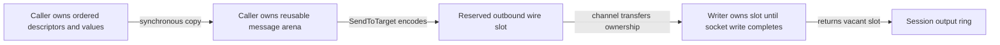

Dynamic outgoing repeating groups currently reconstruct `RepeatingGroup`, `Group`, templates, maps and copied fields on every message. Add `FieldMap.SetGroupValues` to copy ordered group fields into the caller message's fixed outbound construction storage, including flattened nested groups. The existing public `SetGroup` and owned getter behavior remain compatible.

The attached message arena allocates one `BoundedMaxFields` metadata slab during setup. Group construction, replacement, remove and clear reuse that slab; scalar or legacy group replacement reclaims its capacity. Input slices/strings are copied synchronously, with aliases staged before arena movement. Capacity failures preserve prior fields and latch an error until `Clear`; append/send observes that error before sequence/store changes. No hot-path growth, pool, refcount or new mutex is introduced.

The service integration also exposed a first-send snapshot gap: borrowed outgoing callbacks precede arena attachment, so `CopyInto` could retain caller numeric buffers. The borrowed callback wrapper now establishes a temporary snapshot scope and restores it on return, error or panic. Full-message, per-section and `GetGroup` snapshots own their bytes from the first callback while caller identity, external `SetBytes` aliases and delayed arena attachment stay unchanged. The regression failed before the correction and passes afterward.

Measured on Apple M4 Pro, Go 1.25.3, `-benchtime=1s -count=5 -cpu=1`, with setup/warm-up outside timing:

| Two-party construction plus caller-buffer append | Median ns/op | B/op | allocs/op |
|---|---:|---:|---:|
| Existing `RepeatingGroup` / `SetGroup` | 1,700 | 3,552 | 68 |
| New ordered `SetGroupValues` | 202.6 | 0 | 0 |

The mandatory `BenchmarkAllocationBaseline` ran before and after this change. Its allocation rows are unchanged:

| Baseline fixture | Before B/op / allocs/op | After B/op / allocs/op |
|---|---:|---:|
| Reused parse, no dictionary | 0 / 0 | 0 / 0 |
| Reused parse with dictionary | 0 / 0 | 0 / 0 |
| Reused parse with repeating group | 0 / 0 | 0 / 0 |
| Validate NewOrderSingle | 0 / 0 | 0 / 0 |
| Convenience build NewOrderSingle | 152 / 6 | 152 / 6 |
| Legacy framed read | 160 / 2 | 160 / 2 |

Validation:

- Full wire parity, nested groups, binary/SOH values, ownership, alias staging, metadata compaction, scalar/legacy replacement, clear, shallow-copy detachment and atomic capacity recovery pass. Focused suite: 2.067 seconds.
- A real TCP fixture rebuilds the nested outgoing group on every callback and completes 3,200 orders with **zero additional heap objects and bytes**, retaining dictionary validation, bounded persistence, completed writes and returned slots. Resend, inbound-gap and slow-consumer correctness also pass.
- First-send snapshot, error/panic restoration and replacement regressions pass with group/lifecycle checks on Go 1.23.12: 2.746 seconds.
- Entire core package passes on Go 1.23.12: 30.675 seconds, including the existing seven exact full-session allocation scenarios.
- Separate full core race run passes: 33.946 seconds. Allocation measurements are separate from race instrumentation.

The construction benchmark measures construction and append, not socket latency. The completed-session allocation proof uses the existing bounded store/null logger/borrowed callback configuration; it does not claim that all FIX-server business, decimal, logger or persistence code is allocation-free. The unrelated pre-existing Mongo logger teardown issue is tracked separately; its integration package was not rerun here.

The callback correction separately preserves zero allocation in completed outbound sends. Scalar-send median: 1,945 → 1,970 ns; repeating-group-send median: 2,844 → 2,845 ns. It is an ownership correction needed for reusable numeric inputs, not a claimed send-latency improvement.

Raw before/after output, scope and reproduction commands: [outbound group evidence](benchmarks/zero-allocation/phase-7/outbound-groups/README.md).
