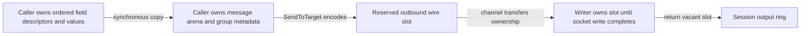

# Bounded outgoing group construction

Baseline source: `c12fe2165493aa1491da7a88426f61fe36c51861`.
Candidate: the `SetGroupValues` change delivered with this report.
Host: Apple M4 Pro, darwin/arm64. Performance uses Go 1.25.3 and `-cpu=1`;
Go 1.23.12 compatibility and race correctness run separately.

## Change and ownership

The legacy `RepeatingGroup` / `Group` / `SetGroup` path constructs maps,
templates, scalar writer values and owned group ranges. The additive
`FieldMap.SetGroupValues` accepts fields already in FIX wire order and copies
their bytes synchronously into the caller message's attached construction
arena. The message owns one fixed `BoundedMaxFields` metadata slab for all such
groups. Replacing or removing a group compacts the slab and updates every live
range; scalar and legacy group replacement reclaim the same capacity.



Every field including repeated counts consumes the existing total frame/field
budget. Input aliases are staged before any arena move. Getter-value bytes and
encoded bytes remain separate, so mutating an owned getter cannot rewrite the
encoded snapshot. Capacity failures leave old fields intact and latch the
section error until `Clear`; the setter returns it, and append/send sees it
before sequence/store changes. No automatic growth, new mutex, pool or shared
mutable slot is introduced. Legacy owned API behavior is preserved.

Nested groups are supplied in flattened dictionary order with their count
fields. The caller supplies correct counts and boundaries; this setter does not
parse raw wire bytes or replace dictionary validation. Byte values containing
SOH, `=` or NUL are copied exactly rather than reinterpreted.

## Measurement

The unchanged controlled baseline is recorded in
[before](baseline-before.txt) and [final after](callback-baseline-and-groups-after.txt).
The same after file also compares two-party construction through legacy
`RepeatingGroup` / `SetGroup` with the new ordered setter, followed by
`AppendTo` into an existing destination. Both cases use identical fields and
values, one attached arena and untimed initialization/warm-up. The component
benchmark does not include a completed socket write.

| Two-party construction plus append | Median ns/op | B/op | allocs/op |
|---|---:|---:|---:|
| Legacy `RepeatingGroup` / `SetGroup` | 1,700 | 3,552 | 68 |
| Ordered `SetGroupValues` | 202.6 | 0 | 0 |

All five ordered-setter samples measured zero bytes and objects. The original
baseline allocation rows are unchanged before/after: parsing with no dictionary,
with a dictionary and with groups, plus validation, all remain 0 B/op and
0 allocs/op; the convenience build remains 152 B/op and 6 allocs/op, and the
legacy framed read remains 160 B/op and 2 allocs/op. The arbitrary-precision
decimal overflow fixture remains 168 B/op and 5 allocs/op.

```sh
GOTOOLCHAIN=auto rtk proxy go test . -run '^$' -bench '^BenchmarkAllocationBaseline$' -benchmem -benchtime=1s -count=5 -cpu=1
GOTOOLCHAIN=auto rtk proxy go test . -run '^$' -bench '^(BenchmarkAllocationBaseline|BenchmarkOrderedGroupConstruction)$' -benchmem -benchtime=1s -count=5 -cpu=1
```

## Completed session and correctness

[Focused tests](tests.txt) pass, including a new real TCP fixture that rebuilds
the nested outgoing party group on every order. Its warmed exact interval
completes **100 batches of 32 orders with zero added heap objects and bytes**.
The existing fixture retains dictionary/group validation, bounded persistence,
peer wire/checksum validation and acknowledgement of completed writes and
returned slots. Setup, all slot/journal warm-up and allocation-counter reads
are outside the measured interval. Separate correctness cases exercise
outbound resend, inbound gaps and slow-consumer handling with this dynamic
group construction enabled.

Focused field fixtures cover full wire parity, nested groups and binary values,
owned input snapshots, aliases from both byte planes, changing group sizes,
cross-section metadata compaction, scalar/legacy replacement, remove/clear,
owned `GetGroup` retention, shallow-copy detachment, atomic capacity failure
and recovery. The warmed setter/replace/clear/append fixture also requires
exactly zero allocations.

The [entire QuickFIX core package on Go 1.23.12](callback-core-go1.23.12.txt) passes
in 30.675 seconds, including the pre-existing seven exact full-session
allocation scenarios and the new outgoing group fixtures. The separate
[full core race run](callback-core-race.txt) passes in 33.946 seconds; exact allocation
measurement remains excluded from race instrumentation. The repository's
separate Mongo logger teardown issue is unrelated and that integration package
was not run in these core checks.

These results qualify the described bounded QuickFIX component/session path.
They do not establish zero allocations in FIX-server's business objects,
decimal formatting, logging, store or asynchronous application handoffs.
No PREPROD deployment or load test is part of this upstream measurement.

## First-send snapshot correction

Service integration exposed a cold-path ownership gap after group construction
commit `4d099c836c7621cf4aeacee64a77f5fb9aee06e9`: a first borrowed `ToApp` or
`ToAdmin` receives the caller's ordinary message before its second-send arena
attachment. `CopyInto` and `GetGroup` did not recognize those fields as scoped
and could retain the caller's mutable `SetBytes` inputs. Reusing numeric input
buffers after the send then changed a supposedly owned audit snapshot.

The [failing regression](first-send-copy-before.txt) captures both first-send
callbacks changing retained `HEADER` bytes to `XXXXXX`. The wrapper now marks
unmarked fields reusable only during the synchronous outgoing callback, so
the existing snapshot methods copy their bytes. It restores markers on the
same backing after normal return, errors and panics; replacement sections keep
their own flags. Caller message identity, external `SetBytes` aliases, setter
behavior and second-send arena attachment remain unchanged. No construction
arena is allocated merely to establish this first callback's scope.

The [Go 1.23 focused check](first-send-copy-go1.23.12.txt) passes in 2.746 seconds,
including full-message and per-section snapshots, legacy `GetGroup`, callback
error/panic cleanup, section replacement and all new completed-group fixtures.
The dynamic group interval still completes 3,200 orders with zero added heap
objects and bytes. This correction is included with the real group-allocation
reduction, rather than being represented as an independent performance gain.

The [callback before](callback-outbound-before.txt) and
[final after](callback-baseline-and-groups-after.txt) benchmarks preserve
0 B/op and 0 allocs/op in every borrowed completed-write case. Scalar-send
medians are 1,945 → 1,970 ns/op; repeating-group send medians are
2,844 → 2,845 ns/op. These are completed outbound component timings, not TCP
round-trip timings. The final group-construction medians in the table above
come from the same final candidate; the [initial group-only run](baseline-and-groups-after.txt)
is retained separately. Mandatory baseline allocation rows remain unchanged.
