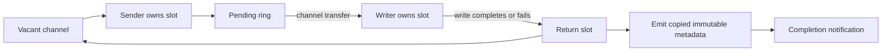

Observed multi-character MsgTypes previously allocated two owned strings per
bounded send. Reuse immutable configured dictionary values, preserve owned
fallbacks for unknown types, and replace the observer's global reader lock with
an atomically installed immutable callback.

Carry timing metadata with the existing output slot to measure pending/writer
queue residence, the complete socket write, and enqueue through slot return.
These intervals were missing from the existing synchronous send metrics.

The writer publishes failure before releasing a slot and never accesses the
slot afterward. Prepared events retain the original type; handoff/write events
retain the final encoded type after callbacks. Observer values remain retainable.
No new queue, hot-path mutex, pool, reference count or capacity growth.

Frozen completed-write component, Go 1.27.2, M4 Pro, CPU1, five one-second samples:

| Observed type | Median ns/op before → after | B/op before → after | allocs/op before → after |
| --- | ---: | ---: | ---: |
| `8` | 3,106 → 3,402 | 0 → 0 | 0 → 0 |
| Configured `AJ` | 3,095 → 3,379 | 4 → 0 | 2 → 0 |
| Unknown custom type | 3,079 → 3,407 | 64 → 64 | 2 → 2 |

Each operation now delivers seven events instead of four. This is an allocation
reduction, **not a latency win**: additional instrumentation costs approximately
0.28–0.33 µs here. Disabled controls remain at zero allocations. The complete
required `BenchmarkAllocationBaseline` preserves all byte/allocation counts.
Warm-up is outside timing; completion requires writer return, slot return, peer
parse and journal retirement. This fixture does not measure TCP, Kafka, metrics
transport or full FIX-server latency.

Ownership fixtures cover partial writes, failure, slot reuse, retained event
values, configured `AJ → AE` callback replacement, observation boundaries and
concurrent observer replacement. The old observer fixtures now collect safely
across submitting/writer goroutines.
Root and dictionary tests, final focused tests, separate full root/dictionary
race tests, vet and the frozen-fixture hash check pass.

Added resident storage is 48 bytes per output slot, 128 bytes per ring, and a
fixed dictionary-type lookup map per session. Observer installation and unknown
type fallback can still allocate. Discarded/unattempted frames do not emit a
completed-write event, and write completion does not establish peer receipt.

**Rollout dependency:** remove FIX-server's existing per-event tag allocations
before enabling these additional stages there. This PR alone does not qualify
service latency, recovery or party-group behavior.

Commands, raw samples, correctness receipts and precise event boundaries:
`benchmarks/zero-allocation/phase-7/outbound-observation/README.md`.
