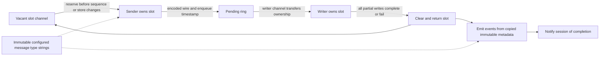

# Configured message types and completed outbound observation

The bounded path previously allocated two owned MsgType strings for each
observed multi-character application message: a snapshot before the application
callback and another from the final encoded wire before writer handoff. This
change reuses immutable dictionary message-type strings for those snapshots.
Unknown types retain the independently owned conversion; no mutable wire bytes
escape to an observer.

The same owned output slots now carry an enqueue timestamp and final message
type through the writer. This closes the gap between the existing
`outbound_channel_wait` measurement and actual completed writes. Observation
uses an immutable, atomically installed callback instead of a global reader
lock. Installation may allocate; event emission does not.

## Ownership



The writer never reads a slot after returning it. Failure is published before
returning the slot, preserving the existing admission and sequence behavior.
No new queue, mutex, pool, reference count, or hot-path capacity growth is added.

## Measurements

Before: `d171d4876e7de65d12f5e9f976c55b0436565bf7`.
Darwin/arm64, Apple M4 Pro, Go 1.27.2, one CPU, five one-second samples.
The source remains Go 1.23 compatible. Numbers below are medians.

| Completed component | Before ns/op | After ns/op | Before B/op, allocs/op | After B/op, allocs/op |
| --- | ---: | ---: | ---: | ---: |
| `8`, observer disabled | 2,790 | 2,834 | 0, 0 | 0, 0 |
| `8`, observer enabled | 3,106 | 3,402 | 0, 0 | 0, 0 |
| Configured `AJ`, disabled | 2,757 | 2,817 | 0, 0 | 0, 0 |
| Configured `AJ`, enabled | 3,095 | 3,379 | 4, 2 | 0, 0 |
| Unknown custom type, disabled | 2,617 | 2,674 | 0, 0 | 0, 0 |
| Unknown custom type, enabled | 3,079 | 3,407 | 64, 2 | 64, 2 |

Observed operations now deliver seven events instead of four. The added
completed-write instrumentation costs about 0.28–0.33 microseconds in these
samples. This is an allocation reduction and a measurement improvement, not a
demonstrated CPU or latency improvement. The disabled controls also moved
slightly; these samples do not isolate every timing difference.

The unchanged fixture warms all 33 output slots twice before timing. Each
operation includes `SendToTarget`, bounded persistence, encoding, an independent
writer copy, slot return, peer parse and explicit journal retirement. The observer
consumes every event using atomics, without allocating. The FIX44 grouped fixture
provides a dictionary containing `AJ`; changing its type exercises observation,
not business validation of a complete QuoteResponse. This is not a TCP,
DogStatsD, Kafka, or end-to-end FIX-server latency measurement.

```sh
GOTOOLCHAIN=auto rtk proxy go test . -run '^$' \
  -bench '^BenchmarkOutboundObservation$' -benchmem -benchtime=1s -count=5 -cpu=1
GOTOOLCHAIN=auto rtk proxy go test . -run '^$' \
  -bench '^BenchmarkAllocationBaseline$' -benchmem -benchtime=1s -count=5 -cpu=1
```

Raw before/after results, fixture hash and separate allocation-profile summaries
are retained beside this document. Profiling is separate from performance
measurement. Tiny-allocation profile accounting does not provide an exact
allocations/message count; the benchmark's allocation counters provide that
evidence.

## Event meaning and limits

| Stage | Interval | Success |
| --- | --- | --- |
| `outbound_queue_wait` | Pending enqueue through start of writer operation, including writer-channel residence | Reached writer |
| `socket_write` | Full writer operation, including deadline setup and all partial writes | Write returned no error |
| `outbound_complete` | Pending enqueue through write result and slot return | Write returned no error |

Events are delivered after slot return and before the writer's completion
notification. They do not establish peer receipt. Callback overhead occurs after
the completion timestamp but still consumes writer time and delays notification.
The intervals overlap and must not be added together.

Prepared stages retain the pre-callback type. Handoff and writer stages retain
the final encoded type. Observer callbacks may run concurrently on submission,
session and writer goroutines and must return promptly.

Queue intervals require observation at enqueue and when flushing begins.
Enabling observation after enqueue can produce a socket-write event without
inventing an earlier interval. Replacing or disabling the observer can split or
omit events. Frames discarded without an attempted write have no write-completed
event; accepted-send counts need not equal completed-write counts.

Each 64-bit outbound slot grows from 32 to 80 bytes: 48 additional bytes per
configured slot, or 1,584 bytes for the 33-slot fixture. The ring adds a 128-byte
session identity. A per-session immutable map references configured dictionary
message-type strings; its size is fixed at setup. Unknown message types still
allocate owned strings and never grow that map.

Do not deploy these additional events with FIX-server's old per-event
metric-tag construction: that callback itself allocates. The linked service
phase must remove those known-tag allocations before rollout. This PR alone
does not establish a zero-allocation service path or resolve the PREPROD
recovery/latency qualification gaps.

## Verification

Focused fixtures cover retained strings after dictionary/input mutation,
callback type replacement, slot reuse, partial writes, write failure,
observer enable/disable boundaries and concurrent observer replacement.
Verification on 2026-10-20:

| Check | Result |
| --- | --- |
| `GOTOOLCHAIN=auto rtk proxy go test . ./datadictionary` | PASS |
| Focused outbound observation, heartbeat, metadata and ordinary-observer tests | PASS |
| `GOTOOLCHAIN=auto rtk proxy go test -race . ./datadictionary` | PASS |
| `GOTOOLCHAIN=auto rtk proxy go vet . ./datadictionary` | PASS, exit 0, no diagnostics |
| Frozen benchmark SHA-256 verification and `git diff --check` | PASS |

The final focused and full race runs include the configured `AJ → AE` fixture
and atomic heartbeat-observer counters added after the initial full test run.
Raw correctness receipts are stored alongside the benchmark results. Generated
profile binaries and raw profiles were removed after retaining their compact
text summaries.

The unrelated Mongo logger teardown failure observed before the initial codec
phase is outside this change. Root and dictionary checks do not qualify the
Mongo integration package.
