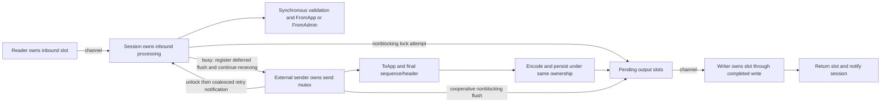

# Receive progress during slow outbound callbacks

The previous runtime (`026550e098e20104229e234f331c9a2f5bc14e78`) stalled
the receive loop behind external senders' `ToApp` callbacks. A fresh local
reproduction delivered all 1,500 inbound probes but increased p99 from 104 us
without a flood to 3.339456 seconds with one. The earlier block profile located
the waits in routine schedule checks and `SendAppMessages`, both taking the
same send mutex. This change addresses that specific starvation case in PR #39.

## Ownership and progress



The loop never spins trying to acquire the send mutex. It registers a deferred
flush, then retries once to close the unlock/registration race. All production
owners use the same unlock notification. Since Go's mutex starvation mode can
prevent `TryLock` from winning against queued senders indefinitely, an active
sender also completes the deferred nonblocking flush before unlocking. Even a
rejected callback must not strand earlier accepted output. The original send
result, sequence assignment, persistence, resend serialization, callback scope
and writer slot lifetime remain unchanged. Retired/offline/reset-pending sends
do not cooperatively flush.

A separate deferred unlock also releases send ownership if an observer or
logger panics during the cooperative flush. Lock-hold observations still happen
after unlocking. Regression fixtures recover the original panic and verify the
mutex is available.

Calendar checks use atomic creation-time seconds; schedules have second
precision. Construction/start and every reset/refresh attempt publish the
snapshot, even when persistent-store I/O fails after updating memory. Bounded
journal reset commits publish too; capacity rejection does not. An expired
snapshot is rechecked under the lock before deciding to reset. The hot path
adds no heap allocation, mutex, queue, goroutine, pool or dependency.

This does not preempt an application's slow `FromApp`/`FromAdmin`, remove a
necessary outbound send wait initiated by such a callback, or make every
control/reset/resend operation nonblocking. Those operations retain their
existing synchronous ordering.

## Paired contention measurement

Go 1.27.2, darwin/arm64, Apple M4 Pro, GOMAXPROCS=4. Four outbound goroutines
continuously send while each `ToApp` deliberately busy-spins for 1 ms. The
opposite peer sends a timestamped probe every 2 ms for 3 seconds, followed by
the original 1-second flood tail and 2-second drain. Latency starts before
probe construction/send and ends in the receiving `FromApp`; it includes local
TCP and queueing, and is not a kernel read-to-callback or response round trip.
The after harness retains the original load and adds send-error/peer-receipt
counters so dropping or merely queueing output cannot qualify as success.

| Flow | Before flooded inbound p99 | After flooded inbound p99, two runs | Inbound received per run | Outbound accepted / received per run |
|---|---:|---:|---:|---:|
| Original owned callbacks + MemoryStore | 3.339456 s | 75 us; 75 us | 1,500 / 1,500 | 3,983 / 3,983; 3,982 / 3,982 |
| Bounded queues and journal, owned callbacks | Not measured before | 79 us; 72 us | 1,500 / 1,500 | 3,981 / 3,981; 3,983 / 3,983 |

Both after variants have zero send errors. Between 2,983 and 2,984 outbound
messages had already reached the peer before each 3-second probe interval
ended. Bounded qualification uses 1 KiB frames, 64 fields, 8 group entries,
depth 4, 32 input/output/writer/stash allowances and 16,384 retained messages
per session; session validation and persistence remain enabled. Neither flood
variant uses a data dictionary. These flood fixtures
use ordinary owned callbacks and allocating message builders. They establish
progress and latency under contention, not zero allocation.

Raw receipts: [before](starvation-before.txt), [final after](starvation-after.txt).
[Initial candidate](starvation-candidate.txt) predates the cooperative-flush
safeguard and is retained separately. No other task-owned Go build, test or
profile ran on the benchmark host alongside a latency/performance measurement.

```sh
QUICKFIX_STARVATION_TEST=1 GOTOOLCHAIN=auto rtk proxy go test . \
  -run '^Test(Bounded)?InboundIsNotStarvedByOutboundFlood$' \
  -count=2 -timeout=90s -v
```

## Correctness and allocation qualification

Deterministic tests hold a sender inside `ToApp` while a scheduled session
consumes the sole output wake, attempts a flush and dispatches an inbound
message. They require inbound completion before releasing the callback, then
prove accepted/rejected senders flush earlier output in sequence without
another event-loop opportunity. Additional cases cover an unrelated lock owner,
blocked writer notification/slot return, reset/refresh metadata changes followed
by errors, stale snapshots, zero/epoch creation times, schedule boundaries and
DST. Existing reset-capacity, replay, ownership and observer checks remain.

The [package suite](tests.txt) passes (core 39.162 seconds), the complete core
[race suite](race.txt) passes (53.836 seconds), and [vet](vet.txt) passes.
The local Mongo logging teardown fixture remains excluded
explicitly from package checks; this change does not qualify that environment.
No deployment or PREPROD test is part of this change.

The [exact TCP interval](exact-allocations.txt) covers the existing seven
scenarios plus scheduled grouped traffic, so the new calendar fast path is
measured too. Each scenario completes 100 warmed cycles with zero new heap
objects and zero heap bytes, including completed writes and slot return. The
fixture uses borrowed callbacks, dictionary validation and the bounded store.

An earlier CI run at `e4bcfee6` failed the unchanged dictionary reject fixture
`TestConfiguredValidationRejectExactAllocations/not_defined`, counting 4 objects
and 96 bytes in its 1,000-call interval. The [failure excerpt](ci-validation-failure.txt)
is retained; its source is not attributed. The unchanged assertion passes
[20 isolated repetitions](validation-isolated.txt) locally on Go 1.27.2 and the
unit-test jobs on both Go 1.24.13 and Go 1.27.2 at final runtime `78a64273`
([CI run](https://github.com/railbirdexchange/quickfix/actions/runs/39712143885)).
No allocation assertion was weakened or skipped.
All 49 [CI checks at that runtime](ci-runtime.txt) pass, including the protocol
acceptance suites with MemoryStore, FileStore and MongoStore.

## Controlled allocation baseline

Go 1.27.2, Apple M4 Pro, CPU 1, five one-second samples; setup and warm-up are
untimed. Before is `026550e0`; after is `78a64273`, with runtime/test sources pinned in
[source.sha256](source.sha256). The scheduling fix preserves every allocation
row; the consolidated PR's earlier allocation reductions remain intact.

| Existing operation | Median ns/op before → after | B/op before → after | Allocs/op before → after |
|---|---:|---:|---:|
| Decimal short | 11.25 → 11.07 | 0 → 0 | 0 → 0 |
| Decimal signed fraction | 27.77 → 27.93 | 0 → 0 | 0 → 0 |
| Decimal max uint128 | 53.82 → 56.31 | 0 → 0 | 0 → 0 |
| Decimal overflow | 323.6 → 320.9 | 168 → 168 | 5 → 5 |
| Reused parse, no dictionary | 379.2 → 352.8 | 0 → 0 | 0 → 0 |
| Reused parse, dictionary | 441.6 → 425.6 | 0 → 0 | 0 → 0 |
| Reused parse, group | 817.1 → 806.3 | 0 → 0 | 0 → 0 |
| NewOrderSingle validation | 682.9 → 681.5 | 0 → 0 | 0 → 0 |
| Legacy build | 779.7 → 775.3 | 144 → 144 | 5 → 5 |
| Legacy framed read | 116.6 → 116.0 | 160 → 160 | 2 → 2 |

Raw [before](allocation-before.txt) and [after](allocation-after.txt) samples.
Decimal overflow and legacy convenience APIs remain outside the guarantee.

| Borrowed session component | Median ns/op before → after | B/op before → after | Allocs/op before → after |
|---|---:|---:|---:|
| Inbound NewOrderSingle | 1299 → 1262 | 0 → 0 | 0 → 0 |
| Inbound repeating group | 1916 → 1891 | 0 → 0 | 0 → 0 |
| Outbound NewOrderSingle | 1938 → 1910 | 0 → 0 | 0 → 0 |
| Outbound repeating group | 2793 → 2780 | 0 → 0 | 0 → 0 |
| Outbound custom message type | 1917 → 1904 | 0 → 0 | 0 → 0 |

Raw [before](session-before.txt) and [after](session-after.txt) samples. Output
measurements wait for completed writes and returned slots. These small changes
in uncontended medians do not establish a general CPU or quiet-path latency
improvement; the demonstrated latency win is the slow-callback contention case
above.

```sh
GOTOOLCHAIN=auto rtk proxy go test ./... -skip '^TestMongoLogTestSuite$' \
  -count=1 -cpu=1 -p=1 -timeout=5m
GOTOOLCHAIN=auto rtk proxy go test -race . -count=1 -cpu=1 -timeout=5m
GOTOOLCHAIN=auto rtk proxy go vet ./...
GOTOOLCHAIN=auto rtk proxy go test . \
  -run '^TestBoundedFullSessionExactAllocations$' -count=1 -cpu=1 -timeout=2m -v
GOTOOLCHAIN=auto rtk proxy go test . -run '^$' \
  -bench '^BenchmarkAllocationBaseline$' -benchmem -benchtime=1s -count=5 -cpu=1
GOTOOLCHAIN=auto rtk proxy go test . -run '^$' \
  -bench '^Benchmark(ScopedInboundSession|ScopedOutboundSession)$' \
  -benchmem -benchtime=1s -count=5 -cpu=1
```
