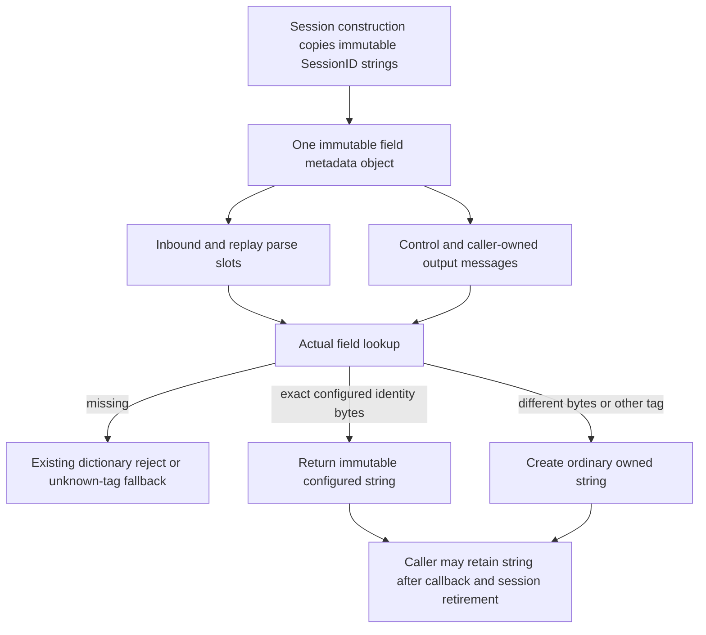

# Configured header string reads

Baseline: `10701f166ae500214641484e283b2c4c96701ba5`.
Runtime: Go 1.27.2, darwin/arm64, Apple M4 Pro, `-cpu=1`.

This phase removes repeated owned-string allocations when `GetString` reads
exactly a configured session identity. It preserves the public owned-string
contract and actual field lookup. It does not intern arbitrary incoming strings
or change message routing, wire encoding, validation or application ownership.

## Ownership and limits



Only tags 8, 49, 50, 56, 57, 142 and 143 are eligible. Sender/target pairs
recognize both inbound and outbound directions by exact byte equality. Missing
fields remain missing, including empty configured optional identities. Different
CompIDs, per-message SubIDs and standalone messages keep ordinary owned-string
behavior. The metadata contains the immutable dictionary reject map and seven
immutable string values, with no session, message, frame or output-slot pointer.
Each session creates its own object; traffic never adds values or changes it.
This adds one metadata allocation during session setup (and for dictionary-backed
public slots). It reuses the existing immutable strings rather than copying their
bytes, and replaces the old map handle without enlarging `FieldMap`.

Copies, owned inbound materialization, arena attachment/detachment and slot reset
preserve the appropriate metadata reference. Sending a caller-owned message
through another session rebinds that message to the destination session's object;
previously returned strings and copied messages remain independent. No new hot
mutex, pool, mutable intern table or unsafe byte/string alias is introduced.

## Frozen measurements

`session_header_strings_benchmark_test.go` SHA-256:
`e5ce92a676815d27eb339c40ca40f4ba7f32be869ac43e84e3e9f93aaebdd7c8`.
The companion semantic fixtures passed against unchanged production source before
measurement. The benchmark source is unchanged between before and after captures.

```sh
GOTOOLCHAIN=auto rtk proxy go test . -run '^$' -bench '^BenchmarkAllocationBaseline$' -benchmem -benchtime=1s -count=5 -cpu=1
GOTOOLCHAIN=auto rtk proxy go test . -run '^$' -bench '^Benchmark(SessionHeaderString(Read|Heartbeat)|PreparedMissingField|PreparedRejectHeartbeat|SessionRequiredValidation|SessionRequiredReject)$' -benchmem -benchtime=1s -count=5 -cpu=1
```

Setup, dictionary construction, parsing and warm-up are outside the timed loops.
Getter results escape into package-level string sinks. The completed-heartbeat
component performs three real header string reads inside each callback, persists
to the bounded journal, encodes, completes the writer copy, returns its output
slot, validates the independent peer frame and retires the acknowledged journal
entry. It is not a network or whole FIX-server latency benchmark. Existing
missing-field and required-validation benchmark rows are preserved as controls.

## Results

Five samples per row. Times below are medians; allocation counts and bytes are
identical across all five samples for each before/after row.

| Getter/component | Before ns/op | After ns/op | Before B/op / allocs/op | After B/op / allocs/op |
| --- | ---: | ---: | ---: | ---: |
| Configured inbound sender | 21.53 | 10.79 | 24 / 1 | 0 / 0 |
| Configured inbound target | 21.31 | 10.40 | 24 / 1 | 0 / 0 |
| Configured outbound sender | 21.41 | 10.60 | 24 / 1 | 0 / 0 |
| Configured outbound target | 21.58 | 10.43 | 24 / 1 | 0 / 0 |
| Different inbound sender | 21.38 | 22.29 | 24 / 1 | 24 / 1 |
| Per-message inbound SubID | 21.27 | 22.14 | 24 / 1 | 24 / 1 |
| Standalone sender | 21.37 | 22.22 | 24 / 1 | 24 / 1 |
| Completed heartbeat with three callback identity reads | 2,006 | 1,971 | 16 / 3 | 0 / 0 |

Matched getter timing roughly halves in this component. The completed heartbeat
removes three allocations; its small timing difference is not a claim about
network or deployed latency. Nonmatching/standalone getter medians increase by
about 0.9 ns and retain the existing owned-copy allocation. Raw results are in
`header-before.txt` and `header-after.txt`.

Configured missing-field errors (including two text reads), completed heartbeat
reject-getter controls, valid/missing-Side validation and completed required-field
rejects remain 0 B/op and 0 allocs/op. The unknown-tag missing-field fallback
remains 72 B/op and 2 allocs/op, with or without repeated Error calls.

The mandatory allocation baseline preserves every allocation row in all samples:
non-overflow decimal parsing, reused parsing with/without dictionaries/groups and
valid NewOrderSingle validation remain 0 B/op and 0 allocs/op. Decimal overflow
remains 168 B/op and 5 allocs/op; legacy construction remains 144 B/op and
5 allocs/op; legacy framed reads remain 160 B/op and 2 allocs/op. See
`allocation-before.txt` and `allocation-after.txt`. No whole-library
zero-allocation claim is made.

## Qualification

Semantic fixtures cover all seven identity tags in both directions, missing and
nonmatching values, mutable input overwrite, owned copies/materialization,
detachment, slot reset and cross-session caller-message reuse. Performance and
race testing are separate. The package suite excludes only the previously
documented unrelated `TestMongoLogTestSuite` teardown failure; Mongo store tests
remain enabled.

Final qualification passed on the frozen production source:

```sh
GOTOOLCHAIN=auto rtk proxy go test ./... -skip '^TestMongoLogTestSuite$' -count=1 -timeout=180s
GOTOOLCHAIN=auto rtk proxy go vet ./...
GOTOOLCHAIN=auto rtk proxy go test -race . ./internal/... -count=1 -timeout=180s
```

Receipts are `correctness-all.txt` and `race-core-internal.txt`; vet exited
successfully without output. The new allocation regression checks all seven
matching identity reads after owned materialization, CopyInto and arena
detachment. Metadata-isolation tests share dictionary errors across distinct
session identities and use separately owned messages for concurrent readers.
