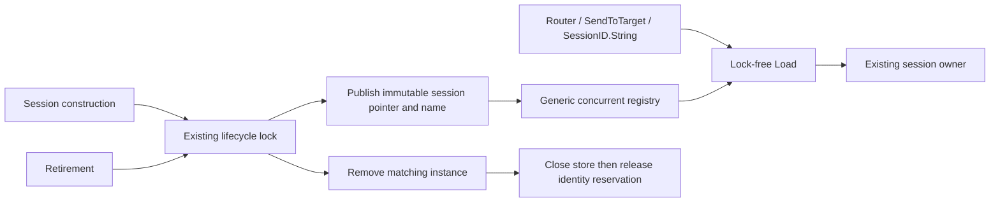

# Generic concurrent session registry

The registry now uses `xsync.Map[SessionID, registeredSession]` for routing,
send and registered-name lookups. Each entry publishes its session pointer and
owned immutable name together. Registration/removal no longer rebuilds a map
of every session name. This removes the shared read-lock counter from ordinary
lookups and reduces actual lifecycle allocations.

The existing lifecycle lock remains responsible for compound reservation and
registration changes. `SetNextTargetMsgSeqNum`, `GetExpectedSenderNum` and
`GetExpectedTargetNum` still hold their existing read lock through store access,
so retirement waits for those operations before closing the store. Existing
sender/resend ownership, dynamic identity quarantine and instance-safe removal
are preserved. The change adds no message copy, queue or callback handoff.



## Paired measurements

Measured October 21, 2026, on Apple M4 Pro, darwin/arm64, Go 1.27.2.
Parent runtime: `22800fcc32be905c6a31f1532d089bebdce19de5`. Candidate runtime:
`b830f01c67b42e0f8ec2aff7b9c118558b97e594`. Both use the identical new benchmark fixture.
Setup and warm-up are outside timing; each fixture registers 100 sessions.
Five independent one-second samples run at each CPU setting, with no concurrent
task-owned builds or tests. CPU profiling and correctness/race runs are separate.

| Fixture | GOMAXPROCS | Before median ns/op | After median ns/op | Before B/op, allocs/op | After B/op, allocs/op |
|---|---:|---:|---:|---:|---:|
| Registry lookup | 1 | 39.88 | 42.44 | 0, 0 | 0, 0 |
| Registry lookup | 8 | 92.19 | 5.414 | 0, 0 | 0, 0 |
| FIXT default-version routing | 1 | 101.7 | 104.0 | 0, 0 | 0, 0 |
| FIXT default-version routing | 8 | 103.7 | 26.14 | 0, 0 | 0, 0 |
| Registered session name | 1 | 43.10 | 41.37 | 0, 0 | 0, 0 |
| Registered session name | 8 | 6.876 | 5.395 | 0, 0 | 0, 0 |
| Register + unregister, 100 other sessions | 1 | 27,882 | 283.9 | 38,416, 11 | 240, 2 |
| Register + unregister, 100 other sessions | 8 | 23,998 | 260.2 | 38,416, 11 | 240, 2 |

The first three fixtures use `RunParallel`: multi-CPU ns/op is aggregate
throughput cost, not individual-message latency. The lifecycle fixture is
serial at both CPU settings. Concurrent routing throughput improves about 4x,
while single-threaded routing is about 2.3% slower and lookup about 6.4% slower.
There is no end-to-end FIX-server latency or PREPROD claim from this measurement.
Registration is intentionally outside the warmed message guarantee and still
allocates its name and map entry. Generic-map resizing occurs on lifecycle
writes, not lookup.

Raw results: [before](before.txt), [after](after.txt).

The subsequent router missing-header correction is measured separately in
[routing header errors](../routing-header-errors/README.md).

```sh
GOTOOLCHAIN=auto rtk proxy go test . -run '^$' -bench '^BenchmarkSessionRegistry$' -benchmem -benchtime=1s -count=5 -cpu=1,8
GOTOOLCHAIN=auto rtk proxy go test . -run '^$' -bench '^BenchmarkAllocationBaseline$' -benchmem -benchtime=1s -count=5 -cpu=1
```

The prescribed allocation baseline preserves all B/op and allocs/op rows:
[before](allocation-before.txt), [after](allocation-after.txt). The comparison
includes existing allocating convenience-frame/build and decimal-overflow paths;
those have not been removed from measurement.

The separate eight-worker lookup [CPU profile before](before-cpu.txt) attributes
96.01% of sampled CPU to the RWMutex reader-count atomic add operations.
[After](after-cpu.txt), that reader-count contention is absent and hashing/key
comparison dominate. The [mutex profile](before-mutex.txt) is not the primary
evidence here: read-only contention spends CPU on shared atomics rather than
waiting for a writer. Profiles are from the focused registry fixture, not a
deployed service. Binary profiles and test executables are disposable; only
compact text evidence is retained.

## Dependency review

- Pin: [`github.com/puzpuzpuz/xsync/v4 v4.5.0`](https://github.com/puzpuzpuz/xsync/releases/tag/v4.5.0), upstream tag commit `1d45188d8e2d528554c2a97fa2ec6f6fe067ee01`, released April 18, 2026.
- Provenance: original upstream module downloaded through Go's module tooling; module/archive checksums are recorded in `go.sum`. No transitive module dependencies.
- License: [Apache-2.0](https://github.com/puzpuzpuz/xsync/blob/v4.5.0/LICENSE).
- Version: v4 requires Go 1.24 and uses public `hash/maphash.Comparable`. The user approved raising the minimum from 1.23 to 1.24; preferred toolchain remains Go 1.27.2. Existing CI minimum-version jobs and docs are updated, with no additional matrix.
- API: `Load` avoids mutexes; writes use internal bucket locks and allocate entries. The shared immutable registry has concurrent readers and lifecycle writers. Mutable frame/message slots retain their existing channel ownership; no registry request/reply channel is introduced.
- Scope: use only `Load`, `Store`, `Delete` and test reset `Clear`. The open [Compute callback panic issue](https://github.com/puzpuzpuz/xsync/issues/208) concerns an API this change does not use. No application callback runs inside a map operation.

## Correctness and qualification

Focused routing, name lifetime, concurrent registration and dynamic-retirement
tests passed before the full qualification. New coverage checks concurrent
lookup/name reads during registration/removal, exactly one same-ID registration
winner, reservation rejection and stale cleanup preserving a replacement.
Existing target-sequence mutation/retirement fixtures continue to protect store
lifetime synchronization.

| Check | Result | Evidence |
|---|---|---|
| `go test ./... -skip '^TestMongoLogTestSuite$' -count=1` | PASS; core 37.377 s | [Package results](tests.txt) |
| `go test -race . -count=1` | PASS; 50.767 s | [Race result](race.txt) |
| `go vet ./...` | PASS; exit 0, no diagnostics | [Output](vet.txt) |
| `TestBoundedFullSessionExactAllocations` | PASS; all seven scenarios, 100 completed cycles each, exact zero objects and bytes | [Exact counters](exact-allocations.txt) |
| Standard five-run allocation baseline | PASS; every B/op and allocs/op row unchanged | [Before](allocation-before.txt), [after](allocation-after.txt) |

All commands use `GOTOOLCHAIN=auto rtk proxy` with the selected Go 1.27.2
toolchain. The full-session fixture covers ordinary orders, groups, outbound
resend, inbound gaps, a slow consumer, warmed reconnect and heartbeat/TestRequest.
It uses the existing bounded store and null logger, and waits for completed
writes and returned slots. This does not qualify Kafka, an allocating logger or
the full FIX-server.

Mongo integration requires its external fixture: the previously documented
missing-fixture logger teardown failure is
[separate historical evidence](../../dynamic-retirement/mongo-environment-failure.txt).
Only that logger suite was explicitly excluded; the Mongo store suite skips
itself when its connection setting is absent. Mongo integration remains NOT RUN,
not qualified by the green package summary. PREPROD deployment/load testing and
the revised Go 1.24 CI lane were not run for this PR.
