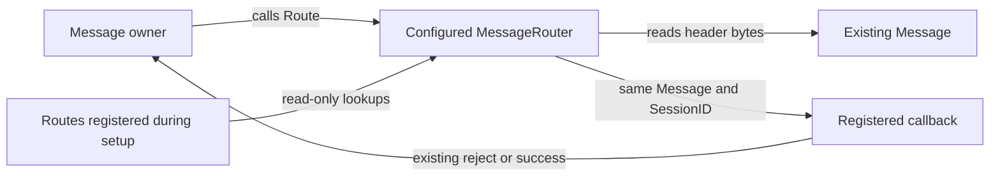

# Ordinary message routing

This change removes allocations from the existing `MessageRouter.Route` API
when routing FIXT application messages using an explicit or session-default
application version. It also avoids copying long custom version and message-type
keys. FIX 4.4 routing already allocated zero bytes in the baseline.

Public signatures, callback arguments and message/byte retention are unchanged.
There is no new router mode, configuration or handler interface. The router reads
the existing message and invokes the registered callback with the same `*Message`
and `SessionID`.



The private route table now uses a version map containing message-type maps.
Direct string-map lookups from byte slices avoid temporary owned string copies.
A private optional-field accessor reads ApplVerID under the existing FieldMap
lock without constructing a discarded missing-field reject. The router no longer
constructs an interface-backed `FIXString` just to read that field.

`AddRoute` still replaces an existing matching route. It allocates setup metadata,
including one inner map for each version. Configure routes before sharing the
router; this change does not add support for concurrent `AddRoute` and `Route`.
Concurrent calls to `Route` on a configured router remain read-only. Existing
FieldMap and session-registry locks are preserved.

## Measurement

The before source is `e10fbae8844518b4bb3374cb8df77383bc6b9b8e`, with only the
focused benchmark/test fixture added. Measurements use Go 1.25.3, darwin/arm64,
Apple M4 Pro, one benchmark CPU, on October 15, 2026. The same focused benchmark
is used before and after. Every fixture constructs its message, single route and
optional registered default-version session outside the timer, invokes the route
once to warm it, then measures ordinary `Route` calls with a non-allocating
callback. Callback arguments and the completed callback count are checked.

```sh
GOTOOLCHAIN=auto rtk proxy go test . -run '^$' -bench '^BenchmarkAllocationBaseline$' -benchmem -benchtime=1s -count=5 -cpu=1
GOTOOLCHAIN=auto rtk proxy go test . -run '^$' -bench '^BenchmarkMessageRouterAllocation$' -benchmem -benchtime=1s -count=5 -cpu=1
```

Raw mandatory baseline evidence: [before](baseline-before-go1.25.3.txt),
[after](baseline-after-go1.25.3.txt).
Raw focused routing evidence: [before](router-before-go1.25.3.txt),
[after](router-after-go1.25.3.txt).

Each row summarizes all five runs; allocation results were identical in every
run. Latencies show the observed range rather than a complete-session target.

| Routing fixture | Before B/op | Before allocs/op | After B/op | After allocs/op | Before ns/op | After ns/op |
| --- | ---: | ---: | ---: | ---: | ---: | ---: |
| FIX 4.4, `D` | 0 | 0 | 0 | 0 | 47.78–49.15 | 43.10–44.23 |
| FIXT, explicit `1128=9` | 16 | 1 | 0 | 0 | 70.33–72.07 | 57.12–58.87 |
| FIXT, session-default `9` | 144 | 5 | 0 | 0 | 224.2–230.2 | 94.85–97.73 |
| FIX 4.4, multi-byte type `AE` | 0 | 0 | 0 | 0 | 42.10–42.98 | 36.65–37.52 |
| FIXT, custom version/type longer than 32 bytes | 112 | 3 | 0 | 0 | 89.04–90.43 | 50.19–51.51 |
| FIXT, custom session-default version | 144 | 5 | 0 | 0 | 218.5–224.7 | 90.91–92.69 |

The mandatory baseline preserves all prior allocation results in all five runs:
ordinary decimal reads, reused parsing without/with dictionaries and groups,
and ordinary validation remain 0 B/op and 0 allocs/op. Decimal overflow remains
168 B/op and 5 allocs/op; ordinary message building remains 152 B/op and 6 allocs/op;
owned framed reads remain 160 B/op and 2 allocs/op.

## Semantics and scope

Focused fixtures preserve all version mappings, including FIX 2.7/3.0 and custom
values, explicit empty ApplVerID precedence over a session default, missing
BeginString/MsgType behavior, unknown default-session rejects, unsupported message
rejects, admin and business-reject routing, duplicate route replacement, callback
reject identity, and retained callback message/byte data. Shared immutable
messages are routed concurrently through the same configured router. The initial
semantic matrix passed against the unchanged router before the production
edit. The final retention fixture also mutates and restores the existing
ApplVerID and MsgType byte storage in place, checking that each modified key is
unmatched and the restored key still selects the original registered route.

The allocation claim covers successful routing with the measured callback.
Creating messages/routes, rejection construction, arbitrary application handlers,
parsing, validation, encoding, persistence and socket I/O are not part of this
measurement. Router latency is not a complete-session or network round-trip
latency. No callback lifetime has been shortened and no frame slot is recycled
by this change.

## Verification

- Go 1.23.12 [all-package correctness](tests-go1.23.12.txt): passed; core package
  8.325s. Only the known Mongo logger suite is skipped; Mongo store tests passed.
- Go 1.23.12 [vet](vet-go1.23.12.txt): exited zero without diagnostics.
- Final focused [race checks](race-go1.25.3.txt), three runs: passed, 1.858s.
- Ordinary-API allocation assertions: zero allocations across all six routing
  fixtures on Go 1.23.12 and in the focused race run.

```sh
GOTOOLCHAIN=go1.23.12+auto rtk proxy go test ./... -skip '^TestMongoLogTestSuite$' -count=1
GOTOOLCHAIN=go1.23.12+auto rtk proxy go vet ./...
GOTOOLCHAIN=auto rtk proxy go test -race . -run '^TestMessageRouter' -count=3 -timeout=120s
```

The pre-existing optional Mongo logger teardown failure is documented separately
in [phase 1](../phase-1/README.md#existing-optional-mongo-logger-test-failure).
It is not a routing failure and is not reported as a passing integration suite.
